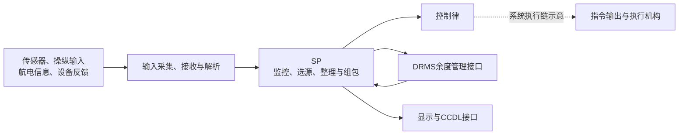
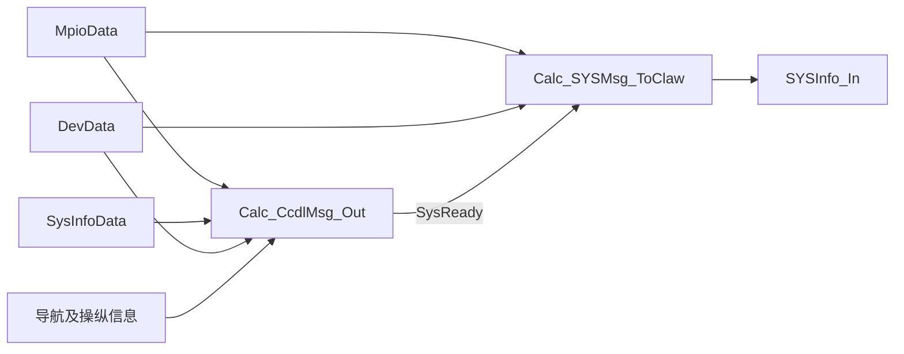

# SP 工作区模型主要功能梳理

> 首次生成：2026-09-08；本次修订：2026-10-16（Asia/Shanghai）。保留原文件名，避免已有学习资料链接失效。  
> 2026-10-16 更新范围：新增3.9节，定位故障检测、状态处理、选源、余度与系统判定；3.8节集中汇总紫色区域模型输入处理和输出意义。其他修订及参数补证见第7.2节。
> 修订依据：用户于 2026-09-10 明确补充：**SpMdl 作为旧的开发版本，现已不再维护。** 这是本次版本定位的直接依据，不再将其维护状态列为待确认。  
> 本文主对象：VE25SP 及其引用的细分模型；第 8 节补充整个工作区的文件框架与设计组织；旧版 SpMdl 的图、接口和七应用实现保留在附录 A，仅供按需追溯。  
> 权威来源：用户当前版本说明，以及 `D:\666\VE25\sp` 工作树；分支 `AC102_Rebuild`，提交 `a895a43a19209c076e679fcc2e2f8953e9f49bb4`。  
> 方法：复用 2026-09-08 的静态解析，并于本次核对 VE25SP 的引用、关键连线、参数表达式及代码生成目标；未加载模型、执行回调、编译、仿真或生成代码。  
> 定位：当前学习与功能分析的导读，不是正式发布构型认定、需求符合性报告或两套算法等价证明。本轮修订本文件并同步学习问答记录，不修改模型或工程配置。

## 1. 总体结论

**当前功能梳理以 VE25SP 为主，不再以停止维护的 SpMdl 作为当前实现的讲解主线。** SpMdl 文件仍在工程中，并不改变其旧开发版本、已停止维护的定位。

VE25SP 的主要职责可概括为：把多源输入进行预处理、状态整理、选源或表决，再组织控制律、显示、CCDL 和 DRMS 等接口。它不是仅做数据转发，也不能被表述为完整的飞行控制律。

按功能领域归纳如下；这种七类划分只是阅读分类，不表示 VE25SP 引用了旧版的七个应用模型。

| 功能领域 | VE25SP 引用链中的主要模型 | 本文关注点 |
|---|---|---|
| 导航、大气与高度处理 | AdahruMsgsPreprocess、RAMsgsPreprocess、Calc_NavSourceSelection、Calc_VotedCAS、Calc_VotedRA、Calc_VotedFTADC | 输入标准化、源选择、专项表决、数据与状态 |
| 设备反馈处理 | Calc_MCUSCUData | MCU/SCU 反馈形成 DevData |
| MPIO 信息处理 | Calc_MPIOData | MPIO 输入整理为 MpioData，供操纵、FMS、系统与显示等后级使用 |
| GCS 输入处理 | Calc_GCSData | 当前/左/右 GCS 与 RMS 信息形成 GcsData |
| 驾驶员输入处理 | Calc_PilotInData、Calc_PilotIn_ToClaw | VDT/离散输入处理、结合 GCS/MPIO 形成操纵及空地相关输出 |
| 系统状态与 CCDL | Calc_SysInfo、Calc_CcdlMsg_Out | 系统与跨通道信息汇总，形成 SysReady、LimitDispatch 等 |
| 对外接口组织 | Calc_NAVMsg_ToClaw、Calc_SYSMsg_ToClaw、Calc_FMSMsg_ToClaw、Calc_PilotIn_ToClaw、Calc_SPDispMsg_Out，以及根层组装 | 控制律导航/系统/FMS/操纵接口、显示、交叉通信和记录输出 |

具体算法、故障恢复和阈值应回到这些模型检查，不能把旧版 NavSpMdl、SpOutMdl 的内部实现直接当作新版功能证据。

## 2. 新旧版本定位与入口范围

### 2.1 入口和范围

2026-09-08 全工作树静态盘点记录为 **31 个 SLX 文件**：26 个业务/集成模型、2 个库、1 个测试台、2 个配置/模型模板；当时解析到 26 处 Model Reference，目标均能唯一对应。本次再次列出的 SLX 数量仍为 31。**这些数量包含旧版本和支撑资产，不是 VE25SP 当前运行模型数量。**

| 入口 | 已知结构 | 本文中的定位 |
|---|---|---|
| [VE25SP.slx](D:/666/VE25/sp/04_Design/VE25SP/specification/VE25SP.slx) | 根层 11 个计算模型引用；内部 NavSpApp 再引用 5 个导航模型；Calc_NavSourceSelection 再引用 Calc_VotedCAS | 当前功能讲解与学习主对象，细分引用闭包为 17 个业务模型 |
| [SpMdl.slx](D:/666/VE25/sp/03_Architecture/specification/SpMdl.slx) | 引用 DevSpMdl、GcsSpMdl、MpioSpMdl、NavSpMdl、PilotInSpMdl、SpOutMdl、SysSpMdl | **用户已确认的旧开发版本，现已不维护**；只作历史参考 |
| [testbench.slx](D:/666/VE25/sp/10_TestBench/testbench.slx) | 引用 NavSpMdl 和 SpOutMdl | 连接旧版引用链的局部测试台，不是 VE25SP 的直接验证入口 |

此前“仅凭文件不能判定哪套不再维护”的限制，已经由用户本次明确说明补足，不能继续把 SpMdl 的维护状态保留为悬而未决的问题。与此同时，停止维护不等于已删除、无法运行，或其所有子模型、公共库、需求和测试资产都失去价值。

[VE25SP_generate_code.m](D:/666/VE25/sp/50_Delivery/VE25SP_generate_code.m:3) 明确以 `VE25SP` 调用 `genSrcCode(..., 'TreatAsTopMdl')`，与本次选择的讲解对象一致。[open_VE25SP.m](D:/666/VE25/sp/04_Design/VE25SP/specification/open_VE25SP.m) 只是打开入口；两类证据仍不等于某次实际发布、部署或验证已经完成。

### 2.2 VE25SP 的主要组织与数据关系

VE25SP 的根层计算模型与内部导航子系统共同组成主链。内部名为 `NavSpApp` 的子系统，不应与旧版模型 `NavSpMdl` 混同；本次引用解析没有把旧版七应用当成 VE25SP 的下级模型。

| 环节 | 主要流向与职责 |
|---|---|
| 导航输入处理 | SpIn_ADAHRS → AdahruMsgsPreprocess → Calc_NavSourceSelection；SpIn_RA → RAMsgsPreprocess → Calc_VotedRA；RA 结果与 SpIn_FTADC 进入 Calc_VotedFTADC；之后还经过 NavSpApp 本地 Subsystem 整理 NavData，不能把 FTADC 处理输出直接等同于最终 NavData |
| 其他输入处理 | Calc_MCUSCUData、Calc_MPIOData、Calc_GCSData、Calc_PilotInData、Calc_SysInfo 分别形成设备、MPIO、GCS、操纵和系统内部数据 |
| 操纵与空地信息 | Calc_PilotIn_ToClaw 综合 GCS、操纵与 MPIO 数据；其 Air2Gnd/Air2GndValid 输出连接 Calc_NAVMsg_ToClaw |
| 导航输出及下游使用 | Calc_NAVMsg_ToClaw 的 Claw_Nav_Msg 连接 NAV_Root，并进入 Calc_CcdlMsg_Out 和根层 SP2DRMS 组装；该计算模型产生的 FtadcLog 在当前顶层接 Terminator，不应写成已从顶层输出的日志 |
| 就绪、限制及显示 | Calc_CcdlMsg_Out 的 SysReady 连接 Calc_SYSMsg_ToClaw、Calc_SPDispMsg_Out；LimitDispatch 连接 Calc_SPDispMsg_Out |
| 其他接口组织 | Calc_FMSMsg_ToClaw、Calc_SYSMsg_ToClaw 及根层总线组装形成相应外部接口；详细字段以模型和字典为准 |

这些是静态数据连接，不表示操作系统调度顺序、同周期执行先后或延迟保证。旧 SpMdl 的 `*_Step` 端口和 29 入/17 出统计已移到附录 A，不用于描述 VE25SP。

### 2.3 顶层浅紫色输出区域的含义

VE25SP右侧浅紫色大框属于Simulink的`Area（区域标注）`，用于视觉组织相关模型元素。[MathWorks说明](https://www.mathworks.com/help/simulink/ug/visually-organize-models-using-areas.html)允许为区域设置标题、背景色，并将其中元素一起移动；它与可执行Subsystem是不同的对象类型。

当前原SLX中，`simulink/systems/system_root.xml`的Annotation SID386保存`AnnotationType=area_annotation`，前景/背景色均为`[0.901961,0.901961,1.000000]`。SID387的标题为“计算SP分区输出信号”。框内各计算模块仍是根层Block，不是该Annotation下的子系统。

| 图中对象 | 类型和作用 | 如何理解 |
|---|---|---|
| 浅紫色大框 | Area区域标注 | 把输出生成相关模块集中展示，便于识别、布局和整体移动 |
| 框内灰色计算块 | Model Reference模型引用块 | 调用各自的Calc_*模型，其接口和执行特性由被引用模型及配置决定 |
| 标题“计算SP分区输出信号” | 功能说明文字 | 表示该区域整理SP对外提供的数据；标题本身不建立操作系统分区或调度规则 |

#### 功能定位与模块分工

按当前数据流，这组模块位于SP处理链的后段，承担面向下游的输出生成和综合状态判定。左侧先把导航、设备、MPIO、GCS及操纵输入整理为内部数据；紫色区域再根据消费者所需的结构形成控制律、跨通道通信、显示及余度管理接口。这里既有字段转换与组包，也有导航检查、系统就绪及放行限制等判定。“后段”是对处理关系的归纳，不是新增的受控软件层级名称。

| 图中模块 | 主要职责 | 当前主要去向 |
|---|---|---|
| [Calc_PilotIn_ToClaw](D:/666/VE25/sp/04_Design/Calc_PilotIn_ToClaw/specification/Calc_PilotIn_ToClaw.slx) | 接收GCS、操纵和MPIO数据，形成控制律操纵输入及空地标志；`ToClaw`在此表示提供给控制律 | `PilotData→Cockpit_In`；`PilotIn、RC`供后续CCDL/显示处理；空地标志供导航接口 |
| [Calc_SYSMsg_ToClaw](D:/666/VE25/sp/04_Design/Calc_SYSMsg_ToClaw/specification/Calc_SYSMsg_ToClaw.slx) | 将设备反馈、MPIO信息和系统就绪结果整理成控制律系统输入 | `Claw_SYS_Msg→SYSInfo_In` |
| [Calc_NAVMsg_ToClaw](D:/666/VE25/sp/04_Design/Calc_NAVMsg_ToClaw/specification/Calc_NAVMsg_ToClaw.slx) | 把已处理导航数据和空地信息整理为控制律导航输入，保留相应有效性 | `Claw_Nav_Msg→NAV_Root`，并供CCDL检查和DRMS反馈；`FtadcLog`在当前根层终止 |
| [Calc_FMSMsg_ToClaw](D:/666/VE25/sp/04_Design/Calc_FMSMsg_ToClaw/specification/Calc_FMSMsg_ToClaw.slx) | 将MPIO中的飞管目标和请求整理成控制律的FMS输入接口 | `Claw_FMS_In_Msg→FMS_In` |
| [Calc_CcdlMsg_Out](D:/666/VE25/sp/04_Design/Calc_CcdlMsg_Out/specification/Calc_CcdlMsg_Out.slx) | 汇总系统、导航、设备及操纵信息，形成跨通道报文，并计算就绪和放行限制结果 | `SpCcdlOut→SpCcdlMsgOut`；`SysReady、LimitDispatch`供区域内其他模块 |
| [Calc_SPDispMsg_Out](D:/666/VE25/sp/04_Design/Calc_SPDispMsg_Out/specification/Calc_SPDispMsg_Out.slx) | 将就绪、放行限制和操纵/MPIO信息组织为显示报文 | `SpDispMsg→SPDispMsgOut` |
| 根层底部`SP2DRMS`组装 | 形成设备余度管理反馈接口，包括导航有效性及备用FCC激活相关状态 | `SP2DRMS`根输出 |

区域内部有明确的数据依赖：`Calc_PilotIn_ToClaw.Air2Gnd/Air2GndValid`进入`Calc_NAVMsg_ToClaw`；导航报文再进入`Calc_CcdlMsg_Out`的检查；其`SysReady`继续进入`Calc_SYSMsg_ToClaw`和显示模块，`LimitDispatch`进入显示模块。因此它们共同完成从内部处理结果到下游接口的转换和系统级判定，不能把画布上下顺序当作执行顺序。上一问定位的`NavCheck`就属于`Calc_CcdlMsg_Out`内部的导航有效性综合检查。

大框本身没有输入/输出端口，也没有使能或触发条件，不增加原子执行边界。淡紫色由作者保存的颜色属性决定，不代表Simulink自动判定的运行状态。根层连线与六个引用模型的输入输出已静态核对；职责说明不等于其全部内部算法或运行时调度已验证。[本轮职责及连接核验Q058](D:/666/VE25/.runtime/sp_learning_qa/q058_validation.json)。各模型的输入处理与输出现实意义集中见第3.8节。

工程来源：[VE25SP.slx](D:/666/VE25/sp/04_Design/VE25SP/specification/VE25SP.slx)，根系统Annotation SID386/387及根层ModelReference块；本次原文件SHA-256=20D8C7DE2A103D8FF298BCD5BB0C28F73AA6CCC2E27D43D0F5AB9952365F77E4。为静态对象/结构检查，未运行模型。核验见[Q049记录](D:/666/VE25/.runtime/sp_learning_qa/q049_validation.json)。

### 2.4 SP在飞控系统中的定位与上下游

**SP的设计定位是飞控计算机侧的信号处理软件层：接收已经采集/解析的数据记录，按相应规则执行状态监控、有效性和一致性检查、冗余选源/表决及接口转换，为控制律等消费者提供可使用的数据与状态。** 当前讨论对象为VE25SP及其实际引用链。它承担输入质量判断和数据组织职责；控制律随后利用这些输入计算飞行控制指令。

[高级需求](D:/666/VE25/sp/02_Requirements/specification/documents/信号处理软件高级需求-SP_SW_HLR-20250722.xlsx)工作表“信号处理软件高级需求-SP_SW_HLR”A26/C26（`SP_SW_HLR-766`）明确要求接收“信号输入处理软件解析的输入信号”，经信号监控、冗余处理后提供下游所需的导航、作动设备、操作及系统信息。A28/C28（`SP_SW_HLR-767`）说明Simulink开发并生成C代码供软件集成。该需求表保留REG300/VE25-101及旧模型背景，本节仅用它说明职责约定；当前接口及实现连接以VE25SP原模型为准，不把旧软件组成或周期规定直接套到新版。

**设备来源、直接软件上游和软件下游属于不同层次。** 数据流可作如下职责示意：



图中采集/解析到SP的层次关系有需求依据；SP到各软件接口的连接由当前模型确认。控制律之后的执行链为系统职责示意，本节未读取其实现，不据此声称已确认指令输出驱动、执行顺序或时延。

**上游数据来源与当前入口**

| 数据来源/角色 | 当前SP输入 | 送入的主要内容 |
|---|---|---|
| 导航与测量设备 | `SpIn_ADAHRS、SpIn_RA、SpIn_FTADC` | 姿态、航向、加速度、角速度、位置/速度、大气数据及无线电高度等，具体字段以对应Bus为准 |
| 电机与舵面执行系统反馈 | `SpIn _McuInfo、SpIn_ScuInfo` | MCU转速/功率/模式/故障，SCU位置和状态；原始MCU端口名保留SpIn后的空格 |
| 飞行员操纵与地面站 | `VDT_Stick_Curr/Left/Right、Dis_Key_Curr/Left/Right、SpIn_Gcs_Curr/Left/Right` | 杆位、开关/按键、遥控操纵和远程模式面板信息 |
| 显控计算机MPIO | `SpIn_MpioInfo` | 能源与高压状态、重量/重心、航前检查、FMS目标及请求；直接协议节点MPIO1/MPIO2及原始产生者边界见3.2节 |
| FCC平台、通道状态与余度管理 | `SpIn_SysInfo_Curr、Sys_Status_Curr/Left/Right、RmsPublicMsg` | 本机系统信息、各候选通道的就绪/放行状态，以及FCC身份、存在性和垂直起降状态等 |

当前VE25SP根层确认有20个输入端口。表中所列是模型接收的软件接口；实际总线接收、模拟量采样、报文字节解码及输入记录装配不在这些输入口的内部实现中。`Curr/Left/Right`仍按相对候选通道理解，不凭端口名称认定每份数据的物理发送方或独立设备数量。

**直接下游接口与消费者职责**

| 下游类别 | 当前SP根输出 | 输出用途 |
|---|---|---|
| 控制律输入 | `NAV_Root、Cockpit_In、SYSInfo_In、FMS_In` | 分别提供导航状态、操纵输入、设备/能源/就绪信息、飞管目标与请求；来自对应`*_ToClaw`模型 |
| 显示/状态呈现接口 | `SpIn_Nav2Display、NavDataState、SPDispMsgOut` | 提供导航数据、导航处理状态及操纵/系统显示信息；具体终端接入由集成层决定 |
| 跨通道交换接口 | `SpCcdlMsgOut` | 组织需要交换的SP系统/通道信息，经通信集成层接入CCDL |
| DRMS反馈接口 | `SP2DRMS` | 提供`navValid、isBfccActv、isBfccActvValid`三个根组包成员；与上游`RmsPublicMsg : BUS_DRMS2SP_MSG`形成两个方向的接口关系 |

当前模型确认9个根输出。`FMS_In、SYSInfo_In、Cockpit_In`是SP的输出，名称中的In描述消费者侧输入；`SpIn_Nav2Display`也实际为Outport。`FMS_In`由`Calc_FMSMsg_ToClaw`形成，不据名称解释成向外部FMS设备发控制命令。DRMS按本项目设备余度管理接口理解，D=Device由用户确认；它不能与FICD图中的“显示与记录系统”混为一谈。

**同一设备在不同信息方向上的角色**

MCU/SCU向SP提供反馈，是本模型的上游数据来源；在整个飞控执行链中，电机控制与舵面执行系统又接收飞控侧的控制指令，属于执行端。显控同样具有双向角色：MPIO提供综合输入，飞控侧又向显控接口送出导航、告警和状态。所谓上下游应限定到某条数据流，不能把一个物理设备永久归到单一方向。

[FICD主文](<D:/666/VE25/Doc/VE-IC11-003_V1.4_VE25-100飞控系统功能接口控制文件(FICD)/VE-IC11-003_V1.4_VE25-100飞控系统功能接口控制文件(FICD).docx>)提供设备交联背景：第5章图5-1的Shape195/196标明ADAHRU/RA到FCC，Shape153为显控计算机MPIO；第6章附件01-05/01-06为FCC与舵机、电升力/电推力接口，01-09为FCC CCDL。GCS和标准大气机分别列在试飞改装附件02-01/02-02；图5-1注明“不含试飞改装”，不能把这两类试飞设备说成已画在常规图中。FICD确认物理接口类别，并没有单独画出SP的软件内部调用或调度。

**当前实现定位：** [VE25SP.slx](D:/666/VE25/sp/04_Design/VE25SP/specification/VE25SP.slx)`simulink/systems/system_root.xml`根Inport/Outport、SID375/376/377/397控制律接口引用、SID406/408通道/显示输出引用、SID446/458 DRMS组包/出口；导航内部另见`system_54.xml`。[VE25SP_generate_code.m](D:/666/VE25/sp/50_Delivery/VE25SP_generate_code.m:3)指定VE25SP并调用`genSrcCode(...,'TreatAsTopMdl')`。这些证据说明模型职责、接口和交付入口，本轮未运行代码生成或证明实际机载部署。静态核验见[Q051记录](D:/666/VE25/.runtime/sp_learning_qa/q051_validation.json)。

### 2.5 MPIO与SYS信息的层次区别

**MPIO按显控侧输入来源组织综合业务信息；SYS相关输入与内部`SysInfoData`主要描述飞控设备/通道的健康、余度、就绪及放行状态。最终送往控制律的`SYSInfo_In`则是面向消费者组织的综合系统接口，会吸收一部分MPIO数据。** 因此，要按信号所在的处理层次比较，不能把所有含SYS的名称视为同一个Bus。

| 层次 | MPIO相关信号 | SYS相关信号 |
|---|---|---|
| 原始输入 | `SpIn_MpioInfo : SpIn_Mpio`，31项；包括能源/高压、可用功率、重量/重心、检查及FMS目标/请求 | `SpIn_SysInfo_Curr : SpIn_SysInfos`，8项健康字段；三路`Sys_Status_* : SpIn_CcdlMsg`各含Valid、SysReady、LimitDispatch；还使用FCC存在性及VDT监测结果 |
| 内部处理结果 | `Calc_MPIOData → MpioData : BUS_MpioData`，28个声明成员；承载整理后的业务值及各自data/valid/reset | `Calc_SysInfo → SysInfoData : BUS_SysInfoData`，17项；含CurrentFccReady、各类LossRedundancy，以及三路SysReady/LimitDispatchInfo |
| 控制律接口 | 部分MpioData字段被后级读取，不以完整MpioData直接作为SYS输出 | `Calc_SYSMsg_ToClaw → SYSInfo_In : BUS_SYSINFO_IN`，5个直接成员，综合SysReady、MPIO能源信息和DevData设备反馈 |

**两类信息回答的问题不同。** `MpioData.UsablePwr_KW`描述输入的可用功率及有效性；`SysInfoData.MpioLossRedundancy`描述模型对MPIO相关余度状态的判定。前者是业务数据，后者来自`SpIn_SysInfo_Curr.MPIO_HealthBit`的配置位检查。SYS输入中出现MPIO名称，是因为系统状态处理也要检查这类接口的健康信息，并不表示重量、重心、功率和FMS目标都进入了SysInfoData。

`Calc_SysInfo`没有`MpioData`输入。它读取`isFccExist、VdtCBIT`、三路CCDL状态及本机健康Bus；`FccHealth:boolean`直接成为`CurrentFccReady`，而`CurrentSysReady`来自Curr通道的`Valid AND SysReady`。这两个Ready的来源和层次也需要分开。

**在后级汇合的实际关系**



`Calc_CcdlMsg_Out`综合SysInfoData、MPIO检查信息和导航、设备、操纵数据，产生独立的`SysReady`等输出；其中MPIO的`PreflightCheckValid.data/valid`参与本机CCDL报文中`Data.SysReady`的计算。该报文成员与模型单独输出的SysReady是不同接点，本节不将它们合并为同一个信号。最终`Calc_SYSMsg_ToClaw`接收的第三个输入是独立SysReady，未直接输入SysInfoData。

`SYSInfo_In`的当前内容为：

| 最终成员 | 来源及当前处理 |
|---|---|
| `SysReady_SYSINFO_b` | 上述独立SysReady直接进入 |
| `Reset_FCM_b` | 当前固定false |
| `VCU_Status.VCU_Valid` | 由MPIO的HiVltgSts形成，判据为`HiVltgSts.valid AND HiVltgSts.data <= uint8(2)`；不能简化成高压码必须等于2 |
| `VCU_Status.VCU_SOP_kw` | 来自MPIO的UsablePwr_KW；有效时使用本拍data，无效时由Delay保持先前输出 |
| `Motor_Status、Actuator_Status` | 来自DevData的电机和舵面执行机构反馈 |

这里按当前字段用途说明VCU_Status的能源/功率内容，不凭字段名另行认定某台VCU物理设备或其正式英文全称。接口分类可以同时按来源、业务含义和消费者需要组织；同一个能源值由MPIO进入、再成为控制律SYS消息的成员，在当前连接中有明确依据。

**来源定位：** [Calc_SysInfo.slx](D:/666/VE25/sp/04_Design/Calc_SysInfo/specification/Calc_SysInfo.slx)根SID179/37/181/182/31；MPIO健康检查见`system_79.xml`。内部字段定义见[SP_InteriorBus.sldd](D:/666/VE25/sp/04_Design/common/specification/data_types/SP_InteriorBus.sldd)`BUS_SysInfoData`及[SP_Step_New.sldd](D:/666/VE25/sp/04_Design/common/specification/data_types/SP_Step_New.sldd)`SpIn_SysInfos、SpIn_CcdlMsg、BUS_SYSINFO_IN、BUS_SYSINFO_VCU`。[Calc_SYSMsg_ToClaw.slx](D:/666/VE25/sp/04_Design/Calc_SYSMsg_ToClaw/specification/Calc_SYSMsg_ToClaw.slx)根SID13/52/58/12/11及`system_52/58.xml`；[Calc_CcdlMsg_Out.slx](D:/666/VE25/sp/04_Design/Calc_CcdlMsg_Out/specification/Calc_CcdlMsg_Out.slx)根各输入及`system_4.xml`的SID27。两支汇合关系另见VE25SP根SID363/406/377。详细Bus字段见[结构说明](D:/666/VE25/Doc/VE25SP_Bus信号结构说明.md:733)，本次静态核验见[Q052](D:/666/VE25/.runtime/sp_learning_qa/q052_validation.json)。

## 3. VE25SP 的细分模型与主要功能

本章按 VE25SP 的实际引用链列出 17 个细分业务模型。功能说明同时解释输入来源、专业术语和输出含义；模型名与信号名保留原文，便于在 Simulink 中查找。每个模型链接均指向当前工程中的实际 SLX。

### 3.1 通用信号命名与处理术语

| 名称或术语 | 在本章中的含义 |
|---|---|
| `SP / Sp`、`SpIn` | Signal Processing，信号处理；`SpIn`表示进入信号处理模块的输入。某个名称的实际方向仍以模型端口为准。 |
| `CCDL`、`SpCcdlMsgOut` | CCDL通常展开为Cross Channel Data Link，交叉通道数据链；在当前FCC语境中用于通道间信息交换。`SpCcdlMsgOut`可拆成SP（信号处理）＋CCDL＋Msg（报文）＋Out（输出），表示SP提供的通道交换输出报文。当前模型名称是CCDL，末尾含L。英文行业展开见[厂商术语说明](https://defense-solutions.curtisswright.com/products/flight-test/data-acquisition/ttcmdas/bus/mcdl202a1)；项目具体内容与方向仍以根端口及引用模型为准。 |
| `Calc`、`Msgs`、`Preprocess` | 计算、消息/报文、预处理。报文是按字段组织的一组数据；预处理把原始输入整理成后续模块可使用的结构，并执行该实例实际接入的检查。 |
| `Nav`、`Dev`、`Sys`、`PilotIn`、`Disp` | 分别指导航、设备（Device）、系统、驾驶员输入、显示。`Data`是数据，`Info/Infos`是信息/信息集合。 |
| `NormalInfos` | 预处理后的信号记录集合，通常同时保存数值、有效性和处理状态。“形成NormalInfos”表示形成统一的记录结构，其中仍可以有无效或失配的信号。 |
| `data`、`valid`、`reset` | 数值或离散码、是否有效、复位/切换相关通知。读取data时还要看valid；reset的触发规则随模块而异，例如源切换、有效性恢复，不能统一解释成“把数值清零”。 |
| `State`、`Status`、`Log` | 状态、状态、记录信息。状态用于说明有效性、比较或选源情况；Log是否真正送到外部，要看下游连接。 |
| 源、源编号、源权重 | “源”指提供数据的某台设备或某路输入；源编号说明选中了哪一路；源权重是参与选择的评价量，其含义由对应选源逻辑决定。 |
| 选源、表决、余度 | 选源是从多路输入中选择使用来源；表决是按模块规则综合多路输入得到结果；余度指用多路设备或通道提供备份能力。具体规则须看实现，模型名带Voted并不固定代表某一种算法。 |
| `OnGnd`、空地条件 | On Ground，在地面状态；空地条件区分模型认定的空中/地面状态。本章中它是逻辑判定输入，来源由相应模型连线决定。 |
| `Curr / Left / Right` | 本机视角下三路输入记录的逻辑位置，不直接证明产生者、发送者或物理路径。GCS用FCC身份决定优先候选位置，位置编码为Curr=1、Left=2、Right=3；系统状态接收上游已分好的三路。具体规则与证据边界见3.5.1节。 |
| `Bus`、`Claw / ToClaw` | Bus是把多个字段组织在一起的数据结构；Claw是Control Law（控制律），即根据飞机状态和操纵目标计算控制指令的算法。ToClaw表示整理成控制律需要的输入接口。 |
| 连续量、离散量 | 连续量描述杆位大小等数值；离散量描述开关、按键或模式编号等有限状态。它们都可能另带有效性标志。 |
| 静压、总压 | 静压是空气本身的压力；总压是将流动空气等熵减速至静止时的压力。静压与总压是大气数据处理中不同的测量量。[NASA压力说明](https://www1.grc.nasa.gov/beginners-guide-to-aeronautics/bernoullis-equation/) |
| 迎角、侧滑角 | 迎角（AOA/Alpha）描述飞机纵向参考方向与相对气流之间的上下偏角；侧滑角（AOS/Beta）描述左右方向的偏斜。这里解释物理概念，参考轴和正负方向以项目接口为准。[NASA气流角说明](https://www.grc.nasa.gov/www/winddocs/user/physical.html) |

### 3.2 细分模型的功能与信号解释

#### 导航、大气与对地高度

| 模型 | 处理对象与主要功能 | 输出信号怎样理解 |
|---|---|---|
| [AdahruMsgsPreprocess](D:/666/VE25/sp/04_Design/AdahruMsgsPreprocess/specification/AdahruMsgsPreprocess.slx) | 处理`ADAHRS`（大气数据、姿态与航向参考系统）的多路输入，涉及姿态角、角速度、加速度、空速和高度等。姿态描述飞机的空间朝向，例如俯仰和滚转；航向表示机头在水平面内的指向。`Adahru`是对应参考单元的命名。该模型调用信号状态处理等公共逻辑，整理各路数值及状态。 | `adahruNormalInfos`：预处理后的多路导航信息，含数值、有效性及相关状态，供后续选源使用。 |
| [RAMsgsPreprocess](D:/666/VE25/sp/04_Design/RAMsgsPreprocess/specification/RAMsgsPreprocess.slx) | `RA`指无线电高度计（Radio Altimeter），对应量为无线电高度，可理解为飞机相对下方地面的高度。模型处理两路RA输入，补一个无效占位以适配公共三路结构，并进行有有效性门控的一致性检查。 | `raNormalInfos`：三份RA信号记录，其中只有前两份对应实际输入，第三份为无效占位。 |
| [Calc_NavSourceSelection](D:/666/VE25/sp/04_Design/Calc_NavSourceSelection/specification/Calc_NavSourceSelection.slx) | 根据导航输入记录和`OnGnd`（在地面状态）评价来源并选择导航数据；即同一种量有多路来源时，决定本次使用哪一路，并组织相关状态。内部还调用校准空速专项表决模型。 | `AdahruWeight`：各源权重；`adahruSrc`：选中来源编号；`AdahruData`：选源后的导航数据；`NavDataState`：信号及选源状态。 |
| [Calc_VotedCAS](D:/666/VE25/sp/04_Design/Calc_VotedCAS/specification/Calc_VotedCAS.slx) | `CAS`为Calibrated Airspeed（校准空速），指对仪表和安装误差作修正后的指示空速。[通用定义见FAA手册](https://www.faa.gov/sites/faa.gov/files/regulations_policies/handbooks_manuals/aviation/glider_handbook/faa-h-8083-13a.pdf)。模型由Calc_NavSourceSelection调用，按实际分支规则处理三路CAS输入。 | `voterCAS`：供后级使用的一份校准空速结果，结构包含`data/valid/reset`，即数值、有效性及复位相关通知。 |
| [Calc_VotedRA](D:/666/VE25/sp/04_Design/Calc_VotedRA/specification/Calc_VotedRA.slx) | 从两路实际RA输入中选择高度来源，依据为各路valid、空地条件和上一拍源号；将选中结果加入已有导航数据总线。 | `RaSrc`：所选RA编号；`raData`：补入RA高度及其有效性/reset后的导航数据；`raState`：补入RA状态后的导航状态总线。 |
| [Calc_VotedFTADC](D:/666/VE25/sp/04_Design/Calc_VotedFTADC/specification/Calc_VotedFTADC.slx) | `FTADC`在当前工程中是大气数据设备输入名称，其中ADC通用含义为Air Data Computer（大气数据计算机），FT的项目展开待确认。输入包含静压、总压、迎角、侧滑角、校准空速及有效性。该模型处理这些输入，并向已有导航总线补写FTADC字段；已有RA字段继续保留。 | `ftadcData`：加入FTADC大气数据后的导航总线，随后还经过NavSpApp中的本地处理，才成为最终`NavData`。 |

#### 设备反馈与综合飞机信息

| 模型 | 处理对象与主要功能 | 输出信号怎样理解 |
|---|---|---|
| [Calc_MCUSCUData](D:/666/VE25/sp/04_Design/Calc_MCUSCUData/specification/Calc_MCUSCUData.slx) | `MCU`在这里是电机控制相关单元，提供转速、功率、工作模式和故障等反馈；`SCU`是伺服/舵面执行机构控制相关单元，提供位置及状态等反馈。模型整理这些设备数据，分组形成升力电机、推力电机和舵面执行机构信息。 | `DevData`：Device Data，设备反馈数据。包含`LiftMCU`（8份升力电机数据）、`ThrustMCU`（3份推力电机数据），以及副翼、升降舵、方向舵对应的8路执行机构记录。 |
| [Calc_MPIOData](D:/666/VE25/sp/04_Design/Calc_MPIOData/specification/Calc_MPIOData.slx) | `MPIO`在现有FICD图5-1中标为显控计算机；附件01-01列发送节点MPIO1/MPIO2，向FCC提供综合信息。当前模型处理31项能源/高压、功率、重量/重心、航前检查及FMS目标/请求。设备类别与发送节点已有依据，正式英文全称仍待确认。 | `MpioData : BUS_MpioData`：整理后的综合飞机信息，供操纵、FMS、系统状态及显示等使用。`HiVltgSts、UsablePwr_KW、CenterGravity`分别为高压状态、可用功率、重心相关字段；具体来源和分组见下文。 |

##### MPIO：显控计算机提供的综合信息输入

**按现有FICD，MPIO对应显控计算机；这组综合信息直接由MPIO显控侧发送给FCC（飞控计算机）。** SP接收的内容包括能源与高压状态、飞机参数、航前检查，以及飞行管理目标和请求。MPIO四个字母的正式英文展开仍没有直接定义。

**发送设备与接口节点（2026-10-08补证）**

[FICD主文](<D:/666/VE25/Doc/VE-IC11-003_V1.4_VE25-100飞控系统功能接口控制文件(FICD)/VE-IC11-003_V1.4_VE25-100飞控系统功能接口控制文件(FICD).docx>)的第5章图5-1把设备标为“显控计算机／MPIO”。该标签位于DOCX内嵌`word/embeddings/Microsoft_Visio_Drawing.vsdx`的`visio/pages/page1.xml`，Shape ID153；它直接支持设备中文名称。图5-1注明“不含试飞改装”。主文文件名为V1.4，正文封面为Rev.V2，更改记录列适用性AC102+；本节按实际文件定位，不据文件名认定某次发布构型。

[附件01-01：飞控计算机&显控系统—ARINC825](<D:/666/VE25/Doc/VE-IC11-003_V1.4_VE25-100飞控系统功能接口控制文件(FICD)/附件1：VE-IC11-003-01_VE25-100飞控系统FICD构型索引基线/VE-IC11-003-01-01-飞控计算机&显控系统-ARINC825/VE-IC11-003-01-01-飞控计算机&显控系统-ARINC825.xlsx>)进一步给出发送节点：

| 发送节点 | 发送报文 | 消息ID（原表写法，十六进制） | 精确位置 |
|---|---|---|---|
| `MPIO1` | `IDU_Data_Msg` | `84A8CC0` | 工作表`03-Msg ID`，K136、A136、J136 |
| `MPIO2` | `IDU_Data_Msg` | `84A8CC1` | 工作表`03-Msg ID`，K138、A138、J138 |

同附件工作表`04-显控相关参数`的F1/F3为`Transmitter / MPIO`，T1/T3为`Receiver / FCC`，B3为`IDU_Data_Msg`，D3给出100 ms周期。可确认的是两个协议发送节点，以及MPIO显控计算机这一设备类别；两个节点与具体机箱、板卡、安装位置的对应关系，仍需设备构型或节点配置资料。`IDU_Data_Msg`是报文名称，不能单凭这个名称把发送设备认定为某块显示屏。

**发送端与数据原始产生者**

“由MPIO发来”说明FCC直接接收的发送端；报文中各业务字段的原始产生者还需分别追溯。当前接口表支持的范围如下：

| 信息类别与当前模型字段举例 | 接口表说明 | 原始设备来源的确认范围 |
|---|---|---|
| 能源/高压：`EgyWkSts、HiVltgSts、HiVltgSW、Usable_Pwr` | `04-显控相关参数!S3`为能源系统工作模式；S4明确涉及BMS（电池管理系统）、电池包及高压连接状态 | 可以确认能源/BMS业务含义；未说明具体BMS型号、节点或BMS→MPIO的完整路径 |
| 飞管目标/请求：`FMS_Alt_Target、FMS_Roll_Command、FMS_VNAV_Request`等 | S7为FMS高度目标，S16为FMS滚转指令，S22为飞管请求的垂直模式 | 可以确认FMS（飞行管理系统）功能归属；未说明由哪台物理计算机运行这些功能 |
| 重量/重心：`Gross_Weight、Center_Gravity` | S53为飞机起飞重量，S41为飞机重心 | 未说明人工录入、计算结果或其他设备提供 |
| 检查：`Motor_Check、Surface_Check、Preflight_Check_Valid` | S43/S44为检查单项目，S55为航前检查单状态反馈 | 未明确检查操作终端或每个字段的原始生产者 |

因此，MPIO承担向FCC提供综合信息的接口角色，不能把所有字段都解释成MPIO自身测量或计算。表中S62另有“IDU需要把FMCP航向转换成真航向发给FCC”的具体字段说明；该证据不能扩展到当前`MpioData`全部成员。

**接入当前模型的边界**

接口层是`MPIO1/MPIO2 → FCC`的ARINC825报文；当前模型可确认的链路是：

```text
SpIn_MpioInfo : SpIn_Mpio（根输入5，一份标量Bus）
    → Calc_MPIOData
    → MpioData : BUS_MpioData
```

[VE25SP.slx](D:/666/VE25/sp/04_Design/VE25SP/specification/VE25SP.slx)根输入SID15的`PortDimensions=1`，根模型引用SID362调用`Calc_MPIOData`。两处协议发送节点不等于模型中有两份或三份MPIO数组；“FCC接收/解包后如何选取或组合两个节点，装配成这一份输入Bus”不在当前`Calc_MPIOData`的字段整理逻辑中，尚未核实其集成实现。业务字段与接口表匹配支持接口对应关系，但不能替代这一步接入证明。

本次主文SHA-256=9AE5D0583FAE1A9F22BF1E690529E420EFB05632A598AFC9C5A3C6A69E063FD7，附件SHA-256=864D7977DBBDFEE9E45CDE4BF4C5116D1489DB7E8CEDE3B3A9FE4E877E3AB01E；静态来源与文档核验见[Q050记录](D:/666/VE25/.runtime/sp_learning_qa/q050_validation.json)。下面保留需求中的历史命名背景。

[高级需求表](D:/666/VE25/sp/02_Requirements/specification/documents/信号处理软件高级需求-SP_SW_HLR-20250722.xlsx)的工作表“信号处理软件高级需求-SP_SW_HLR”给出以下背景：

- A343=`SP_SW_HLR-668`，C343明确写“MPIO消息参见《VE-IC10-001-01航电飞控CAN报文定义》。”
- A240/C240（`SP_SW_HLR-381`）称相关功能为“航电信号处理软件”；A244/C244（`SP_SW_HLR-383`）描述一路IDU输入；A247/C247（`SP_SW_HLR-387`）列出能源、高压、可用功率、重心及航前检查等信息。
- 上述条款保留旧`MpioSpMdl/SP_IDU_Msg`路径，可用于解释接口背景；当前逻辑仍以`Calc_MPIOData`为准。本轮工程文件名检索没有找到所引CAN报文定义原文件。

这让“MPIO输入的现实意义”更明确：**飞控除了知道飞机怎样运动，还需要知道电源能否提供功率、飞机当前重量/重心、航前检查状态，以及飞行管理侧希望它怎样飞；MPIO这组输入承载的就是这些综合信息。** FMS字段说明飞管功能归属；IDU名称保留在需求及报文中。具体硬件型号和上游路径仍按上述证据边界确认。

当前数据链为：

```text
SpIn_MpioInfo : SpIn_Mpio
    → Calc_MPIOData：字段整理、有效性处理和必要的异常监控
    → MpioData : BUS_MpioData
    → 操纵、FMS、系统状态及显示等后级
```

`SpIn_Mpio`共31个标量成员，按实际业务分组如下：

| 分组 | 当前字段 | 现实含义 |
|---|---|---|
| 公共有效性（1项） | `Valid` | 这一份输入的公共有效标志，类型为boolean |
| 能源与高压（5项） | `EgyWkSts、HiVltgSts、HiVltgSW、Usable_Pwr、Usable_Pwr_Valid` | 能源工作状态、高压连接状态、高压开关、可用功率及其有效码 |
| 飞机参数（4项） | `Center_Gravity、Center_Gravity_Valid、Gross_Weight、Gross_Weight_Valid` | 重心、总重及各自有效码 |
| 航前检查（3项） | `Motor_Check、Surface_Check、Preflight_Check_Valid` | 电机/桨检查、舵面检查、检查单状态或有效性相关码 |
| FMS目标（12项） | `FMS_Alt_Target、FMS_Spd_Target、FMS_TrueHeading_Target、FMS_Track_Target、FMS_Vertical_Speed_Target、FMS_FPA_Target`，以及`FMS_Alt_Target_Valid、FMS_Spd_Target_Valid、FMS_TrueHeading_Target_Valid、FMS_Track_Target_Valid、FMS_Vertical_Speed_Target_Valid、FMS_FPA_Target_Valid` | 高度、速度、真航向、航迹方向、垂直速度和航迹倾角目标；Target表示希望跟踪的值 |
| FMS滚转指令（2项） | `FMS_Roll_Command、FMS_Roll_Command_Status` | 滚转指令及其状态码 |
| FMS请求与状态（4项） | `FMS_Trans_Request、FMS_LNAV_Request、FMS_VNAV_Request、FMS_VNAV_Status` | 转换请求、横向导航请求、垂直导航请求及垂直导航状态；Request不等于动作已经完成 |

除公共`Valid`外，数值为`single`，状态/请求/单项有效码为`uint8`；不能统一把名字带Valid的成员当成boolean。当前模型对`Usable_Pwr、Center_Gravity、Gross_Weight`同时使用公共Valid与单项有效码，并调用异常监控；这些单项有效码以是否等于`uint8(1)`判定。其他字段的处理方式见学习问答Q029，不能把三项数值的规则无差别套给全部31项。

`BUS_MpioData`声明28个成员，当前输出Bus Assignment实际赋27项；`SelectedFCC`不在该赋值列表内。因此，类型中出现某成员，不等于本模块已为它计算了业务值。

**英文全称的判断：** `Multi-Purpose Input/Output`（多用途输入/输出）是有[NXP原厂手册](https://www.nxp.com/docs/en/user-guide/MC56F8323EVMUM.pdf#page=11)支持的通用嵌入式候选；该手册解释的是芯片端口，不能作为VE25/SP的设备命名依据。现有FICD可支持的项目写法是“MPIO：显控计算机；其接口发送节点为MPIO1/MPIO2，向FCC提供综合信息；项目正式英文全称待确认”。

实现来源：[Calc_MPIOData.slx](D:/666/VE25/sp/04_Design/Calc_MPIOData/specification/Calc_MPIOData.slx)的`system_root.xml`，SID4输入、SID5取字段、SID73/76/80异常监控、SID121/122/123有效码比较、SID120组包、SID113输出；[SP_Step_New.sldd](D:/666/VE25/sp/04_Design/common/specification/data_types/SP_Step_New.sldd)的`DD.ENTRY[47](SpIn_Mpio)`；[SP_InteriorBus.sldd](D:/666/VE25/sp/04_Design/common/specification/data_types/SP_InteriorBus.sldd)的`DD.ENTRY[13](BUS_MpioData)`。字典Description为空，单位、量程和完整码表仍按正式接口资料核对。


#### 地面站与驾驶员输入

| 模型 | 处理对象与主要功能 | 输出信号怎样理解 |
|---|---|---|
| [Calc_GCSData](D:/666/VE25/sp/04_Design/Calc_GCSData/specification/Calc_GCSData.slx) | `GCS`为Ground Control Station（地面控制站/地面站）。模型处理本/左/右通道的地面站报文，利用`RMS`余度管理接口提供的本机及主控飞控计算机编号确定优先来源；遥控操纵组与远程面板组分别按有效性选源。操纵组含四轴和开关，面板组含按钮及高度、速度、航向等目标。 | `GcsData`：整理后的地面站输入，共39个业务字段，每项含`data/valid/reset`。`RemotePilotCtrl`指遥控操纵组；`RemoteFMCP`可理解为远程飞行模式控制面板输入；`FMCP`的行业全称是Flight Mode Control Panel，用于选择自动飞行模式并设置目标值，项目正式命名仍待接口资料确认。 |
| [Calc_PilotInData](D:/666/VE25/sp/04_Design/Calc_PilotInData/specification/Calc_PilotInData.slx) | 处理本/左/右通道的操纵杆与离散按键输入，进行一致性比较及冗余处理。`VDT`在这里承载操纵杆连续量；`GPIO`为General-Purpose Input/Output（通用输入输出），在本接口中承载开关、按键等离散量。 | `PilotInData`：驾驶员输入，含6项VDT连续量及14项GPIO开关量。`VdtCBIT`：操纵杆输入运行监测状态字，用状态位标记各通道指定输入的无效情况；本实现检查VDT索引1、2、5、6。CBIT通用含义为Continuous Built-In Test（连续内建自检），这里的实际范围以上述有效性检查为准。 |
| [Calc_PilotIn_ToClaw](D:/666/VE25/sp/04_Design/Calc_PilotIn_ToClaw/specification/Calc_PilotIn_ToClaw.slx) | 综合地面站数据`GcsData`、驾驶员操纵数据`PilotInData`和综合飞机信息`MpioData`，进行操纵信号转换、选择和控制律接口组织。 | `PilotData`、`PilotIn`：驾驶员输入报文；`RC`为Remote Control（遥控）路径的报文；`Air2Gnd/Air2GndValid`：空地开关相关判定及其有效性。它们的具体使用位置以连线为准。 |

##### RemoteFMCP：远程飞行模式控制面板输入

**FMCP = Flight Mode Control Panel，飞行模式控制面板。** 通俗地说，这类面板用于选择自动飞行模式，并设置高度、爬降速度、航向、空速等目标。[《基于SCADE软件的驾驶舱控制板仿真建模方法与实践》](https://myfj.ijournals.cn/myfjsjyyj/article/html/20240217)的中英文摘要给出了这一术语对应。

当前`RemoteFMCP`是`SpIn_GcsMsg`中的一组输入数据，可理解为“远程飞行模式控制面板输入”。`Remote`表示远程；从模型接口位置看，这组输入经地面站报文进入SP。这个名称和字段结构支持上述功能解释，但不能据此确定本项目使用了哪款实体面板，或其实际按钮布局。项目词表/ICD中的正式命名尚待确认。

[SP_Step_New.sldd](D:/666/VE25/sp/04_Design/common/specification/data_types/SP_Step_New.sldd)实际定义15个标量成员：

| 字段 | 类型 | 实际阅读含义 |
|---|---|---|
| `FD_Pushbutton` | uint8 | 飞行指引按钮输入，供自动飞行系统处理指引相关操作 |
| `AP_Pushbutton` | uint8 | 自动驾驶激活相关按钮输入 |
| `AT_Pushbutton` | uint8 | 自动油门激活相关按钮输入 |
| `FMS_Spd_Pushbutton` | uint8 | 飞行管理速度相关模式按钮输入 |
| `SYC_Pushbutton` | uint8 | 航向同步按钮输入；保留源文件的SYC拼写 |
| `HDG_Pushbutton` | uint8 | 航向相关模式按钮输入 |
| `LNAV_Pushbutton` | uint8 | 横向导航模式按钮输入，涉及水平航迹 |
| `VNAV_Pushbutton` | uint8 | 垂直导航模式按钮输入，涉及高度和爬降剖面 |
| `VS_Pushbutton` | uint8 | 垂直速度相关模式按钮输入 |
| `ALT_Pushbutton` | uint8 | 高度相关模式按钮输入 |
| `Altitude_Target` | single | 希望达到或保持的高度目标 |
| `Vertical_Speed_Target` | single | 希望采用的爬升/下降速度目标 |
| `Heading_Target` | single | 希望采用的机头指向，即航向目标 |
| `Airspeed_Target` | single | 希望采用的空速目标 |
| `FmcpMsgValid` | boolean | 这一组面板输入报文是否有效 |

因此，它传递的是“选择什么模式、目标设多少”等操作输入。按钮输入本身不等于该模式已经接通；目标值也不等于飞机当前测量值。例如`Altitude_Target`是所设高度，实际高度要从导航/高度测量输入取得。按键码值、目标单位和模式接通条件不能仅从上述字段名推出。

`Calc_GCSData`接收本/左/右三路报文，对`RemoteFMCP`和`RemotePilotCtrl`分别按本组有效性选择来源；将面板组的14个业务字段封装进`GcsData`，再送往`Calc_PilotIn_ToClaw`。`FmcpMsgValid`参与生成输出有效性，所以“15个输入成员”和“14个输出业务字段”并不矛盾。本实现最终给这14项输出的`reset`统一赋`false`；详见[学习问答Q035、Q037](D:/666/VE25/Doc/SP模型学习问答记录.md)。

来源锚点：字典`data/chunk0.xml`的`DD.ENTRY[39](RemoteFMCP)`、`[43](SpIn_GcsMsg)`；`Calc_GCSData`的`system_155.xml`中SID156–158、164–166。业务中文含义参照[项目需求表](D:/666/VE25/sp/02_Requirements/specification/documents/信号处理软件高级需求-SP_SW_HLR-20250722.xlsx)工作表“信号处理软件高级需求-SP_SW_HLR”的A311–A324/C311–C324；该表保留旧模型路径，本段只用它解释术语，当前处理逻辑以实际模型为准。

##### handleGCS中的SSX/SSY：侧杆操纵量

**SSX表示侧杆纵向操纵输入，SSY表示侧杆横向操纵输入。** 在当前`handleGCS`中，二者分别对应地面站遥控的俯仰轴与滚转轴：

| 路径 | 当前输入 | 输出 | 业务含义 |
|---|---|---|---|
| `CalcSSX` | `GcsData.chElevator.data` | `SSX_CP_deg` | 主驾侧杆纵向等效操纵角度，俯仰操纵 |
| `CalcSSY` | `GcsData.chAileron.data` | `SSY_CP_deg` | 主驾侧杆横向等效操纵角度，滚转操纵 |

`SS`是侧杆相关命名，可按Side Stick理解，但本次来源未给出项目正式英文展开。`X/Y`在此标记侧杆纵向/横向操纵轴；`CP`对应主驾，`FO`对应副驾，`deg`为角度单位“度”。不能把这里的X/Y当作飞机姿态角，也不能据飞机机体系轴名推翻当前连线的俯仰/滚转对应。

截图中的`SSXVld_CP_b、SSYVld_CP_b`分别是上述两项的有效标志，`Vld`表示Valid、`b`表示布尔量；它们来自独立的`CalcSSXValid/CalcSSYValid`判定链，不是另两项杆位数值。

`handleGCS`将地面站遥控操纵量转换并填入统一的侧杆输入接口。因而，此处输出带`CP`说明使用主驾侧杆接口字段，并不表示这份数据实际由座舱实体主驾侧杆采集。

术语依据：[高级需求表](D:/666/VE25/sp/02_Requirements/specification/documents/信号处理软件高级需求-SP_SW_HLR-20250722.xlsx)，工作表“信号处理软件高级需求-SP_SW_HLR”，`SP_SW_HLR-503`（A347/C347）定义主驾侧杆纵向输入`SSX_CP_deg`，`-505`（A349/C349）定义主驾横向`SSY_CP_deg`；`-507/-509`（A351/C351、A353/C353）定义副驾两轴。该需求保留旧模型路径，仅用于名称释义；当前实现以[Calc_PilotIn_ToClaw.slx](D:/666/VE25/sp/04_Design/Calc_PilotIn_ToClaw/specification/Calc_PilotIn_ToClaw.slx)为准：`system_108.xml`的SID116→195→115输入1，SID117→227→115输入3。具体转换算法和有效性条件不由这些缩写本身定义。

##### VDT_Stick与Dis_Key：操纵杆位置和按键输入

图中15～20是`VE25SP`根层的**输入端口序号**。每条线传入一份Bus结构，内部包含多项数据。

| 端口 | 信号名 | 现实意义 | Bus类型 |
|---|---|---|---|
| 15 | `VDT_Stick_Curr` | 本通道提供的6项操纵杆位置/偏转信息 | `SpIn_Sitck` |
| 16 | `VDT_Stick_Left` | 左通道提供的同一组6项操纵杆信息 | `SpIn_Sitck` |
| 17 | `VDT_Stick_Right` | 右通道提供的同一组6项操纵杆信息 | `SpIn_Sitck` |
| 18 | `Dis_Key_Curr` | 本通道提供的14项按键/开关信息 | `SpIn_Key` |
| 19 | `Dis_Key_Left` | 左通道提供的同一组14项按键/开关信息 | `SpIn_Key` |
| 20 | `Dis_Key_Right` | 右通道提供的同一组14项按键/开关信息 | `SpIn_Key` |

`SpIn_Sitck`是字典中的原始拼写。`Curr/Left/Right`区分输入通道；三个`VDT_Stick_*`各自都包含完整的`CSSU、RSSU、LSSU`字段，所以`VDT_Stick_Left`不能直接解释成“左操纵杆”。仅靠这段输入连线，也不能确定它固定对应哪台FCC、哪块采集板或哪根线束。 本次新增FICD证据已确认离散量的三FCC分通道监控、杆位三余度处理及CCDL交换背景，详见3.5.1节“操纵采集通道与导航设备来源的区别”；具体上游填充与编号轮换仍须另核。

**操纵杆组表达“杆动了多少”。** 每个`SpIn_Sitck`包含`CSSU_X、CSSU_Y、RSSU_X、RSSU_Y、LSSU_X、LSSU_Y`六项。每项都是一个标量`SpData_Single`，内含`data:single`和`valid:boolean`：前者保存数值，后者说明这份数值是否有效。顶层端口尺寸为1，表示传入一份Bus；六项成员在Bus内部。

当前后级连线给出了下列用途：

| 原始成员 | 整理后的索引 | Calc_PilotIn_ToClaw中的转换 | 输出字段 |
|---|---|---|---|
| `CSSU_X / CSSU_Y` | `VDT[1] / VDT[2]` | `CalcCSX / CalcCSY` | `CSX_PltIn_deg / CSY_PltIn_deg` |
| `RSSU_X / RSSU_Y` | `VDT[3] / VDT[4]` | `CalcFOSSX / CalcFOSSY` | `SSX_FO_deg / SSY_FO_deg` |
| `LSSU_X / LSSU_Y` | `VDT[5] / VDT[6]` | `CalcCPSSX / CalcCPSSY` | `SSX_CP_deg / SSY_CP_deg` |

这里记录的是已核实的字段映射。当前字典没有填写这些输入的说明、单位或范围；本次FICD附件01-07称CSSU为中央侧杆、RSSU为右侧杆；它们与当前全部输入的构型对应、LSSU接口定义、英文展开及X/Y轴的物理方向和正负约定仍需进一步核对。`VDT`在本链路中承载杆位连续量，其项目全称亦未取得直接定义。不能仅凭输出后缀`_deg`就认定输入`data`也是角度。

**按键组表达“开关处于什么状态、驾驶员发出了哪类离散操作”。** 每个`SpIn_Key`包含以下14项，每项都是标量`SpData_Enum`，内含`data:uint32`和`valid:boolean`。名称中的Enum不代表字典已经给出各整数码的枚举含义。

| 序号 | 成员 | 按名称理解的用途及边界 |
|---|---|---|
| 1 | `Key_AirGnd` | 空/地相关开关输入 |
| 2 | `Key_ELFS` | ELFS功能相关键；正式全称及动作待确认 |
| 3 | `Key_PfcModeSW` | Pfc模式切换开关；Pfc正式展开和模式码待确认 |
| 4 | `Key_McProtect` | Mc保护相关开关；具体保护功能待确认 |
| 5 | `Key_Backup` | 备份相关开关；仅此名称不足以判定具体切换对象 |
| 6 | `Key_TRC` | TRC功能相关键；正式全称及动作待确认 |
| 7、8 | `Key_Ap_L / Key_Ap_R` | 带L/R标记的AP相关按键；安装位置及接通/断开动作需另查接口和后级逻辑 |
| 9、10 | `Key_RSSU_BackupActive / Key_CSSU_BackupActive` | RSSU/CSSU备用激活相关输入 |
| 11～14 | `Key_SSU_BackupUp / Down / Left / Right` | 完整字段分别为`Key_SSU_BackupUp`、`Key_SSU_BackupDown`、`Key_SSU_BackupLeft`、`Key_SSU_BackupRight`，表示SSU备用功能的上/下/左/右相关输入 |

这些按键的`Description`均为空，上表的中文是字段名释读，不能替代正式按键定义或码表。尤其要区分：**`valid=true`表示这份开关数据有效，并不表示开关已接通或按键已按下**；实际状态由`data`及其编码共同决定。

**三路输入怎样用起来：** `Calc_PilotInData`先把三个通道的同一业务字段归到一起，例如：

```text
Curr.CSSU_X ─┐
Left.CSSU_X ─┼→ 同一操纵量的三路记录 → 一致性比较、表决 → PilotInData.VDT[1]
Right.CSSU_X─┘

Curr.Key_AirGnd ─┐
Left.Key_AirGnd ─┼→ 同一按键的三路记录 → 一致性比较、表决 → PilotInData.GPIO[1]
Right.Key_AirGnd─┘
```

六项杆位和十四项按键分别按这种方式整理，形成统一的`PilotInData.VDT[6]`和`PilotInData.GPIO[14]`，随后由`Calc_PilotIn_ToClaw`转换并组织操纵接口。因此，读图时要同时分清“业务量数量”和“同一业务量的通道数量”。

来源锚点：

- [VE25SP.slx](D:/666/VE25/sp/04_Design/VE25SP/specification/VE25SP.slx)：`system_root.xml`中输入SID6/7/8/10/11/12，Port=15～20，依次连接SID388的`Model7 (Calc_PilotInData)`输入1～6。
- [SP_Step_New.sldd](D:/666/VE25/sp/04_Design/common/specification/data_types/SP_Step_New.sldd)：`data/chunk0.xml`的`DD.ENTRY[20](SpIn_Sitck)`、`[26](SpIn_Key)`；成员及其data/valid均为标量。
- [Calc_PilotInData.slx](D:/666/VE25/sp/04_Design/Calc_PilotInData/specification/Calc_PilotInData.slx)：`system_1524.xml`中SID58/70/82提取六项杆位，SID214/217/218提取十四项按键，SID794/1216分别组装VDT/GPIO。
- [Calc_PilotIn_ToClaw.slx](D:/666/VE25/sp/04_Design/Calc_PilotIn_ToClaw/specification/Calc_PilotIn_ToClaw.slx)：`system_552.xml`中SID692/693、696/697、698/699分别取VDT索引5/6、3/4、1/2。


#### 系统状态、通道交换与对外接口

| 模型 | 处理对象与主要功能 | 输出信号怎样理解 |
|---|---|---|
| [Calc_SysInfo](D:/666/VE25/sp/04_Design/Calc_SysInfo/specification/Calc_SysInfo.slx) | `FCC`为Flight Control Computer（飞控计算机）；`CCDL`为Cross-Channel Data Link（交叉通道数据链），用于飞控通道间交换信息。本模型汇总FCC存在情况、健康标志、操纵杆输入监测结果及通道交换信息。 | `SysInfoData`：系统信息集合，包含FCC就绪情况、设备余度损失标志，以及各通道报告的就绪和放行限制信息。余度损失表示多通道备份能力受到影响。 |
| [Calc_NAVMsg_ToClaw](D:/666/VE25/sp/04_Design/Calc_NAVMsg_ToClaw/specification/Calc_NAVMsg_ToClaw.slx) | 将`NavData`（导航数据）和空地信息整理成控制律所需的导航报文，涉及姿态、位置、速度、高度以及对应有效性/复位标志。 | `Claw_Nav_Msg`：控制律导航输入，连接根输出`NAV_Root`；`FtadcLog`：FTADC相关记录信息，当前在顶层接终止块，没有形成有效根输出。 |
| [Calc_SYSMsg_ToClaw](D:/666/VE25/sp/04_Design/Calc_SYSMsg_ToClaw/specification/Calc_SYSMsg_ToClaw.slx) | 把综合飞机信息、设备反馈及系统就绪结果整理成控制律系统接口。包括高压电源状态和可用功率、电机故障/模式/功率/转速，以及舵面作动器状态；作动器是驱动舵面运动的执行机构。 | `Claw_SYS_Msg`：控制律使用的系统信息报文；输入`SysReady`写入报文中的`SysReady_SYSINFO_b`，表示是否满足模型设定的系统就绪条件。 |
| [Calc_FMSMsg_ToClaw](D:/666/VE25/sp/04_Design/Calc_FMSMsg_ToClaw/specification/Calc_FMSMsg_ToClaw.slx) | `FMS`为Flight Management System（飞行管理系统）。本模型从MpioData中提取质量、重心、高度/速度/航向/航迹/垂直速度等目标及请求，整理为控制律输入；`LNAV/VNAV`分别指横向导航（水平航迹）/垂直导航（高度及爬降剖面）。航向是机头指向，航迹是飞机相对地面的运动方向。 | `Claw_FMS_In_Msg`：控制律的飞行管理相关输入，含目标、请求及其有效标志。该模型职责是转接和整理这些输入。 |
| [Calc_CcdlMsg_Out](D:/666/VE25/sp/04_Design/Calc_CcdlMsg_Out/specification/Calc_CcdlMsg_Out.slx) | 综合系统健康和余度状态、导航有效性、设备状态、飞行前检查及操纵输入，形成通道交换信息，并计算系统就绪和放行限制相关结果。 | `SpCcdlOut`：供通道交换的输出报文；`SysReady`：系统就绪布尔标志；`LimitDispatch`：放行限制情况的整数编码。它们表示模型判定结果，具体限制类别需按接口码表解释。 |
| [Calc_SPDispMsg_Out](D:/666/VE25/sp/04_Design/Calc_SPDispMsg_Out/specification/Calc_SPDispMsg_Out.slx) | 将当前操纵来源、操纵杆位置及有效性、系统就绪、放行限制和高压开关状态等整理成显示数据。`Disp`是Display（显示）的缩写。 | `SpDispMsg`：信号处理模块提供的显示报文；下游显示系统据此呈现相关状态，本模型负责组织报文内容。 |


**传感器检查需求定位（SP_SW_HLR-673）：**当前VE25SP的入口为`Model9（Calc_CcdlMsg_Out）`，进入`Calc_SysReady_LimitDispatchInfo/NavCheck`。该处从`Claw_Nav_Msg.Valid_Status`提取导航有效性，分成ADAHRU、FTADC基本量、FTADC拓展量、位置/海拔高度及RA五个检查分支，前四项汇为`AdaCheck`，RA单独形成`RaCheck`，再供父层判定使用。分支内部还含连续有效确认计数，不能只按需求文字理解为一组瞬时AND。

[高级需求表](D:/666/VE25/sp/02_Requirements/specification/documents/信号处理软件高级需求-SP_SW_HLR-20250722.xlsx)工作表“信号处理软件高级需求-SP_SW_HLR”的A435为该编号、C435为正文、G435映射`SpOutMdl/NavCheck`。该映射为旧模型短写，旧实际完整位置是`SpOutMdl/Calc_SpDisplayMsg/Calc_SysReady_LimitDispatchInfo/NavCheck`。本次只建立需求到同类实现的定位，不将独立GPS参数、RA分离输出及计数条件未经比较就判为与整条需求完全等价。逐分支字段与原模型锚点见[学习问答Q057](D:/666/VE25/Doc/SP模型学习问答记录.md)及[静态核验](D:/666/VE25/.runtime/sp_learning_qa/q057_validation.json)。

### 3.3 根输出及其含义

| 根输出 | 中文含义与主要内容 | 当前连接来源 |
|---|---|---|
| `SpIn_Nav2Display` | 导航数据出口，名称中的Nav2Display表示“导航到显示”；内容为整理后的导航数据。虽然名称带SpIn，在VE25SP根层实际是输出端口。 | `NavSpApp.NavData` |
| `NAV_Root` | 提供给控制律的导航输入，含飞行状态数值及其有效性等信息。 | `Calc_NAVMsg_ToClaw.Claw_Nav_Msg` |
| `FMS_In` | 飞行管理相关输入，含目标值、请求、质量/重心等信息。 | `Calc_FMSMsg_ToClaw.Claw_FMS_In_Msg` |
| `SYSInfo_In` | 控制律系统输入，含设备、电源和系统就绪信息。 | `Calc_SYSMsg_ToClaw.Claw_SYS_Msg` |
| `NavDataState` | 导航信号及选源状态。当前连接来自RA选源模块的状态总线，覆盖字段按该总线的实际更新情况解释。 | `NavSpApp.NavDataState`，内部来自`Calc_VotedRA.raState` |
| `Cockpit_In` | 座舱/驾驶员操纵接口；Cockpit指驾驶舱，内容由后级操纵输入整理模块形成。 | `Calc_PilotIn_ToClaw.PilotData` |
| `SPDispMsgOut` | SP送出的显示报文，含操纵、就绪和限制等显示信息。 | `Calc_SPDispMsg_Out.SpDispMsg` |
| `SpCcdlMsgOut` | SP送出的交叉通道交换报文。 | `Calc_CcdlMsg_Out.SpCcdlOut` |
| `SP2DRMS` | 从SP送往DRMS余度管理相关接口的数据，包含导航有效性和备用飞控激活相关输入。`2`按“to，送往”理解；`D=Device（设备）`已由用户确认，RMS部分的正式英文展开仍待确认。 | VE25SP根层选择及总线组装 |

### 3.4 术语边界与查阅依据

- `FMCP`的行业全称为Flight Mode Control Panel（飞行模式控制面板），[《基于SCADE软件的驾驶舱控制板仿真建模方法与实践》](https://myfj.ijournals.cn/myfjsjyyj/article/html/20240217)的中英文摘要明确使用这一对应。结合当前`RemoteFMCP`中的FD/AP/AT等按钮，以及高度、垂直速度、航向、空速目标字段，可将它理解为“远程飞行模式控制面板输入数据”；这是行业术语与字段共同支持的解释，尚未取得项目词表或ICD中的正式全称定义。

- `ADAHRS`的通用全称为Air Data, Attitude and Heading Reference System；`ADAHRU/Adahru`对应Air Data, Attitude and Heading Reference Unit。通用全称用于理解名称，不据此认定本项目设备厂商或型号。
- `FTADC`中的FT，以及`MPIO、VDT、RemoteFMCP`的项目正式全称仍缺定义；`MCU/SCU`按已确认的电机/伺服舵面反馈功能解释；`RMS/DRMS`按当前余度管理接口用途解释。本章没有将候选英文展开写成项目定义。
- 本章的功能与接口已于2026-09-23对照当前模型及字典静态复核，18个模型（含VE25SP）的来源哈希与本轮复用的提取快照一致；未加载、编译或仿真模型。表中的中文释义用于阅读，信号的单位、范围、正负方向和离散码仍以实际接口定义为准。
- 类型与字段来源：[SP_Step_New.sldd](D:/666/VE25/sp/04_Design/common/specification/data_types/SP_Step_New.sldd)中的输入/输出Bus；[SP_InteriorBus.sldd](D:/666/VE25/sp/04_Design/common/specification/data_types/SP_InteriorBus.sldd)中的`BUS_DevData、BUS_MpioData、BUS_GcsData、BUS_PilotInData、BUS_SysInfoData`；各行链接模型的根接口及实际连线。逐字段名称、类型和维度见[VE25SP Bus信号结构说明](D:/666/VE25/Doc/VE25SP_Bus信号结构说明.md)。
- 根连接定位：`VE25SP.slx!/simulink/systems/system_root.xml`、内部导航`system_54.xml`；间接CAS引用位于`Calc_NavSourceSelection`根系统SID529。`VdtCBIT`的限定检查位于`Calc_PilotInData/Subsystem2`；GCS分组选源位于`Calc_GCSData/Subsystem4`和`Subsystem1`。SLX内部XML名只作为静态来源锚点。
- 既有术语来源与未确认项集中见[学习问答记录Q003](D:/666/VE25/Doc/SP模型学习问答记录.md)，RA和GCS完整链分别见该记录Q034、Q035；工程实现以本章链接的当前primary文件为准。

### 3.5 已询问的接口名称与术语索引

本节集中收录学习问答Q001～Q038中涉及的接口、数据类型、信号字段及相关缩写，结合本轮MPIO复核订正。英文通用释义用于读懂名称，项目实际用途以当前模型为准；“待确认”表示尚缺项目正式定义。17个业务模型的完整名称和作用见3.2节，9个根输出见3.3节。

#### 3.5.1 根输入与主要数据链

| 名称 | 中文含义、结构与处理入口 |
|---|---|
| `SP / Sp / sp、SpIn / SpOut` | Signal Processing，信号处理；SpIn/SpOut通常表示其输入/输出。实际方向看所属模型端口，例如`SpIn_Nav2Display`在VE25SP根层实际是输出。 |
| `ADAHRS、ADAHRU / Adahru` | 通用释义分别为Air Data, Attitude and Heading Reference System / Unit，大气数据、姿态与航向参考系统/单元。名称本身不能确定项目设备厂商、型号或产品身份。 |
| `SpIn_ADAHRS : SpIn_Adahrus` | 根输入1；31种导航/大气物理量，每种含3路记录。经`AdahruMsgsPreprocess`形成`adahruNormalInfos`，再进入`Calc_NavSourceSelection`。`AdahruMsgsPreprocess`可拆为“参考单元＋报文＋预处理”。 |
| `RA / Ra、SpIn_RA : SpIn_Ra` | RA设备指Radio Altimeter，无线电高度计；量值指Radio Altitude，无线电高度。根输入2仅含`L164_Radio_Altitude[2]`，经`RAMsgsPreprocess`形成三份`raNormalInfos`，其中第三份是无效占位，再进入`Calc_VotedRA`。 |
| `MCU、SpIn _McuInfo : SpIn_McuInfos` | 根输入3，原始端口名SpIn后有空格。MCU在这里是电机控制相关单元；Motor Control Unit是通用候选，项目正式英文名称待确认。Bus只有一个直接成员`MCU[11]`，每份为`Sp_McuInfo`七字段结构；进入`Calc_MCUSCUData`。 |
| `SCU、SpIn_ScuInfo : SpIn_ScuInfos` | 根输入4；伺服/舵面执行机构控制相关单元。输入`SCU[8]`，每份为`Sp_ScuInfo`五字段结构；项目正式全称不能仅凭名称选定为Servo或Surface Control Unit。 |
| `MPIO、SpIn_MpioInfo : SpIn_Mpio` | 根输入5；显控计算机MPIO侧提供的综合信息，共31项，经`Calc_MPIOData`形成`MpioData`。FICD列直接发送节点MPIO1/MPIO2；原始产生者、接入选路和全称边界见3.2节MPIO小节。 |
| `Sys_Status_Curr、Sys_Status_Left、Sys_Status_Right : SpIn_CcdlMsg` | 根输入6～8；本/左/右通道的系统/通道交换状态输入，进入`Calc_SysInfo`。CCDL为Cross-Channel Data Link，交叉通道数据链。 |
| `SpIn_SysInfo_Curr : SpIn_SysInfos` | 根输入9；本通道系统信息，供系统状态整理使用。Sys为System，系统。 |
| `RmsPublicMsg : BUS_DRMS2SP_MSG` | 根输入10；DRMS提供给SP的公共信息，包含本机/激活FCC编号、三路FCC存在标志和垂直起降相关状态。`Rms2PublicMsg`是相关模型内部使用的公共消息端口命名，方向和连线须在所属模型中读取。 |
| `FTADC、SpIn_FTADC : SpIn_ftadc` | 根输入11；大气数据设备输入。ADC为Air Data Computer，大气数据计算机；FT的项目展开待确认。成员`Psi、Pti、AOA、AOS、CAS、Valid`分别涉及静压、总压、迎角、侧滑角、校准空速与公共有效性；Psi/Pti末尾i尚缺正式说明。 |
| `GCS、SpIn_Gcs_Curr、SpIn_Gcs_Left、SpIn_Gcs_Right : SpIn_GcsMsg` | 根输入12～14；Ground Control Station，地面控制站。每份Bus含`RemotePilotCtrl`和`RemoteFMCP`，经`Calc_GCSData`形成`GcsData`。 |
| `VDT_Stick_Curr、VDT_Stick_Left、VDT_Stick_Right : SpIn_Sitck` | 根输入15～17；三通道各自提供完整六项杆位量。VDT用途已确认，项目正式全称/传感器原理未确认；Sitck保留源文件拼写。 |
| `Dis_Key_Curr、Dis_Key_Left、Dis_Key_Right : SpIn_Key` | 根输入18～20；三个通道各提供同样十四项离散按键/开关输入，和杆位组一起经`Calc_PilotInData`处理。字段详表见3.2节。 |
| `Curr / Current、Left / Right、L / R` | 前述六组根接口中的Curr/Left/Right为相对通道标签；Bus内部字段的L/R也可能表达设备位置。必须区分层级，不能直接固定为FCC1/2/3或左、右操纵杆。 |

所有20个根输入的类型与成员依据`VE25SP`根端口和`SP_Step_New`；“一份Bus”与其内部成员的数组长度分别计数。`MCU[11]`表示11份设备记录，不是一个七字段结构被索引到第11个字段；相关分组为`LiftMCU[8]`与`ThrustMCU[3]`。

##### Curr/Left/Right的相对通道映射与设计依据

**这里采用本机视角下的逻辑通道位置：Curr表示本通道位置，Left和Right表示另外两个相对位置。** GCS选源器把FCC身份转换为优先候选输入位置；系统状态模块直接处理上游已经分好的三路。该关系不直接说明业务数据的原始产生者或物理发送方，也不表示飞机或计算机的空间位置。

**数据类别、通道位置和FCC选源编号要分开。** `GCS/Sys_Status`说明“这是什么数据”，`Curr/Left/Right`说明“这份记录放在哪个逻辑通道位置”。这些后缀首先是输入端口名，并不表示模型给原始报文增加了“由某FCC产生”的证明。

| 当前接口 | 模型实际建立的关系 | 不能据此推出的关系 |
|---|---|---|
| GCS | 用`fccId、activeFccId`算出优先候选位置，送到两组选源器的`default`输入；业务数据仍来自三路GCS输入口 | 不能证明指令由FCC产生、报文必经对应FCC转发，或三路接收硬件独立 |
| Sys_Status | 根端口接入`Calc_SysInfo/SpIn_CCDL_Curr/Left/Right`；读取各路Valid、SysReady、LimitDispatch并按原通道保留结果 | 不能仅凭端口名确定最初生成这些状态的软件、物理发送方或网络路由，也不能直接套用GCS的编号映射表 |

例如，本机`fccId=0`且`activeFccId=PFCC2`时，GCS选源的优先位置为Right。这句话只描述选择控制：满足本组有效条件时，选用Right口上的GCS记录；它没有断言FCC2创造了地面站操纵指令。

**SP模型边界也不等于FCC整机边界。** 一条线从SP根输入口进入，说明上游不在这段SP实现中，不能单凭图示判断其是否来自FCC其他软件、通信接收处理或外部设备。原始内容由外部设备产生，与记录按某个飞控通道组织，在概念上可以同时成立；但本工程具体经过哪些环节，仍需上游适配实现或接口资料证明。

因此，当前宜说“模型将GCS候选输入与FCC身份建立了选源位置映射”，不宜把所有Curr/Left/Right一概写成“由本FCC、左FCC、右FCC发送的数据”。对于为什么GCS候选位置要跟随主控FCC，模型仅证明采用了这个规则，未证明其端到端架构理由；下文Annotation SID154保留的FCM/GCS疑问正是这一缺口。

**GCS侧的直接实现依据。** [Calc_GCSData.slx](D:/666/VE25/sp/04_Design/Calc_GCSData/specification/Calc_GCSData.slx)在两个选源子系统都保留了注释：

> 当前、左、右分别是1 2 3  
> 顺序不能变

位置为`system_63.xml`的Annotation SID131、`system_155.xml`的Annotation SID217。`Subsystem`从`Rms2PublicMsg`读取本机编号`fccId`和激活FCC编号`activeFccId`，将后者转换成相对位置`ActiveFCC`。当前模型的对应关系为：

| 本机编号fccId | Curr / 1对应 | Left / 2对应 | Right / 3对应 |
|---|---|---|---|
| 0 | PFCC1 | PFCC3 | PFCC2 |
| 1 | PFCC2 | PFCC1 | PFCC3 |
| 2 | PFCC3 | PFCC2 | PFCC1 |

表内保留模型的fccId原始比较值和PFCC枚举名称，避免混用不同编号类型。其他未匹配值映射为0。该表是GCS模块的实现约定，不能自动当成所有外部接口的已确认接线表。

例如，若`activeFccId=PFCC2`：本机配置为0时模型寻找Right，配置为1时寻找Curr，配置为2时寻找Left。这三个名称会随观察者改变，而所指向的绝对FCC身份可以相同。随后`RemotePilotCtrl`和`RemoteFMCP`各自检查本组有效性，优先来源无效时仍会按各自规则回退选源。因此不能把“映射到Right”和“最终一定使用Right”混为一谈。

`SpIn_Gcs_Curr/Left/Right`表示飞控侧三路相对位置上的GCS输入记录；仅凭端口数量不能确定地面站数量，也不能确定这些记录经什么物理链路送到当前FCC。

**系统状态侧的作用。** `Sys_Status_Curr/Left/Right`分别连接`Calc_SysInfo`的`SpIn_CCDL_Curr/Left/Right`。每份`SpIn_CcdlMsg`含`Valid、SysReady、LimitDispatch`，三路按同样规则处理：

- 用各自Valid门控各自SysReady；
- 用各自Valid决定转发LimitDispatch还是默认码5；
- 保留为Current/Left/Right各自的SysReady和LimitDispatchInfo字段。

`Calc_SysInfo`没有fccId输入，不承担上述编号转换；外部应按已约定的来源提供这三路记录。本机另外还有`SpIn_SysInfo_Curr`健康信息输入，其`FccHealth`进入`CurrentFccReady`，它与三路通道报告的就绪/限制状态属于不同输入层次。

**为什么这种设计有用。** 从结构可以推导出：相对标签便于同一业务处理模型适配不同本机编号；保留本路及另两路输入记录的逻辑通道身份；不同处理模块可以沿用固定的端口顺序。以上是当前结构支持的设计解释，尚未取得写明“当初为什么选Left/Right这两个词”的决策记录或强制标准条款。

**能追溯到哪里。**

| 证据层次 | 当前结果 |
|---|---|
| 当前模型 | 已找到固定顺序注释、GCS的编号转换分支，以及系统状态的三路处理连线 |
| 指定高级需求 | SP_SW_HLR-424、-434描述地面站输入与处理；-409、-411、-760描述平台就绪/状态。所查文本未规定本/左/右的相对映射或命名理由；GCS条款仍指向旧GcsSpMdl，不能直接证明当前三路接口的设计动机 |
| 有限Git历史 | GCS和SysInfo各返回3条文件提交记录，说明为重构、模型更新或DRMS接口调整；没有给出命名理由 |
| 尚待整机接口闭合 | FCC/FCM身份与各GCS输入记录的来源关系、外部通道适配、通信硬件与拓扑 |

模型还保留一条值得继续追溯的历史疑问（`Calc_GCSData/system_root.xml`，Annotation SID154）：

> 问题：Rms2PublicMsg里面的CHA指的是FCM，为啥会跟GCS通道有关？

这条注释说明模型内曾提出过FCM通道与GCS通道关系的问题；它本身没有提供已完成确认的答案。当前可以说明模型怎样选择三路输入，仍需适用的整机架构或接口定义来确认端到端来源关系。

来源锚点：GCS映射为`system_6.xml`的SID8/14/61及`system_19/33/47.xml`；[Calc_SysInfo.slx](D:/666/VE25/sp/04_Design/Calc_SysInfo/specification/Calc_SysInfo.slx)的`system_115.xml`处理三路状态，根SID179/181/182处理本机FccHealth；[Calc_CcdlMsg_Out.slx](D:/666/VE25/sp/04_Design/Calc_CcdlMsg_Out/specification/Calc_CcdlMsg_Out.slx)的`system_4.xml`消费三路结果。需求锚点见[高级需求表](D:/666/VE25/sp/02_Requirements/specification/documents/信号处理软件高级需求-SP_SW_HLR-20250722.xlsx)工作表“信号处理软件高级需求-SP_SW_HLR”的A277/C277、A286/C286、A265/C265、A267/C267、A269/C269。更完整的核查范围见学习问答Q040；本节未运行模型或验证实际通信。


##### 操纵采集通道与导航设备来源的区别（FICD补证）

本次新增查阅的FICD提供了接口层证据，可以进一步区分“由哪个采集通道形成记录”和“由哪台导航设备提供测量”。来源目录名含V1.4，主文封面标为Rev. V2；更改记录给出V2有效性AC102+。下述接口条款与当前SLX分别核对，不据目录名默认两者构型完全相同。

**操纵量为何保留Curr/Left/Right。** FICD的01-03综合开关附件明确要求“3台FCC分别监控3个channel开关状态，表决后输出状态量”；01-08侧杆离散接口也列FCC1&2&3、三余度及表决处理。01-07侧杆Analog附件规定三余度表决取中间值；01-09 CCDL报文列出VDT/GPIO的Value、Valid交换字段。01-08部分Backup_Control输入则是单余度，因此这些条款不能概括为“十四项按键全是硬件三余度”。因此，离散量的FCC分通道采集已有直接条款，杆位连续量也有三余度处理和跨通道交换背景；这支持按采集/处理通道组织操纵输入。所读Analog表尚未给出每个RVDT余度到FCC编号的一一对应。

当前`Calc_PilotInData`本身不读取`fccId/activeFccId`，也不做GCS式的编号转换。上游须已将记录放入本/左/右输入口；模块仅保持通道身份、按同一业务量比较和表决。上述FICD能够支持通道采集与交换的设计背景，仍不能单凭本模块确定哪台FCC在每一构型下对应Left/Right，或逐项确认所有端口由哪段适配代码填充。

**采集、接收与端口标签。** `VDT_Stick_*、Dis_Key_*`中的Curr/Left/Right是端口上的逻辑通道标签；其各业务量记录只有data/valid，不含fccId字段。这里说“FCC采集操纵输入”，是以飞控计算机设备为边界：操纵装置提供模拟量或离散电信号，FCC接口进行采集/监控，SP接收整理后的软件记录；不能理解为SP模型直接采样传感器电压。采集通道身份与原始操纵装置身份应分别保留。具体RVDT电路、采样时刻及端口填充仍不在当前模型证据范围内。

GCS应称为“报文接收”而不是把地面站操纵动作当成本机模拟量采集。当前Curr/Left/Right用于区分候选输入记录，并由FCC身份控制优先位置；这不等于在原始GCS报文中新增fccId字段，也不表示FCC产生了地面站指令。若要进一步称某份记录“由某FCC接收/转发”，仍需对应上游接收与转发实现来证明。

**地面站协议已有另一种来源标识。** 本次所查FICD试飞改装附件02-01《3-协议综述》G12/I12将消息源节点定义为“地面站单片机（MCU）”，MCU1=0x2A、MCU2=0x3A；C21:D22列SrcDevice/DstDevice为GCS→PFCCS。这里的MCU指地面站单片机，不是SP电机接口中同缩写的设备。协议发送节点ID、SP输入口的Curr/Left/Right和用于优先选源的fccId/activeFccId是三个不同概念，不能把协议源ID解释成FCC采集设备标签。《5-架构参考》的嵌入图还画出电台1/2经RS422链路通往FCC1/2/3及BFCC，支持多个FCC接收地面站链路的架构背景；图中仍未定义三路SP输入口的填充映射。该附件属于试飞改装接口，不能仅凭它就将两个MCU与当前三份GCS候选记录逐一对应；完整链路仍待核实。来源链接及单元格见学习问答Q044。

**这些信号在模型中怎样定义。**

| 输入 | 当前定义与业务含义 | 同一业务量怎样形成多路 |
|---|---|---|
| `VDT_Stick_Curr/Left/Right` | 三个标量Bus端口，类型`SpIn_Sitck`；每份有CSSU_X/Y、RSSU_X/Y、LSSU_X/Y六项杆位连续量，每项`data:single、valid:boolean`。FICD相关Analog表以RVDT输出描述杆位关系 | 例如Curr.CSSU_X、Left.CSSU_X、Right.CSSU_X组成该项的三路；不是拿三个不同操纵杆互相比 |
| `Dis_Key_Curr/Left/Right` | 三个标量Bus端口，类型`SpIn_Key`；每份十四项开关/按键离散量，每项`data:uint32、valid:boolean` | 三路Key_AirGnd比较同一空地键/开关量的记录；具体整数码不能从valid推断 |
| `SpIn_ADAHRS` | 一份`SpIn_Adahrus`，31种业务量每种为3元素数组；经纬度data为double，其余为single | 如`L324_Pitch_Angle[1..3]`，在字段内部组织三个候选测量记录 |
| `SpIn_Ra` | 一份Bus，`L164_Radio_Altitude`在当前字典中是2元素 | 当前RA预处理再补一份零初始化、valid=false的记录，供三路算法使用；第3项不是第三台RA |

**ADA/RA为何不按本/左/右FCC重新命名。** FICD的ARINC429表把SDI明确称作“源设备ID”：ADAHRS附件定义ADAHRU1/2/3，RA附件定义RA1/2。这些编号识别测量设备；FCC则出现在接收设备栏。设备身份和接收计算机身份属于不同维度：同一台设备的数据即使由另一接收方获得，也不会因此变成另一台测量设备。

结合当前接口组织，按设备来源保留导航候选记录，便于比较、监控和选择测量源；操纵输入保留采集通道记录，便于比较同一次操纵在各路形成的结果。这是由接口和模型推出的设计作用，不是已取得的原始命名决策。SDI到SP数组下标的具体填充代码仍在当前核查边界之外，不能仅凭“都是3”就宣称数组第1项必由FCC1提供。

**RA与“三路”的边界。** 此次所查01-04附件只有RA1/RA2源设备码，当前SP也只有两份真实RA输入。若另一张图中画出三条连接，还须逐条辨认其是在数接收方、链路还是设备。不能将当前`raNormalInfos[3]`反向解释为三台RA。

**版本与覆盖限制。** 所查01-08中右侧杆Backup_Control的接收FCC列与逻辑说明还存在不一致，不能从该行构建确定接线映射。 所查CCDL表列VDT[0..5]与GPIO[0..5]，当前SP输出为六项VDT、十四项GPIO；接口背景已取得，但具体十四项字段到这份CCDL表的映射尚未闭合。ADAHRS表中的“FCC1记录ADA1；FCC2记录ADA2；FCC3记录ADA3”位于“仅FTDR记录数据”上下文，不能当作所有测量数据的接收分配规则。两份ARINC429表的接收方写FCC统称，不据此补出“每台设备必向三台FCC广播”的接线结论。原GCS/FCM关系疑问也不能因本节操纵接口证据而宣布解决。

来源锚点：FICD附件01-03《4-离散量功能逻辑表》J2/J3/J4/J6/J8；01-08同名表D2/E2/J2及对应三余度行；01-07《4-侧杆角度与RVDT输出关系&逻辑表》K2:K6、K8:K12；01-09《4-CCDL_Msg》B259:B282；01-02《4-A429_Tx_1》M5、U35及FTDR备注；01-04《4-A429_Tx》L4。完整文件链接、版本/hash及当前模型锚点见[学习问答Q043](D:/666/VE25/Doc/SP模型学习问答记录.md)。

##### 同源操纵信息与三路输入处理

**外部操纵源的数量、采集/通信通道的数量、SP输入记录的数量，是三个不同层次。** 一个地面站或一次操纵动作可以对应多路输入记录；是否经过独立接收器、独立传感器/采集电路，或只在某层复制，当前SP接口本身没有给出足够硬件证据。

先按当前模型区分三条路径：

| 输入内容 | 当前处理 | 三路在这里的作用 |
|---|---|---|
| GCS报文内的`RemotePilotCtrl`，包括四轴遥控操纵与开关 | `Calc_GCSData`按主控对应位置及本组`PilotCtrlMsgValid`选源 | 从三份候选操纵报文中选一份；没有对三路操纵数值做一致性比较或多数表决 |
| 同一GCS报文内的`RemoteFMCP`，包括模式按钮与目标值 | 同模型按本组`FmcpMsgValid`独立选源 | 面板组可以和操纵组选到不同通道 |
| `VDT_Stick_Curr/Left/Right、Dis_Key_Curr/Left/Right` | `Calc_PilotInData`按同一业务量组织三路，进入比较/状态处理和Voter链 | 评估各路操纵输入记录的一致性并按实例规则形成结果；这是另一条驾驶员输入处理链 |

`RemotePilotCtrl`属于`SpIn_GcsMsg`，不是VE25SP根层另列的三台遥控器。`Calc_PilotIn_ToClaw`的RC路径来自GCS处理结果；它与VDT/Dis_Key路径应按实际连线分别解释。

**GCS选源规则。** 对操纵组和面板组各自执行：优先使用主控FCC对应的相对位置；该位置的本组有效标志为false时，按Curr→Left→Right寻找有效输入；全无效时输出valid=false。当前内部记录`VoterType=Enum_VoterType.SourceSelect`，这表明此处采用来源选择。模型中的Voter相关命名不能统一解释成“三路比较后取多数”或“求中值”。

这也限定了它能做什么：如果某一路接收/处理异常已由上游标为无效，当前模块可以改用另一有效路；如果某路内容错误但本组有效标志仍为true，GCS选源器没有通过与另外两路数值比较来识别它。两个MsgValid的上游生成机制仍需接口和接收处理资料确认。

**VDT/离散输入的比较条件。** 当前模型确实把三路记录接入`CmpMonitor`，其结果再进入`Voter`；比较受输入有效性与监控参数约束。实例参数脚本中VDT的`maxerror=0.5`、GPIO的`maxerror=0`，两组`misscmp=5、synced=2、banenable=0`。其中`banenable=0`控制禁用许可，不能解释成关闭比较；脚本值尚未经过运行时参数解析。六个根输入仅含data/valid，没有原始采样时间戳；这里由一致性监控产生的`isSynced`也不能证明三路已按时间戳对齐。

**同源为什么仍可能有不同的记录。** 下面是设计层面的可能情况，不是本项目已确认的接线：

- 同一外部报文由不同通道接收、缓存或处理，其中一路可能停更、接收异常或保留旧记录。
- 同一次操纵动作由多路传感器/采集电路形成数据，各路可能出现不同故障。
- 不同通道拿到的数据可能属于不同采样时刻；同源不自动保证同帧或同步。

因此，若分路后的采集、通信或处理具有一定独立性，三路处理可以用于管理这些路径上的局部异常；在存在数值比较的路径中，也可发现输入记录之间的不一致。能发现什么、怎样禁用或恢复，仍取决于实际有效性判定、比较使能、阈值和状态规则，不能单凭“有三路”保证。

**完全复制的边界。** 如果三路来自同一个采集结果，并只是无差别复制，那么源头的同一个错误也会被复制三次。三份错误值相等，比较差为0，数值一致性检查无法证明原始值正确；按有效性选源也无法凭空发现这种错误。即使三路不同，一致性检查本身也不等于已查明哪一路物理设备故障。

所以，当前最准确的结论是：**GCS/遥控操纵链用三路候选报文维持可用的输入来源；VDT/离散操纵链另有比较和表决机制。两者都不能仅凭三路输入证明外部操纵源独立，或证明能够消除源头共同错误。**

来源：`Calc_GCSData/system_63.xml`和`system_155.xml`的两组选源；`SP_Step_New`的`SpIn_GcsMsg/RemotePilotCtrl/RemoteFMCP`定义；`Calc_PilotIn_ToClaw/handleGCS`及RC输出连线。VDT/离散输入的具体比较实例及采样边界见学习问答Q041；参数来源为[SpCPT_define.m](D:/666/VE25/sp/04_Design/common/libs/parameters/SpCPT_define.m:722)第722～727、744～749行。本节不据模型端口推定整机硬件独立性。

#### 3.5.2 内部数据、处理结果与类型

| 名称 | 含义与读取方法 |
|---|---|
| `NormalInfo / NormalInfos` | 预处理后的单份/多份信号记录；包含数值、有效性和状态。名称不保证全部数据正常，也不表示把数值缩放到0～1。 |
| `Bus_SingleSignalNormalInfo / Bus_DoubleSignalNormalInfo` | 单路记录类型；均含`state、data、valid、isSynced`，data分别为single/double。`state:tSignalState`再含`lastTimestamp、stateBits`。 |
| `adahruNormalInfos / BUS_adahruNormalInfos` | ADAHRU预处理结果及其类型；31种量，每种有3份记录。组合经纬度`CombLate、CombLong`使用double记录类型，其余29项使用single记录类型。 |
| `raNormalInfos` | RA预处理记录数组；三份中只有前两份对应真实输入。它是`Bus_SingleSignalNormalInfo[3]`，不是空间三维坐标。 |
| `AdahruWeight、adahruSrc、AdahruData、NavDataState` | 导航源权重、来源编号、选源数据、导航状态；来自导航选源/状态链。大小写保留模型原文。 |
| `voterCAS、RaSrc、raData、raState、ftadcData、NavData / BUS_NavData` | CAS表决结果；RA来源编号、加入RA后的数据/状态；加入FTADC后的数据；后续汇总的导航数据及其Bus类型。raData、ftadcData在这里是逐步补写的导航总线，不是单独一个高度/空速数。 |
| `raRadioAlt_M、ra1RadioAlt_M、ra2RadioAlt_M` | 选定无线电高度及两路RA记录对应的字段名；具体data/valid/reset结构看使用位置。 |
| `h_AGL_m、Valid_Status.h_AGL_Valid、Reset_Status.h_AGL_Reset` | 控制律对地高度、其有效性及reset通知。前述有效性与通知须各自读取，不能用高度数值推断。 |
| `ftadcStaticPressure_kPa、ftadcTotalPressure_kPa` | FTADC静压、总压字段。 |
| `ftadcAttackOfAngle_Deg、ftadcSideslipAngle_Deg、ftadcCAS_mps、ftadcVoterCAS_mps、FtadcLog` | FTADC迎角、侧滑角、空速及相关表决空速命名；FtadcLog为记录接口，当前根层接终止块。 |
| `DevData / BUS_DevData、LiftMcuData、LiftMCU、ThrustMCU` | 设备反馈集合及升力/推力电机分组；Dev=Device，设备。`tMcuMsg`是一份处理后电机记录。 |
| `MpioData / BUS_MpioData` | 处理后的航电综合信息；`UsablePwr_KW、CenterGravity、GrossWeight、PreflightCheckValid`分别为可用功率、重心、总重、航前检查相关字段。`SelectedFCC`为类型中的成员名，不能据此认定当前Calc_MPIOData已赋值。 |
| `GcsData / BUS_GcsData` | 处理后的地面站输入，39个业务字段分别带data/valid/reset。`RemotePilotCtrl`贡献25项，`RemoteFMCP`贡献14项。 |
| `PilotInData / BUS_PilotInData、VDT、GPIO` | 驾驶员输入内部结果；VDT含6项连续操纵量，GPIO含14项离散量。GPIO全称General-Purpose Input/Output，通用输入输出；在这里是软件字段组。 |
| `VdtCBIT、CBIT、SpIn_IpCBIT` | CBIT通用全称Continuous Built-In Test，连续内建自检；VdtCBIT当前按各通道VDT索引1、2、5、6的有效性形成状态字，不能扩大成所有操纵硬件的完整自检。 |
| `PilotData、PilotIn、RC、PilotSource、Cockpit_In、BUS_PILOT_IN` | 驾驶员/遥控输入结果、操纵来源及对外接口类型。RC为Remote Control，遥控；当前根输出Cockpit_In连接Calc_PilotIn_ToClaw的PilotData。 |
| `Air2Gnd、Air2GndValid、OnGnd` | 空地相关判定及有效性、在地面条件。不同模块端口的来源/极性须沿连线确认。 |
| `SysInfoData / BUS_SysInfoData、CurrentFccReady` | 系统状态集合及本通道FCC就绪相关标志。 |
| `FccLossRedundancy、VdtLossRedundancy、LossRedundancy` | FCC、操纵输入等的余度丧失相关状态；表示备份能力受到影响，不能直接等同于所有设备失效。 |
| `CurrentSysReady、LeftSysReady、RightSysReady、SysReady` | 各通道报告的就绪状态及模型计算的就绪结果，需区分来源和聚合层。 |
| `CurrentLimitDispatchInfo、LeftLimitDispatchInfo、RightLimitDispatchInfo、LimitDispatchInfo、LimitDispatch` | 各通道放行限制信息及整理后的限制编码；具体类别依接口码表，不能统一当boolean。 |
| `Claw_Nav_Msg / BUS_NAV_IN、Claw_FMS_In_Msg / BUS_FMS_IN、Claw_SYS_Msg / BUS_SYSINFO_IN` | 控制律使用的导航、飞行管理和系统输入报文；根层分别连接NAV_Root、FMS_In、SYSInfo_In。 |
| `Mass_AC_Kg、Xcg_AC_100MAC、FMS_Heading_Target、FMS_Flight_Path_Angle_Target、Trans_Request` | 控制律接口中的飞机质量、重心、航向/航迹倾角目标及转换请求名称；物理基准和码值由接口约定，不能只按后缀补定义。 |
| `SysReady_SYSINFO_b、SpCcdlOut / SpCcdlMsgOut、SpDispMsg / SPDispMsgOut` | 系统报文中的就绪布尔量、通道交换报文、显示报文。完整9个根输出及连接来源见3.3节。 |
| `SpData_Single / SpData_Double / SpData_Enum` | 输入记录Bus，均含标量data/valid，data分别为single/double/uint32。SpData_Enum名称本身不提供各整数码含义。 |
| `tSingleData / tDoubleData / tBoolData / tU8Data / tU32Data` | 处理后数据Bus：data分别为single/double/boolean/uint8/uint32，均另含boolean类型valid/reset。t按type前缀理解是命名模式推断；Single是单精度，不是单路或单余度。 |
| `tServoMsg、Position、FaultStatus、ClawFaultStatus` | 一份舵面执行机构结果，分别保存位置、故障分类、供控制律使用的故障分类。`Jam / Float / Valid`是相关枚举标签，不能由Float进一步断言真实机械脱开。 |

#### 3.5.3 电机、舵面和余度管理字段

**MCU七个原始字段：** 它们是一台设备的一份记录。十一台设备各有同样结构。

| 字段 | 实际含义 |
|---|---|
| `Valid` | 该份MCU输入的公共有效性 |
| `McuFaultLevelFbk` | 故障等级反馈 |
| `McuWorkModFbk` | 工作模式反馈 |
| `McuSpdFbk` | 电机转速反馈 |
| `McuPowerFbk` | 电机功率反馈 |
| `McuSpdFbkInvalid` | 转速反馈无效标志，注意Invalid的方向 |
| `McuPowerFbkInvalid` | 功率反馈无效标志 |

处理后`tMcuMsg`中的`SpdFbk、Power、FaultLevel、WorkMode`对应转速、功率、故障等级和工作模式。该输出类型还声明`PowerPercentInvalid、PowerPercent、Temp、MotorTemp、WarnCode、FaultCode`等成员；其中Temp/MotorTemp虽有温度含义，当前MCU输入并无温度字段，不能写成已经取得了温度反馈。

**SCU五个原始字段：**

| 字段 | 实际含义与边界 |
|---|---|
| `Valid` | 该份SCU数据是否有效 |
| `INT_STS` | 参与故障分类的设备状态码；INT正式展开未确认 |
| `EN_STS` | 按名称理解为使能状态类字段；当前判断涉及是否为0，完整码表未确认 |
| `STK_MON` | 当前链路用于卡滞相关分类的监控码；正式全称和原始编码待确认 |
| `Position_Fdb` | 执行机构位置反馈；输入单位、方向和零位未由字典给出 |

舵面输出名称`AilLI、AilRI、AilLO、AilRO、EleL、EleR、RudL、RudR`对应副翼、升降舵、方向舵的左右/内外分组。`Ail=Aileron（副翼）、Ele=Elevator（升降舵）、Rud=Rudder（方向舵）`；`LI/RI/LO/RO`按左内/右内/左外/右外阅读，具体接线仍以构型接口为准。

**RMS/DRMS双向接口：** RMS在当前模型中表示余度管理相关输入来源；正式英文全称待确认。DRMS的`D=Device（设备）`已由用户明确确认。`2`在接口名中按to（送往）理解。

| 方向/类型 | 字段 | 含义 |
|---|---|---|
| DRMS→SP：`BUS_DRMS2SP_MSG` | `fccId` | 本机FCC编号 |
| 同上 | `activeFccId` | 激活/主控FCC编号 |
| 同上 | `isFccExist[3]` | 三路FCC存在标志，存在不能直接替换为健康 |
| 同上 | `vtolState` | 垂直起降/飞行状态枚举 |
| SP→DRMS：`BUS_SP2DRMS_MSG` | `navValid : BUS_FCS_NAV_Valid_Status` | 导航量有效性集合 |
| 同上 | `isBfccActv` | 备用FCC激活相关输入的处理结果，不表示已完成接管 |
| 同上 | `isBfccActvValid` | 上述激活相关结果的有效性 |

`FCC=Flight Control Computer（飞控计算机）`，`FCS=Flight Control System（飞行控制系统）`；`BFCC/Bfcc`在本接口按备用FCC理解。`ENUM_DRMS_FccId、ENUM_DRMS_VTOL_STATE`是编号/状态枚举类型；PFCC1/2/3等成员名不能替代完整主备策略说明。VTOL为Vertical Take-Off and Landing，垂直起降。

#### 3.5.4 地面站操纵组、面板及驾驶员标签

`SpIn_GcsMsg`内有两组独立数据：`RemotePilotCtrl`为遥控操纵输入，`RemoteFMCP`为远程飞行模式控制面板输入。FMCP的行业全称Flight Mode Control Panel及全部15个字段已在3.2节展开。

| RemotePilotCtrl成员 | 含义 |
|---|---|
| `RC_SW0、RC_SW1、RC_SW2、RC_SW3、RC_SW4、RC_SW5、RC_SW6、RC_SW7、RC_SW8、RC_SW9` | 十项遥控开关状态；每一项的具体开关分配需接口表 |
| `Stick_Type` | 操纵杆类型/选择相关码，具体码值待接口确认 |
| `Key_AP、Key_TRC、Key_Emergency` | 自动驾驶相关键、TRC功能键、应急相关键；TRC正式全称仍待确认 |
| `Key_Multcopter_Prot、Key_BackupFcc_Act、Key_FC_Mode_Sel` | 多旋翼保护、备用FCC激活、飞控模式选择相关输入；保留Multcopter原始拼写 |
| `Key_Trans_Act、Key_AirGround_SW、Key_Lock_SW` | 转换激活、空地、锁定相关操作输入 |
| `ValidBit` | 有效位相关数据字段；当前Calc_GCSData只将它封装为data，没有在本模块拆位决定其他字段的valid |
| `chAileron、chElevator、chThrottle、chRudder` | 四轴遥控操纵数值，分别涉及滚转、俯仰、油门、偏航；不是实际舵面角度反馈 |
| `PilotCtrlMsgValid` | 整组遥控操纵报文的有效性 |

合计26个输入成员，其中25个业务字段加1个整组有效标志。`ActiveFCC`在Calc_GCSData内表示主控对应的相对输入位置；`ChannelUsed`表示所用通道的位掩码，`VoterType=Enum_VoterType.SourceSelect`表示选源方式。两者编号体系不同：例如Right在ActiveFCC中是3，在ChannelUsed中是4。

面板相关片段：`FD`为飞行指引，`AP`为自动驾驶，`AT`为自动油门；`FMS_Spd、SYC、HDG、LNAV、VNAV、VS、ALT`在本面板字段中分别对应飞管速度、航向同步、航向、横向导航、垂直导航、垂直速度、高度相关操作；`Pushbutton`为按钮输入。按钮数据不等于相应模式已经接通。

座舱操纵术语已有部分直接依据：FICD附件01-07称CSSU为中央侧杆、RSSU为右侧杆；需求SP_SW_HLR-503/505/507/509定义`CP/FO`为主驾/副驾接口，`SSX/SSY`为侧杆纵向/横向操纵输入。SS可按Side Stick释读，但SS/CP/FO的项目正式英文展开仍未取得；其余设备与坐标细节须按对应接口核实。已确认的映射是CSSU_X/Y→CSX_PltIn_deg/CSY_PltIn_deg，RSSU_X/Y→SSX_FO_deg/SSY_FO_deg，LSSU_X/Y→SSX_CP_deg/SSY_CP_deg。`PltIn`可按Pilot Input，驾驶员输入理解；具体杆位/座位、坐标方向不能仅按缩写猜定。`ELFS、TRC、Pfc、Mc/MCProt`保持功能标签与待确认全称的边界。`MFD`通用为Multi-Function Display，多功能显示器；当前`MFD_PltIn / ENUM_Key_MFD`承载驾驶员相关指令枚举，不能仅按名字当成整个显示器模型。

#### 3.5.5 L标签与导航字段编号

`L+数字`按Label（数据标签）命名理解，用于区分物理量，不表示第几台设备。ARINC 429的标签通常以三位八进制数显示，但当前项目的正式协议/编号约定仍需接口文件证明；SP此处接收的已经是结构化数据，不能把该输入边界描述成直接解码原始429字。

当前`SpIn_Adahrus`有30个L前缀字段，每项长度3；下表按当前字典列出，中文用于解释名称：

| 标签 | 当前字段 | 中文含义 |
|---|---|---|
| 076 | `L076_GPS_Height` | GPS高度 |
| 107 | `L107_Angle_Of_Attack` | 迎角 |
| 110 | `L110_Sideslip_Angle` | 侧滑角 |
| 112 | `L112_Ground_Speed` | 地速 |
| 203 | `L203_Pressure_Altitude` | 气压高度 |
| 204 | `L204_Baro_Corrected_Altitude` | 气压修正高度 |
| 205 | `L205_Mach` | 马赫数 |
| 206 | `L206_Computed_Airspeed` | 计算空速 |
| 210 | `L210_True_Airspeed` | 真空速 |
| 211 | `L211_Comb_Altitude_Rate` | 组合高度变化率 |
| 212 | `L212_Altitude_Rate` | 高度变化率 |
| 213 | `L213_Static_Air_Temperature` | 静温 |
| 242 | `L242_Total_Pressure` | 总压 |
| 245 | `L245_Static_Pressure` | 静压 |
| 310 | `L310_Combined_Latitude` | 组合纬度 |
| 311 | `L311_Combined_Longitude` | 组合经度 |
| 320 | `L320_Magnetic_Heading` | 磁航向 |
| 321 | `L321_True_Heading` | 真航向 |
| 322 | `L322_Mag_Declination` | 磁偏角 |
| 324 | `L324_Pitch_Angle` | 俯仰角 |
| 325 | `L325_Roll_Angle` | 滚转角 |
| 331 | `L331_Body_Longit_Accel` | 机体纵向加速度 |
| 332 | `L332_Body_Lateral_Accel` | 机体横向加速度 |
| 333 | `L333_Body_Normal_Accel` | 机体法向加速度 |
| 336 | `L336_Pitch_Attitude_Rate` | 俯仰姿态角变化率 |
| 337 | `L337_Roll_Attitude_Rate` | 滚转姿态角变化率 |
| 340 | `L340_Heading_Angle_Rate` | 航向角变化率 |
| 365 | `L365_Vertical_Velocity` | 垂直速度 |
| 366 | `L366_North_Velocity` | 北向速度 |
| 367 | `L367_East_Velocity` | 东向速度 |

另外还有`AdaComb_Altitude_Rate`（组合高度变化率相关字段），共31项；它不属于L编号表。`L310/L311`使用`SpData_Double`，其他29个成员使用`SpData_Single`。`SpIn_Ra`另有`L164_Radio_Altitude`（无线电高度），长度2。原需求中出现的`L307`不在当前SpIn_Adahrus字段表内，本表不宣称覆盖设备全部线路报文。`L336/L337/L340`名称为姿态/航向角变化率，不能仅凭命名直接等同于机体角速度p/q/r。

#### 3.5.6 状态字段、命名片段与单位

| 名称/片段 | 读法及实际限制 |
|---|---|
| `Msg / Msgs、Data / Info / Infos` | Message/Messages，消息/报文；数据/信息/信息集合。名称不确定通信协议。 |
| `Nav / NAV、Dev / DEV、Sys / SYS、PilotIn / PltIn、Disp` | Navigation导航、Device设备、System系统、Pilot Input驾驶员输入、Display显示。 |
| `Claw / CLAW / ToClaw` | Control Law，控制律；ToClaw表示整理成供控制律使用的接口。 |
| `Mdl / App / Lib、Bus / BUS、ENUM` | Model模型、Application应用、Library库；Bus为多字段数据结构，ENUM表示枚举。Simulink Bus不自动对应某种物理通信总线。 |
| `Calc、Preprocess、Voter / Voted、Src / Source、Sel / Select / Selection` | 计算、预处理、表决相关、来源、选择。名称不决定具体表决算法。 |
| `data、valid / validOut / Vld、Invalid、reset` | 数值/状态码、有效性、无效标志、复位或切换相关通知。Invalid与valid方向相反；valid=true不等于按键按下，reset也不统一等于数值清零。 |
| `tSignalState、lastTimestamp、stateBits` | 信号状态结构、保存的时间戳、按位组合的状态字。具体时间来源/单位、状态位布局看赋值实现。 |
| `isSynced、isMissComp / isMissCompare、isBanned` | 同步/一致监控结果、失配、禁用状态。禁用锁存涉及保存历史状态，清除条件取决于实例。 |
| `updated、isTimeout、isAbnormal、isOutOfRange` | 更新、超时、异常、超范围状态名称；是否实际参与某一路处理，看该实例接线和配置。 |
| `State / Status / Sts、Id / Bit / Log` | 状态、标识号/位/记录信息；不能只按State和Status的拼写断定变量机制。 |
| `Fbk / Fdb、Cmd / Ctrl、SW、EN / Enable、Actv / Active` | Feedback反馈、Command/Control指令/控制、Switch开关、使能、激活/当前生效。 |
| `Target / Request、Prot / Protect、Warn / Fault / Health` | 目标值/请求、保护、告警/故障/健康。请求不表示执行已完成，接收有效不等于设备健康。 |
| `Cmp / Monitor / Timeout / Abnormal / Range` | 比较/监控/超时/异常/范围。阈值、计数、锁存和恢复需查实际实例。 |
| `CAS / TAS、AGL / AMSL` | Calibrated/True Airspeed，校准/真空速；Above Ground Level对地高度/Above Mean Sea Level相对平均海平面高度。不同高度表示不能直接互代。 |
| `BARO / Baro` | Barometric的常用缩写，表示气压相关。在本模型导航语境中主要指气压高度，由静压及大气关系换算得到；`h_BARO_Valid`为气压高度有效标志。名称含Corrected时还需按其修正高度含义和对应实现理解，不能直接把Baro当作RA对地高度。 |
| `GPS / ADS / IRU` | Global Positioning System全球定位系统、Air Data System大气数据系统、Inertial Reference Unit惯性基准单元；后缀不能单独确认实际设备归属。 |
| `AOA / Alpha、AOS / Beta、Ps / Pt` | 迎角、侧滑角、静压/总压；具体参考轴和正方向由接口约定。 |
| `Lat / Lon、Alt / h、Vel / Spd、Pos` | 纬度/经度、高度、速度/速率、位置；Spd在电机字段里指转速，在空速字段里指飞行空速。 |
| `Att、Rot、Accel、Sfor、Temp` | 姿态、转动相关量、加速度、比力相关命名、温度。Sfor通用可读作Specific Force，但项目需求使用三轴加速度表述，重力处理及精确定义仍待确认。 |
| `Head / Heading / Track、FPA` | 航向相关/航向/航迹；Flight Path Angle，航迹倾角。航向是机头指向，航迹方向是对地运动方向。 |
| `FMS、LNAV / VNAV` | Flight Management System飞行管理系统；Lateral/Vertical Navigation横向/垂直导航。 |
| `Pwr / Power、HiVltg、CG / Xcg、MAC` | 功率、高压、重心/纵向重心、Mean Aerodynamic Chord平均气动弦；Xcg参考点及归一化规则须查接口。 |
| `Gnd / OnGnd、WOW、LG` | 地面/在地面；Weight On Wheels轮载/起落架承重状态；Landing Gear起落架。名称不确定物理开关极性。 |
| `Mtr / Motor、Surf / Surface、Lift / Thrust` | 电机、舵面、升力/推力；`Spd_rpm、Power_kw、Surface_deg`等是下游转速、功率、舵面角度字段命名，不能反推所有原始输入的单位。 |
| `deg / Deg、rad、m / M、mps / MPS、mps2 / MPS2、DegPS、rpm` | 度、弧度、米、米/秒、米/秒²、度/秒、转/分钟。`rps`需结合接口核实，不能仅凭名称确定是弧度/秒还是转/秒。 |
| `Pa / hPa / kPa、KW、b、r2d / d2r` | 帕/百帕/千帕、千瓦（工程名称KW）、布尔量后缀、弧度转度/度转弧度。类型与实际换算以模型为准。 |
| `SpCPT / CPT、SpCPF / CPF、Ts` | 参数对象名及采样周期/时间步惯用名；CPT/CPF正式展开待确认，Ts声明值不自动等于实际调度周期。 |
| `REO、RB、Rot_p/q/r、Frt_psi` | 坐标、分量或专用接口标识；完整物理定义、坐标约定和参考设备未确认。 |

状态编码特别说明：当前`SignalStateSet_New`实例曾核实按`valid + 2×isSynced + 4×isMissCompare + 8×isBanned`组装低四位；`SP_State`中的stateBits描述另列更新/超时/异常等旧布局。两者差异保留为待复核项，不能将其中一套说明当成所有接口通用码表。具体证据见学习问答Q007、Q012。

##### isSynced与stateBits的双重表示

**截图中的两处同步状态是同一判断结果：`Bus_SingleSignalNormalInfo.isSynced`提供可直接读取的boolean字段，`state.stateBits`同时把它和其他状态编码在一个整数中。** 单独字段并未增加第二套同步判据；“单路信号记录”指含state/data/valid/isSynced的一份Bus，而不是额外的一路设备输入。

[SignalProcessingLib.slx](D:/666/VE25/sp/04_Design/common/specification/block_libraries/SignalProcessingLib.slx)的`Calc_SignalState/For Each Subsystem1`（`system_2452.xml`）确认如下连线：

```text
isSynced → Goto[Synced]
    ├→ From[Synced] → SignalStateSet_New → state.stateBits
    └→ From[Synced] → 输出Bus的isSynced
```

两支之间没有反相、Delay或额外门控。当前调用`SignalStateSet_New`的编码为：

```text
stateBits = valid + 2*isSynced + 4*isMissCompare + 8*isBanned

isSynced == (bitand(state.stateBits, uint32(2)) ~= 0)
```

该等价关系只针对当前New编码、同一个For Each元素、本次组包结果。例如valid=true、isSynced=true、另两项false时，stateBits=3，独立isSynced=true。valid也采用独立字段和状态位两种表示。

**保留独立字段的实际作用，已有后级消费依据：**

| 表示方式 | 当前读取方式与作用 |
|---|---|
| `isSynced:boolean` | `Calc_VotedCAS`直接取各路`data/valid/isSynced`，在Voter/select中用`valid AND isSynced`构成同步候选，参与后续选用分支；无需从uint32提取某一位。候选选择还有有效性回退与CASVoterType条件，不能简化为“任何情况下不同步就没有输出”。 |
| `state : tSignalState`，内含`stateBits`和`lastTimestamp` | 公共`SrcSelect`完整提取三路state，封装为含三路状态与voterState的`tRedundantDataState`；RA路径把该结果写入`NavDataState.raRadioAlt_M`，用于传递完整的信号处理状态。本范围未见这一处转发拆出同步位作判断。 |

**作用推导：** 同时保留两种表达，使算法接口可以使用有明确名称和boolean类型的字段，状态接口可以整体携带多个状态。前者的读取无需知道同步标志具体占哪一位；后者保留有效性、同步、失配和禁用等组合状态。信息量上它是同源重复，不能据此视为两份独立故障检测或独立余度；本次没有取得原始设计者为何选用双重表示的决策记录，也不据编码断言已经节省内存/通信带宽。

如果删去独立isSynced，从当前编码中仍能解出该标志，但当前直接读取它的Bus Selector、表决逻辑及Bus类型都需同步改动，不能仅删除图中的一条线。位布局或生产者变化时，解码规则也必须匹配。这是接口变更的影响说明，本轮不修改工程。

**定位与边界：** 生产者`system_2452.xml`：输入SID2460→Goto SID2544；From SID2548→编码块SID2541输入2，From SID2547→最终Bus Creator SID2463输入4；SID2464组装tSignalState。编码器`system_2514.xml`权重SID2524/2529/2530/2531=1/2/4/8。算法消费者见[Calc_VotedCAS.slx](D:/666/VE25/sp/04_Design/Calc_VotedCAS/specification/Calc_VotedCAS.slx)根SID7/8/9、`system_178.xml` SID185/186/187及后级SID193。状态转发见库`SrcSelect/system_407.xml` SID419/2337/2338→SID417→SID439；[Calc_VotedRA.slx](D:/666/VE25/sp/04_Design/Calc_VotedRA/specification/Calc_VotedRA.slx)`output/calcData` SID70输出4→SID62 BusAssignment→SID72输出。

`DD_SpLib`定义四个记录成员，`SP_State`定义tSignalState两成员。字典stateBits的文字说明与New四位布局仍不一致，前述Q007/Q012差异继续保留；本次不能把bit1=isSynced推广到其他setter或未核实的接收端。当前只确认上述算法消费、状态封装和输出，不推定外部终端必然显示/记录。静态核验见[Q053](D:/666/VE25/.runtime/sp_learning_qa/q053_validation.json)。

#### 3.5.7 文档缩写与曾询问的处理块

| 名称 | 已确认定义或待确认边界 |
|---|---|
| `ICD` | Interface Control Document，接口控制文件；规定字段、类型、编码、单位、有效性和时间等接口约定。需求表C10（SP_SW_HLR-778）直接定义该术语。当前已定位到接口文件引用，但未取得对应独立原文，不写成“项目没有ICD”。 |
| `SRS` | 本地[MB_11_06_SRS.docx](D:/666/VE25/sp/01_Planning/standards/MB_11_06_SRS/MB_11_06_SRS.docx)明确为**Software Requirements Standards，软件需求标准**，规定需求怎样编写；正文仍含项目占位符。另一通用用法Software Requirements Specification是软件需求规格说明书，不能覆盖该本地定义。 |
| `STS` | 测试语境候选为Software Test Specification（软件测试规范）或System Test Specification（系统测试规范）；当前[STS0P42测试点文件](D:/666/VE25/sp/SimulationTest/STS0P42变更，系统级需求分析后测试点.xmind)未给英文展开，项目正式含义仍待原文确认。不能只按“系统级”字样判定S=System。 |
| `ADA / Ada` | 独立ADA的项目含义尚未确认。语言语境中的Ada是以Ada Lovelace命名的编程语言名称，不是三个单词首字母组成的缩写；这不证明VE25使用Ada，也不能从ADAHRS拆出ADA作为定义。 |
| `IDU` | 项目需求中出现的航电数据输入来源名，正式英文全称和与当前MPIO的设备边界待确认。 |
| `HLR、FCC_SP_HLR_00055` | High-Level Requirement，高级需求。完整编号目前定位到Calc_NavSourceSelection/SourceSelection/AdAhruWeightCalc注释（system_8.xml，Annotation SID534）；原需求文件及编号迁移关系未定位，不能直接等同SP_SW_HLR-55。 |
| `Calc_SignalState / Calc_SignalState_Double` | 信号状态处理实例，Double对应双精度路径。包含比较、状态处理与结果组织；“拍”表示一次相应离散执行/采样步，不固定等于1秒。 |
| `Comparator、CmpMonitor、SignalStateSet_New / SignalStateSet、AbnormalMonitor、Update、SrcSelect` | 比较器、失配监控、状态组装、异常监控、更新相关处理、来源选择等可复用构件；不同实例的参数/状态位规则可能不同。此前“适配监控”问题在该链路中对应失配监控主题。 |
| `For Each、For Each Subsystem、ForEachSubsystem` | 对输入分区逐份执行相同处理，并按输出配置收集结果的子系统；不是必须由用户另写一个for循环函数。 |
| `Bus Selector / Selector / Bus Creator` | 按字段取Bus成员、按索引取数组元素、把字段组成Bus；三者作用不同。 |
| `From / Goto` | 按同名标签传递信号，减少跨图连线；From输出与关联Goto接收的值/类型一致。截图中两处From[max]引用同一转换后门限，分别供限幅与比较使用，跨拍记忆由Delay承担。 |
| `Switch Case Action Subsystem / Action Port / Merge` | 条件分支子系统、接收动作触发的端口、汇合互斥分支输出的块；具体执行由Switch Case动作连接决定。 |
| `Delay / Level hold` | 延迟块/电平保持式外部复位模式；一拍延迟保存前次值，复位端口可使其输出/状态回到初值。具体实例的初值、采样时间和复位条件仍看参数。 |
| `AdahruVoter (Calc_NavSourceSelection)、Model (Calc_VotedCAS)、Model2 (Calc_MCUSCUData)、Model3 (Calc_GCSData)` | 括号前通常是引用块实例名，括号中是引用模型名。Model后数字用于实例命名，不是设备编号或算法类别。 |

##### 带复位的异常计数回路

**图中的回路是一个按拍累加、条件中断即复位、输出有上限的异常计数器。** 当前库对应`SignalProcessingLib/Abnormal/abnormalCounter`的errorCnt支路。`abnormal`是int32计数参数，不是表示本拍是否异常的boolean输入；本拍是否允许累计，由Delay1的复位条件控制。

| 图中构件 | 当前作用 |
|---|---|
| 常量1与加法器 | 计算`errorCnt + 1`，作为下一拍候选输入 |
| `Delay1，z^-1` | 长度1，保存跨拍历史；数据输入u与本拍输出不同。配置外部复位`Level hold` |
| `max(abnormal,0)` | 得到非负计数上限，避免上限小于下限0 |
| `Saturation Dynamic` | 将Delay输出限制在`[0,max(abnormal,0)]`，得到对外errorCnt |
| 输出反馈线 | 将限幅后的errorCnt反馈给加法器，保持下一拍继续递推 |

按该连接，本拍可写为：

```text
H(k) = max(abnormal(k), 0)
errorCnt(k) = min(max(Delay1_output(k), 0), H(k))
Delay1_input(k) = errorCnt(k) + 1
```

`Saturation Dynamic`按输入端up/lo限幅。[MathWorks说明](https://www.mathworks.com/help/simulink/slref/saturationdynamic.html)支持上述关系。达到H后，对外errorCnt保持H；加法器仍算H+1，候选值进入Delay，下一拍又被饱和截为H。因此不能说Delay内部保存的候选值也必定不超过H。

**Delay建立时间上的递推关系。** 正常无复位执行时，本拍先取上一拍保存的候选值，形成本拍计数，再计算并保存下一拍候选。它让反馈使用跨拍状态；若直接去掉Delay，则反馈会成为同拍计算关系，而不再表达此计数机制。标准默认初值为0、采样时间为-1继承；这两项在当前Delay1 XML中未显式保存，本轮按官方默认解释，未加载模型核验有效参数。[Delay说明](https://www.mathworks.com/help/simulink/slref/delay.html)

下表示例明确假设：`abnormal=3`恒定，Delay初值0，从模型初始化起reset一直为0，每拍都执行该子系统。为连线的静态推演，未仿真：

| 执行拍 | Delay本拍输出 | errorCnt | 本拍送入Delay的下一拍候选 |
|---|---:|---:|---:|
| 第1拍 | 0 | 0 | 1 |
| 第2拍 | 1 | 1 | 2 |
| 第3拍 | 2 | 2 | 3 |
| 第4拍 | 3 | 3 | 4 |
| 第5拍及以后 | 4 | 3 | 4 |

这说明加法器的“+1”留给后续执行，而不是立即改写同拍errorCnt。拍数与所在离散任务的执行有关，不能由图直接换算为秒。

**复位口决定这是一段连续异常的计数。** 完整模型中的第二条Delay输入来自：

```text
reset = dataValid OR NOT valid
允许累加条件 = valid AND NOT dataValid
```

| valid | dataValid | 本计数器的行为 |
|---|---|---|
| false | 任意 | 复位，计数输出为0 |
| true | true | 单项输入有效，复位，计数输出为0 |
| true | false | 允许累加，按上限饱和 |

这里dataValid来自父`Abnormal.dataInValid`，valid来自其公共valid输入。公共有效性不足时不累计这项异常；单项恢复有效也切断连续异常段。Delay下方端口是复位，不是使能或另一条待延迟数据。

`Level hold`在本拍reset非零时复位，连续非零时输出持续回到初值；解除拍不额外因下降沿复位。初始化首拍和已有reset解除首拍要分开：按标准Delay输出后更新语义推演，复位拍输出0仍使反馈候选为1，后续解除拍可取得上一拍的1，不能笼统认定它一定再次输出0。该释放边界没有本轮仿真证据；上表专门采用无复位初始化起点，避免混用起点。

**与父层异常状态的区别。** errorCnt只是内部计数，父层还结合门限、恢复计数和历史状态形成isAbnormal；计数清零不等于直接清除全部历史异常。原始dataInValid=false或valid=false已经通过父层有效性门控压制validOut，不必等计数到顶才报告原始无效。本题不把“计数到H”自动等同具体一拍触发告警：父层errorCnt与ABNORMAL比较块SID2110的比较符在XML中省略，当前未加载读取；阈值触发拍号需另外核对有效比较参数及状态路径。

来源：[SignalProcessingLib.slx](D:/666/VE25/sp/04_Design/common/specification/block_libraries/SignalProcessingLib.slx)`system_2115.xml`：Constant1 SID2216、Sum1 SID2233、Delay1 SID2223、Max SID2224、Saturation Dynamic SID2230、errorCnt输出SID2234；复位路径SID2213与NOT1 SID2227→OR1 SID2229。父层`system_2083.xml` SID2087/2088提供两种有效性输入，SID2110消费errorCnt，SID2091/2107/2106分别涉及参数使能及有效性门控。库SHA-256=0353145198448149A44B5D72C19FA4CAB505275148C06219B414BB2C4E44F490。静态核验见[Q054](D:/666/VE25/.runtime/sp_learning_qa/q054_validation.json)。


##### 数据更新保持与计数Delay的区别

截图对应`SignalProcessingLib/Update`。这里的Delay保存上一次输出的数据，配合Switch决定本拍接纳新数据还是继续保持历史数据。上一段异常计数回路的Delay保存`errorCnt + 1`，用于跨拍累加；两处都延迟一个采样，但所保存的内容和第二输入端口的含义不同。

| 对比项 | 上一段异常计数回路 | 本段Update |
|---|---|---|
| Delay的数据输入 | 限幅后的`errorCnt + 1` | Switch最终输出`data` |
| 下方输入端口 | 外部复位`r`，配置`Level hold` | 外部初始条件`x0`，连接`data0` |
| 周边逻辑 | 加1、延迟、动态限幅、复位 | 新数据/历史数据选择、延迟反馈 |
| 状态用途 | 记录计数历史 | 保存最近一次被接纳的数据 |

Update的Switch中间控制端接`updated`，条件为`u2 > Threshold`，截图阈值为0。`updated > 0`时选择上方`dataIn`；否则选择下方Delay输出。新数据通路直接经过Switch到达输出，因此接纳时本拍就得到`dataIn`，不会先等待一拍。Delay只为后续各拍提供记忆。

用`history`表示本拍Delay提供的历史值，可写成：

```text
初始化：history = data0
本拍：updated > 0 时，data = dataIn；否则，data = history
为下一拍保存：history = data
```

例如初始化值`data0=0`，且没有上层重新初始化：

| 执行拍 | updated | dataIn | data输出 | 原因 |
|---|---|---|---|---|
| 1 | 0 | 100 | 0 | 尚未接纳新数据，使用初值 |
| 2 | 1 | 10 | 10 | 本拍接纳新值 |
| 3 | 0 | 999 | 10 | 保持最近接纳值 |
| 4 | 0 | 888 | 10 | 继续保持 |
| 5 | 1 | 20 | 20 | 本拍再次更新 |

`data0`是初始数据，不是布尔复位命令。当前Delay的端口映射为`u0,p4`，初始条件来源是`Input port`；上一段计数Delay为`u0,r5`，外部复位是`Level hold`。本段没有复位或使能输入；初始化后，单独改变`data0`不会主动触发复位。保持效果来自Switch反复选择旧输出，Delay仍在每次执行时保存最终输出。

`updated`表示“本拍允许更新”，其来源必须看调用处。在库中的`AbnormalMonitor`，`Abnormal`的第一输出同时接`validOut`和`Update.updated`，因此这里由监测后的有效性控制是否接纳数据。`validOut=false`时可保留旧数值，但该数值不会因此自动成为有效数据，下游仍需结合有效性使用。

来源：[SignalProcessingLib.slx](D:/666/VE25/sp/04_Design/common/specification/block_libraries/SignalProcessingLib.slx)，根层Update SID1988；`system_1988.xml`的Delay SID2079、Switch SID2077及输入SID1989/2078/2080，输出SID1990；调用关系见`system_1047.xml`的Abnormal SID2237→Update SID2120及validOut SID1106。库SHA-256=0353145198448149A44B5D72C19FA4CAB505275148C06219B414BB2C4E44F490。块语义参见MathWorks [Delay](https://www.mathworks.com/help/simulink/slref/delay.html)与[Switch](https://www.mathworks.com/help/simulink/slref/switch.html)；上述示例为静态逐拍推演，未运行MATLAB或仿真，实际采样周期及上层重新初始化行为未在本次验证。核验记录见[Q055](D:/666/VE25/.runtime/sp_learning_qa/q055_validation.json)。


##### max标签路由与连续有效确认

本次截图蓝色选中的`[max]`是From块，上方接在`uint32`转换后的是Goto块，标签均为`max`。Goto接收转换后的门限值，两个From把该值分别送到动态限幅块的上限端口和关系比较器的第二输入。其等效连接为：

```text
max输入 → uint32转换 → Goto[max]
                         ├→ From[max]  → 动态限幅上限
                         └→ From1[max] → 比较门限
```

From/Goto只承担信号路由，让两个位置复用同一个门限值并减少跨图连线；跨拍记忆由Delay承担。根据MathWorks图标约定，方括号表示局部标签。本实例的From/Goto标签均实际保存为`max`。

整个反馈回路用于连续有效确认。这里`valid`表示父层本组检查条件是否成立，`max`是确认计数门限，`res`是分组检查结果。下述`>=`关系已由同源原生参数记录补证：令转换后的门限为`M`、动态限幅输出为`c`，则`res = (c >= M)`。限幅范围为`0～M`；反馈将`c+1`送入一拍Delay，使有效持续时计数逐步增加，到达门限后停在上限。

Delay的实际保存配置为`ExternalReset=Level`、初值`uint32(0)`，复位输入是`NOT(valid)`。因此有效条件为假时计数回到0；由假恢复为真的首个有效执行拍也属于Level复位的释放沿，仍从0开始。假设`M=3`保持不变、此前有效条件为假且复位已建立，按标准离散Delay语义静态推演，恢复后连续有效各拍计数为`0,1,2,3,3…`，对应结果为`false,false,false,true,true…`。这表示从首个有效采样起经过3个执行间隔达到门限，不能直接说第3个有效样本就通过；实际秒数还取决于采样周期。

在本模块`>=`判据下，`M=0`使上下限均为0，结果`0>=0`始终成立，包括`valid=false`时。该子系统没有再把`valid`与结果做AND；零门限在本结构中等效于本组检查直接通过。父层`Enable_*`参数接入`max`，因此不能只按名称将其理解为布尔使能。

来源：[Calc_CcdlMsg_Out.slx](D:/666/VE25/sp/04_Design/Calc_CcdlMsg_Out/specification/Calc_CcdlMsg_Out.slx)，`NavCheck/Subsystem1`的`system_119.xml`：Data Type Conversion SID124→Goto SID128；From SID126→Saturation Dynamic SID131上限、From1 SID127→Relational Operator SID130第二输入；SID126/127/128均`GotoTag=max`。复位为NOT SID129→Delay SID125，反馈为限幅SID131→Sum SID132→Delay SID125。其余四检查子系统具有相同连接结构。源SHA-256= A7FBAC6DFFE00A2EB2B838E0F65B9312D04260E5820BD39CE02A3CA698B40DF8。

比较符证据（Q060后续补证）：原SLX中SID130未显式列出`Operator`，初次只读会话连接也未成功；本轮查到[R2023b原生参数读取记录](D:/666/VE25/.runtime/ve25sp_kb_20260915/native-parameters.json)，核对其采集脚本、源基线及所用副本与当前原SLX字节一致，确认NavCheck五个关系块SID130/145/160/175/190均为`>=`，与截图一致。该同源记录补齐了保存模型的参数证据，不代表本轮已回读当前运行会话。上述逐拍结果仍为静态推演，未仿真。标准块语义见MathWorks [From](https://www.mathworks.com/help/simulink/slref/from.html)、[Goto](https://www.mathworks.com/help/simulink/slref/goto.html)及[Delay的Level复位](https://www.mathworks.com/help/simulink/slref/delay.html)；[初次核验Q059](D:/666/VE25/.runtime/sp_learning_qa/q059_validation.json)及[补证Q060](D:/666/VE25/.runtime/sp_learning_qa/q060_validation.json)。

**集中查阅依据：** 当前字段和结构见[SP_Step_New.sldd](D:/666/VE25/sp/04_Design/common/specification/data_types/SP_Step_New.sldd)、[SP_InteriorBus.sldd](D:/666/VE25/sp/04_Design/common/specification/data_types/SP_InteriorBus.sldd)、[DD_SpLib.sldd](D:/666/VE25/sp/04_Design/common/specification/data/DD_SpLib.sldd)、[SpMdlPrivate_DataType.sldd](D:/666/VE25/sp/04_Design/common/libs/sldd/SpMdlPrivate_DataType.sldd)及[SP_State.sldd](D:/666/VE25/sp/04_Design/common/libs/sldd/SP_State.sldd)；完整逐字段类型/维度见[Bus结构说明](D:/666/VE25/Doc/VE25SP_Bus信号结构说明.md)。实现入口为3.2节链接的当前模型。历史提问、通用术语的一手来源和未确认项见[学习问答Q001～Q039](D:/666/VE25/Doc/SP模型学习问答记录.md)；本轮已复核所复用的57个模型/字典来源文件哈希一致，未运行MATLAB。SRS原文锚点为word/document.xml非空段落2、10及89～90；MPIO新增需求依据见3.2节。


#### 3.5.8 chUsed：表决参与通道与输出终止

`Calc_VotedCAS/Voter`的`chUsed`报告本拍进入表决分支的通道组合。其类型为标量`uint8`，低三位分别对应第1、2、3路；置1表示该路被采用。它与空速数值、输出有效性及reset通知分别表达不同信息。

| chUsed十进制值 | 低三位（二进制，第3/2/1路） | 参与组合 |
|---|---|---|
| 0 | 000 | 本拍没有可采用的通道组合 |
| 1 | 001 | 第1路 |
| 2 | 010 | 第2路 |
| 3 | 011 | 第1、2路 |
| 4 | 100 | 第3路 |
| 5 | 101 | 第1、3路 |
| 6 | 110 | 第2、3路 |
| 7 | 111 | 第1、2、3路进入三路表决分支 |

例如`chUsed=3`表示第1、2路共同参与，不能把3理解成“第3路”或“三路都有效”。若用`b1、b2、b3`分别表示最终是否采用三路，则`chUsed = b1 + 2*b2 + 4*b3`。这里的`b1～b3`指最终参与资格，不可直接替换为上游`valid`：选择还检查`isSynced`，并受`SpCPT.CASVoterType`控制是否允许仅一路有效时的降级选择。本节不据参数定义脚本推定运行时参数值。

在Voter内部，`select`输出的同一`chUsed`同时连接Switch Case和Voter第4输出。内部Switch Case按组合值选择相应数据计算分支，因此`chUsed`确实参与表决逻辑；单独引出还使调用方能够获得参与组合信息。它不表示通道数量、空速数值或飞控计算机的设备编号。`chUsed=0`进入默认分支，数值沿用Delay保存的上一拍输出，初始化历史由`data0`提供；因此参与组合为空时仍可能输出历史数值。

截图中Voter第4输出接`Terminator`终止块，当前调用处不把参与组合送入后级。最终`voterCAS`总线只包含`data、valid、reset`：Voter数值输出经`single(1/3.6)`换算进入`data`，另两路分别进入`valid`和`reset`。因此需要区分内部使用和外层消费：外层终止`chUsed`，不会取消Voter内部依该编码进行的分支选择。若另行接到显示或记录模块，可以观察参与组合；当前连线没有实现这种用途，不能据端口存在认定它用于故障记录或特殊安全监控。

来源：[Calc_VotedCAS.slx](D:/666/VE25/sp/04_Design/Calc_VotedCAS/specification/Calc_VotedCAS.slx)。`system_root.xml`：Voter SID14第4输出→Terminator1 SID251；Bus Creator SID248三输入→voterCAS SID252；`system_14.xml`：select SID178第3输出同时→Switch Case SID77及chUsed输出SID247；`system_193.xml`：Bit Set SID203/204/205位索引0/1/2及后续Switch构成组合编码。模型SHA-256=807AD66E0B5C08BBB3592F75D0363879DF7B29EB20A2146373576764F12BC6D6。终止块的一般语义见MathWorks [Terminator说明](https://www.mathworks.com/help/simulink/slref/terminator.html)：显式结束不使用的输出，可避免未连接输出端口提示。当前结论来自静态参数及连接核对，未运行模型；最初保留该对外端口的设计动机待确认。[本轮核验](D:/666/VE25/.runtime/sp_learning_qa/q056_validation.json)。

### 3.6 handleGCS：地面站操纵转换与输入结构

本节对应`VE25SP/Model5 (Calc_PilotIn_ToClaw)/handleGCS`。模型端口名为`MpioData`，不是MipoData。以下以当前SLX和数据字典为实现依据，FICD/需求仅用于解释字段和核对接口约定。

#### 3.6.1 模块职责与上下游

**handleGCS把已经选源的地面站操纵记录，转换成控制律使用的操纵角度、有效标志、模式/检查指令和电源状态。** 输入由两部分组成：

- `GcsData : BUS_GcsData`：上游`Calc_GCSData`完成本/左/右候选报文的选源后形成；这里接到的是一份含39项业务字段的Bus，不再是三份待选GCS报文。
- `MpioData : BUS_MpioData`：上游`Calc_MPIOData`处理形成的综合飞机/航电信息Bus，共28个声明成员；本模块只读取其中5项高压与检查相关数据。

`handleGCS`的三个直接输出为`Air2GndValid、Air2Gnd、Gcs`。其中`Gcs`类型为`BUS_PILOT_IN`，在外层连接`RC`输出，并参与后续操纵来源组织；不能把这个局部模块当成完整`Calc_PilotIn_ToClaw`的所有选源逻辑。

```text
Calc_GCSData ── GcsData ──┬─ 四轴死区、比例换算、限幅 ─┐
                         ├─ 各轴有效性判定 ──────────┤
                         ├─ 开关锁存、边沿/脉冲处理 ──┼─ Gcs : BUS_PILOT_IN → 外层RC
Calc_MPIOData ─ MpioData ─┴─ 高压状态、检查指令整理 ──┘
GcsData.KeyAirGroundSW ───── 空地码判定 → Air2Gnd、Air2GndValid
```

#### 3.6.2 Bus包装和GcsData逐项说明

两个输入的各业务字段采用带元数据的标量记录。**字段名后通常还要再取.data，才能得到实际业务值。** 例如`GcsData.chElevator.data`是数值，`GcsData.chElevator.valid`是这份记录是否有效；`valid=true`不等于按钮按下或模式已接通。

| 包装类型 | data | valid | reset | 维度 |
|---|---|---|---|---|
| `tSingleData` | single | boolean | boolean | 三个成员均为1 |
| `tU8Data` | uint8 | boolean | boolean | 三个成员均为1 |

`reset`是上游提供的状态/来源切换提示，具体产生条件由生产者决定，不能解释成“data自动变成0”。GCS操纵组的reset来自上游选源变化，面板组reset固定false；本模块只有部分边沿分支读取reset，并非所有锁存状态都会随它清除。

BUS_GcsData共有39个成员：31个tU8Data、8个tSingleData。SW与Key记录使用uint8状态码，不是Simulink枚举类型，也不是统一的“1开0关”布尔值。下表按字典顺序分组，使用情况只针对当前handleGCS及其子系统。

**A. 遥控器开关SW0～SW9。** SW=Switch（开关），数字是通道序号；各通道分工不同。

| 序号 | 字段（各项维度均为1） | 包装类型 | 业务含义、码值或单位 | handleGCS内使用 |
|---|---|---|---|---|
| 1 | `SW0` | `tU8Data` | Futaba遥控开关0；协议称外/内拨触发AP或取消紧急降落；当前用于AP断开逻辑 | 使用 |
| 2 | `SW1` | `tU8Data` | Futaba遥控开关1；协议称内拨自动降落；当前用于停止地面站请求逻辑 | 使用 |
| 3 | `SW2` | `tU8Data` | 遥控开关2；协议说明暂无用途 | 本模块未读 |
| 4 | `SW3` | `tU8Data` | 遥控开关3；协议称Futaba优先开关，只在地面站程序处理 | 本模块未读 |
| 5 | `SW4` | `tU8Data` | 遥控开关4；协议定义Default、ATT降级、TRC升模请求；当前用于降级及MFD选择 | 使用，含MFD支路 |
| 6 | `SW5` | `tU8Data` | 遥控开关5；协议暂定多旋翼保护/紧急旋翼模式；当前用于MC保护逻辑 | 使用 |
| 7 | `SW6` | `tU8Data` | 遥控开关6；协议标记ATTDir/ATT；当前用于油门直连使能逻辑 | 使用 |
| 8 | `SW7` | `tU8Data` | 遥控开关7；协议含TRC/Vel与TRANS两种措辞；当前用于TRC请求逻辑 | 使用 |
| 9 | `SW8` | `tU8Data` | 遥控开关8；协议定义左滑块扫频请求；当前用于扫频使能 | 使用 |
| 10 | `SW9` | `tU8Data` | 遥控开关9；协议仅标RS右滑块 | 本模块未读 |

**B. 操纵源类型、按键及有效位。**

| 序号 | 字段（各项维度均为1） | 包装类型 | 业务含义、码值或单位 | handleGCS内使用 |
|---|---|---|---|---|
| 11 | `StickType` | `tU8Data` | 操纵源类型码：0未知、1地面站Futaba、2地面站操纵杆 | 使用 |
| 12 | `KeyAP` | `tU8Data` | 地面站操纵杆AP断开请求键，与PB_AP激活开关不同 | 使用 |
| 13 | `KeyTRC` | `tU8Data` | TRC/TRANS模式切换请求键，协议未展开TRC全称 | 使用 |
| 14 | `ValidBits` | `tU8Data` | 四轴有效位数据；当前模型按低四位分别检查滚转/俯仰/油门/偏航，另有外层valid | 使用 |
| 15 | `KeyEmergency` | `tU8Data` | 紧急降落请求开关 | 使用 |
| 16 | `KeyMultcopterProt` | `tU8Data` | 多旋翼保护请求开关 | 使用 |
| 17 | `KeyBackupFccAct` | `tU8Data` | 备用飞控计算机激活请求开关 | 本模块未读 |
| 18 | `KeyFcModeSel` | `tU8Data` | 控制律模式选择：协议0自动最高可达模式、1 ATT请求、2无效 | 使用，含MFD支路 |
| 19 | `KeyTransAct` | `tU8Data` | TRANS激活请求开关 | 本模块未读 |
| 20 | `KeyAirGroundSW` | `tU8Data` | 空地转换请求开关；协议请求含义与模型Air2Gnd状态输出应分别说明 | 使用 |
| 21 | `KeyLockSW` | `tU8Data` | 升力桨锁定/解锁请求开关 | 使用 |

除KeyFcModeSel外，本表各Key字段在FICD中采用0=不请求、1=请求、2=无效的基本编码；KeyLockSW的0另明确为请求解锁。KeyFcModeSel的0/1是auto/ATT模式选择，不能套用普通按钮解释。ATT指姿态模式；auto在此协议中指当前能达到的最高级模式。TRC/TRANS的精确模式内涵不由本接口表定义。

**C. 四轴操纵量。** ch表示channel（通道）；Aileron/Elevator/Throttle/Rudder分别借用副翼/升降舵/油门/方向舵名称指代滚转、俯仰、油门、偏航操纵通道，不能把这些值当作实测舵面偏角。

| 序号 | 字段（各项维度均为1） | 包装类型 | 业务含义、码值或单位 | handleGCS内使用 |
|---|---|---|---|---|
| 22 | `chAileron` | `tSingleData` | 滚转轴操纵值；协议向右为正 | 使用 |
| 23 | `chElevator` | `tSingleData` | 俯仰轴操纵值；协议拉杆为正 | 使用 |
| 24 | `chThrottle` | `tSingleData` | 油门轴操纵值；协议推杆为正 | 使用 |
| 25 | `chRudder` | `tSingleData` | 偏航轴操纵值；协议向右为正；协议第32行量程/scale空白 | 使用 |

**D. RemoteFMCP面板指令与目标。**

| 序号 | 字段（各项维度均为1） | 包装类型 | 业务含义、码值或单位 | handleGCS内使用 |
|---|---|---|---|---|
| 26 | `PB_FD` | `tU8Data` | 飞行指引激活开关 | 本模块未读 |
| 27 | `PB_AP` | `tU8Data` | 自动驾驶激活开关 | 本模块未读 |
| 28 | `PB_AT` | `tU8Data` | 自动油门激活开关 | 本模块未读 |
| 29 | `PB_FMSSpd` | `tU8Data` | FMS速度激活开关 | 本模块未读 |
| 30 | `PB_Syc` | `tU8Data` | 航向同步开关 | 本模块未读 |
| 31 | `PB_Hdg` | `tU8Data` | 航向选择激活开关 | 本模块未读 |
| 32 | `PB_LNav` | `tU8Data` | LNAV横向导航激活开关 | 本模块未读 |
| 33 | `PB_VNav` | `tU8Data` | VNAV垂直导航激活开关 | 本模块未读 |
| 34 | `PB_VS` | `tU8Data` | 垂向速度激活开关 | 本模块未读 |
| 35 | `PB_Alt` | `tU8Data` | 高度模式激活开关 | 本模块未读 |
| 36 | `AltTarget` | `tSingleData` | 高度目标值 | 本模块未读 |
| 37 | `VertSpdTarget` | `tSingleData` | 垂向速度目标值 | 本模块未读 |
| 38 | `HdgTarget` | `tSingleData` | 航向目标值 | 本模块未读 |
| 39 | `AirSpdTarget` | `tSingleData` | 空速目标值 | 本模块未读 |

这些面板字段承载模式按钮和设定目标；PB按按钮（Push Button）理解，FD为飞行指引，AP为自动驾驶，AT为自动油门，LNAV为横向导航（沿平面航向/航迹控制），VNAV为垂直导航（高度/垂直剖面控制），VS为垂直速度。FMS指飞行管理系统；目标值是希望达到的值，不是当前测量值。四个面板目标的单位在当前字典为空，本节未用同名MPIO目标单位反推它们的单位。FMCP沿用前文“飞行模式控制面板”的语境解释，项目正式英文展开仍以前文证据边界为准。

合计20项被本模块读取，19项在本子树未读。后14项虽然包含在总线内，并未由本handleGCS转换为对应自动驾驶目标。前25项遥控记录的valid/reset来自Calc_GCSData的遥控组选源；后14项面板记录的valid来自独立面板组选源，reset均为常量false。因此GcsData是一份合成记录，不表示39项一定来自同一候选通道。


#### 3.6.3 MpioData逐项说明

BUS_MpioData共有28个成员：18个tU8Data、10个tSingleData。这里沿用前文对MPIO接口职责的解释：FICD把MPIO标为显控计算机，接口列MPIO1/MPIO2向FCC发送综合信息；不在没有正式缩写表时自行补写MPIO英文全称。

**A. 能源、电源、飞机公共信息与检查。**

| 序号 | 字段（各项维度均为1） | 包装类型 | 业务含义、码值或单位 | handleGCS内使用 |
|---|---|---|---|---|
| 1 | `EgyWkSts` | `tU8Data` | 能源系统工作模式；0未知、1离线、2飞行模式、3充电模式、4外部供电模式 | 本模块未读 |
| 2 | `HiVltgSts` | `tU8Data` | 飞行模式下能源系统高压连接状态；0未知、1下高压、2正常上高压且全部电池包在线、3故障上高压且存在不在线电池包 | 高压状态输出 |
| 3 | `UsablePwr_KW` | `tSingleData` | 可用功率相关量，FICD同名原始字段单位Kw；其注释却写可用电量，保留此术语差异，不改成kWh | 本模块未读 |
| 4 | `HiVltgSW` | `tU8Data` | 上下高压开关请求；0未知、1OFF、2ON | 高压开关及有效输出 |
| 5 | `SelectedFCC` | `tU8Data` | 按名称表示所选FCC；当前仅类型声明，生产模型未赋值 | 本模块未读 |
| 6 | `CenterGravity` | `tSingleData` | 飞机重心，以%MAC表示；参考点/完整几何约定仍需专门定义 | 本模块未读 |
| 7 | `MotorCheck` | `tU8Data` | 航前桨检查指令；0未知、1进入检查、2退出检查 | MFD桨/电机检查 |
| 8 | `SurfaceCheck` | `tU8Data` | 舵面检查指令；0未知、1进入检查、2退出检查（FICD注释原文为航电舵面检查） | MFD舵面检查 |
| 9 | `PreflightCheckValid` | `tU8Data` | 航前检查单状态反馈；0未知、1进行中、2完成；data状态码和包装层valid不同 | MFD航前检查完成 |
| 10 | `GrossWeight` | `tSingleData` | 飞机起飞重量，FICD同名原始字段单位Kg | 本模块未读 |


**HiVltgSW的data与valid。** 两条信号是同一份高压开关记录的成员：`data`承载上表0/1/2开关请求码，`valid`承载该记录的有效标志。当前Calc_MPIOData直接用MPIO输入的整体`Valid`填入HiVltgSW.valid，不是由高压是否已接通来生成该标志。handleGCS和handlePilotIn根据`data==2`形成上高压请求值，再用`valid AND data!=0`形成请求有效标志。因此data=1且valid=true是有效OFF请求，data=2且valid=true是有效ON请求；valid=false表示本条请求信息无效，不能把它当成OFF。data=0即使包装valid为true，后级请求有效标志仍为false。该处只排除0，没有额外把所有其他码限制在1/2内。实际高压连接反馈仍由`HiVltgSts`表达。

当前生成锚点为[Calc_MPIOData.slx](D:/666/VE25/sp/04_Design/Calc_MPIOData/specification/Calc_MPIOData.slx)根Bus Selector SID5的Valid/HiVltgSW→Goto6/114→From101/115→Bus Creator33（data/valid/reset，reset来自false常量43），经Goto62/From118写入Bus Assignment120的HiVltgSW。消费锚点为[Calc_PilotIn_ToClaw.slx](D:/666/VE25/sp/04_Design/Calc_PilotIn_ToClaw/specification/Calc_PilotIn_ToClaw.slx)的handleGCS SID120/259/260/111和handlePilotIn SID563/675/676/555。FICD码表位于附件01-01“04-显控相关参数”G15/Q15/R15（HiVltgSW/enum/0未知、1OFF、2ON）；该码表未单独定义软件包装valid，valid来源以上述模型连接为准。[Q061核验](D:/666/VE25/.runtime/sp_learning_qa/q061_validation.json)。

MAC是平均气动弦长。%MAC用于表达重心沿弦向的位置比例，不是“重心占飞机长度百分比”；实际参考原点仍需完整几何定义。HiVltgSW是操作请求，HiVltgSts是状态反馈，两者不是同一量。GrossWeight按此FICD注释为起飞重量，不能仅凭字段名说它就是实时估算总质量。UsablePwr_KW名称及单位指向功率，而协议注释写“可用电量”，本节保留差异，未擅自改成能量单位kWh。

**B. FMS导航目标、请求和状态。**

| 序号 | 字段（各项维度均为1） | 包装类型 | 业务含义、码值或单位 | handleGCS内使用 |
|---|---|---|---|---|
| 11 | `FMS_Alt_Target` | `tSingleData` | FMS高度目标值，单位meter；高度参考基准仍未明确 | 本模块未读 |
| 12 | `FMS_Alt_Target_Valid` | `tU8Data` | FMS高度目标的业务有效性码：协议0 Invalid、1 Valid | 本模块未读 |
| 13 | `FMS_Spd_Target` | `tSingleData` | FMS速度目标值，单位km/h；未由此字段说明确定CAS/TAS等类别 | 本模块未读 |
| 14 | `FMS_TrueHeading_Target` | `tSingleData` | FMS真航向目标值，单位degree | 本模块未读 |
| 15 | `FMS_Track_Target` | `tSingleData` | FMS目标航迹方向，单位degree | 本模块未读 |
| 16 | `FMS_Spd_Target_Valid` | `tU8Data` | FMS速度目标的业务有效性码：协议0 Invalid、1 Valid | 本模块未读 |
| 17 | `FMS_TrueHeading_Target_Valid` | `tU8Data` | FMS真航向目标的业务有效性码：协议0 Invalid、1 Valid | 本模块未读 |
| 18 | `FMS_Track_Target_Valid` | `tU8Data` | FMS航迹方向目标的业务有效性码：协议0 Invalid、1 Valid | 本模块未读 |
| 19 | `FMS_Roll_Command` | `tSingleData` | FMS滚转角指令，单位degree；同组Status注释为滚转角有效性，支持角度量而非角速度/舵量 | 本模块未读 |
| 20 | `FMS_Vertical_Speed_Target` | `tSingleData` | FMS垂直速度目标，单位meter/minutes；正向上、负向下 | 本模块未读 |
| 21 | `FMS_Roll_Command_Status` | `tU8Data` | FMS滚转角指令有效性业务码：0无效、1有效 | 本模块未读 |
| 22 | `FMS_Vertical_Speed_Target_Valid` | `tU8Data` | FMS垂直速度目标的业务有效性码：协议0 Invalid、1 Valid | 本模块未读 |
| 23 | `FMS_Trans_Request` | `tU8Data` | FMS转换请求：协议编码0 Invalid、1 Valid；具体转换类别仍未说明 | 本模块未读 |
| 24 | `FMS_LNAV_Request` | `tU8Data` | FMS横向导航请求：协议编码0 Invalid、1 Valid，不表示已经接通 | 本模块未读 |
| 25 | `FMS_VNAV_Request` | `tU8Data` | FMS请求的垂直模式：0 Invalid、1 VCLB(VPTH)、2 VALT、3 VALTC；本轮保留模式原文，不猜测精确定义 | 本模块未读 |
| 26 | `FMS_VNAV_Status` | `tU8Data` | VNAV有效性状态：0 VNAV_Not_Valid、1 VNAV_Valid | 本模块未读 |
| 27 | `FMS_FPA_Target` | `tSingleData` | FMS航迹倾角目标值，单位degree | 本模块未读 |
| 28 | `FMS_FPA_Target_Valid` | `tU8Data` | FMS航迹倾角目标的业务有效性码：协议0 Invalid、1 Valid | 本模块未读 |

真航向是机头朝向相对于真北的方向；航迹方向是飞机实际/期望移动路径的水平方向，两者可能因风而不同。FPA是Flight Path Angle（航迹倾角），表示飞行轨迹相对于水平面的倾斜角，不是机头俯仰姿态。VCLB(VPTH)、VALT、VALTC在本次读取的码表中只有模式名称，未进一步定义其接通和转换规则。

**双层有效性要分清。** 例如FMS_Alt_Target_Valid本身也是tU8Data：

```text
MpioData.FMS_Alt_Target_Valid.data  = 0/1，表示“高度目标无效/有效”
MpioData.FMS_Alt_Target_Valid.valid = 这条有效性记录本身是否可信
```

数据值1并不自动代表外层valid为true。PreflightCheckValid.data=2表示检查完成，和PreflightCheckValid.valid=true不是同一个意思。

**生产和消费范围。** 当前Calc_MPIOData实际给28项中的27项赋值；SelectedFCC保留默认Bus的data=0、valid=false、reset=false，不能把默认0解释成“选择FCC0”。已赋值记录reset均为false。UsablePwr_KW、CenterGravity、GrossWeight经过异常监控支路后形成各自有效性；其他已赋值记录采用SpIn_MpioInfo.Valid。以上是模型内映射事实；FICD单位来自同名原始字段，未检查底层解包适配代码来验证端到端单位换算。

handleGCS只消费HiVltgSts、HiVltgSW、MotorCheck、SurfaceCheck、PreflightCheckValid这5项。其余23项在本子树未读，包括全部FMS字段；不能因为它们在输入Bus里，就认为handleGCS已经处理FMS航迹或导航目标。


#### 3.6.4 四轴数值转换和有效性

**四轴数值转换。** 对输入u先设置中立死区`[-0.05,+0.05]`；死区内（包括边界）输出0。超出正侧时使用`u-0.05`，超出负侧时使用`u+0.05`，再除以0.95并乘对应角度范围，最后限幅。

| GcsData输入 | 处理块 | 输出 | 正侧倍率/上限 | 负侧倍率/下限 |
|---|---|---|---|---|
| `chElevator.data` | CalcSSX | SSX_CP_deg | 10.5 / +10.5° | 10.5 / -10.5° |
| `chAileron.data` | CalcSSY | SSY_CP_deg | 10 / +10° | 10 / -10° |
| `chThrottle.data` | CalcCSX | CSX_PltIn_deg | 9.5 / +9.5° | 11.5 / -11.5° |
| `chRudder.data` | CalcCSY | CSY_PltIn_deg | 10 / +10° | 10 / -10° |

普通对称轴可写成`y=限幅(去死区后的u/0.95×倍率)`；油门到CSX的正负倍率不同，不能用单一倍率替代。上述值来自模型中的single常量，不是本次重新标定的建议。

FICD02-01《4-message》第29～31行给前三轴报文原始类型int16_t、比例0.00004、偏置0、物理范围[-1,+1]；当前Bus中data已经是single，不能把它仍当原始整数。第32行chRudder未填写同样的比例和范围，故本节仅按模型数值解释其0.05死区，不补成已确认的偏航输入归一化约定。按前三轴的归一化定义，0.05相当于单侧满量程的5%，不是0.05°。

例如，在本表当前常量配置下，chElevator.data=0.525时，死区后为0.475，输出SSX_CP_deg=0.475/0.95×10.5=5.25°；chThrottle.data为+1/-1时，分别输出+9.5°/-11.5°。这里只演算数值分支，不假定有效标志为true。

**四轴有效性单独计算。** 对每一轴，输出有效条件为：

```text
该轴.valid AND
(
    StickType.data == 1
    OR
    (StickType.data == 2 AND bitand(ValidBits.data, 该轴掩码) != 0)
)
```

bitand表示按位与；AND/OR表示布尔运算。各轴掩码为Aileron=1、Elevator=2、Throttle=4、Rudder=8。StickType=1时不再用ValidBits筛这四轴；StickType=2时按位筛选；其他码无效。FICD对应1=GcsFutaba、2=GcsStick、0=Unknown。当前这些分支读取StickType.data和ValidBits.data，没有另外读取它们自己的.valid。

数值路径不会因上述valid=false自动清零；下游必须结合有效标志使用输出。这里没有因为u超范围而自动置无效的判定，数值越界由限幅处理。SSX/SSY是主驾侧杆接口的纵/横向操纵量，CSX/CSY是中央操纵接口量；它们不是飞机姿态角或实际舵面偏角。当前GCS分支的副驾SSX_FO/SSY_FO固定0、有效标志固定false。

#### 3.6.5 开关、状态和检查指令

**有记忆的开关。** 下表的“有效码c”表示该记录`valid=true且data=c`。五个输出都由Switch和一拍Delay反馈实现；初值false，置位优先于清除，两者都不成立时保持上次输出。输入记录无效不会自动清零，这五条支路也没有使用输入`reset`清除状态。

| 输出 | 置位条件（true） | 清除条件（false） | 现实含义 |
|---|---|---|---|
| `MCProtOn_PltIn_b` | KeyMultcopterProt有效码1，或SW5有效码0 | KeyMultcopterProt有效码0，或SW5有效码2 | 多旋翼保护请求的保持状态 |
| `TEST_IN.Enable_Degrade_b` | KeyFcModeSel或SW4有效码1 | KeyFcModeSel或SW4有效码0 | 控制律降级使能；与升模请求配合 |
| `TEST_IN.Enable_THRDir_b` | SW6有效码0或2 | SW6有效码1 | 油门直连使能；不是已执行的电机转速 |
| `AP_Disengage_SW` | KeyAP有效码1，或SW0有效码0/2 | KeyAP有效码0，或SW0有效码1 | 自动驾驶解除状态；不是单拍按钮脉冲 |
| `LiftMotor_lock_SW_b` | KeyLockSW有效码1 | KeyLockSW有效码0 | 升力电机/桨锁定请求状态 |

例如，KeyLockSW有效且data=1后，该输出变true；随后记录失效，输出仍保持true，直到收到有效data=0。这是当前状态保持逻辑的推导，不是实机锁桨行为验证。

**边沿事件。** 以下分支均要求同一输入的前一拍和当前拍有效，且当前`reset=false`。reset仅阻止本拍产生新事件，不清除Delay里已有历史。

| 输出 | 事件条件 | 事件后的处理 |
|---|---|---|
| `TRCOn_PltIn_b` | KeyTRC由0变1，或SW7由0变1；两路分别判边沿后合并 | 当前事件与1、2、3、4拍历史事件做OR，实现短脉冲展宽 |
| `TEST_IN.Request_Stop_GNDStation_b` | KeyEmergency由0变1，或SW1由1变0 | 两路事件直接OR；没有输出锁存或展宽，持续停在触发码不会反复触发 |

TRC支路SID515的`DelayLength`未显式保存，2来自[标准Delay块的默认参数](https://www.mathworks.com/help/simulink/slref/delay.html)，其余1/3/4均为显式值。在该默认解释下，孤立事件输出覆盖当前及随后4次采样。未运行模型读取编译参数，也未确认当前调度周期，因此不换算为毫秒。输入reset也不会清掉已经进入这些延迟项的TRC事件。

协议把KeyTRC描述为TRC/TRANS切换请求，把KeyEmergency/SW1与紧急/自动降落关联；本节按当前输出名称说明实际处理，不能据此声称本模块已经执行了模式转换或自动降落。TRC全称和具体控制律模式另需下游定义。

**其余直接判定。**

| 输出 | 当前实现 | 使用注意 |
|---|---|---|
| `TEST_IN.Enable_PLTLost_b` | `!StickType.valid OR StickType.data==0` | 操纵源丢失/不可用提示；当前不是对全部未知码逐一检查 |
| `TEST_IN.Enable_SwpTest_b` | `SW8.valid AND SW8.data==1` | 扫频试验使能，即允许后续试验输入改变频率；这里不生成扫频波形 |
| `PwrOn_PltIn_b` | `HiVltgSW.data==2` | 上高压请求值 |
| `PwrOnVld_PltIn_b` | `HiVltgSW.valid AND HiVltgSW.data!=0` | 当前只排除0，未收窄成“仅允许码1/2” |
| `HiVltgSts` | 输入有效则转为`ENUM_HiVltg_Sts`，否则Unknow | 枚举为Unknow=0、offline=1、Online=2、Fault=3 |
| `Air2Gnd` | `KeyAirGroundSW.data==1` | 空地相关布尔输出值 |
| `Air2GndValid` | `KeyAirGroundSW.valid AND (data==0 OR data==1)` | 接收方需同时检查此有效标志 |

PwrOn和Air2Gnd的数值路径没有与valid相与：数值为true并不保证有效。FICD02-01《4-message》N26把KeyAirGroundSW的0/1描述为“不请求/请求改变空地状态”；当前模型却直接将码1映射为Air2Gnd=true。本节保留这两层定义，不能把它直接解释为独立测得的“飞机已经在地面”。本轮没有追踪控制律如何最终执行空地切换。


**MFD检查/升模指令。** 此处`MFD_PltIn`的具体业务含义由枚举成员确定，不能仅凭MFD缩写把它当成显示器数据。Subsystem15读取MpioData的三个检查字段，同时读取GcsData.KeyFcModeSel、SW4和当前降级使能。

| 优先级 | 触发条件 | 输出枚举及数值 |
|---|---|---|
| 1 | 当前Enable_Degrade_b=false，且KeyFcModeSel或SW4发生有效1→0 | ModeUpgrade=1：升模请求 |
| 2 | MotorCheck有效，数值变化且变为1 | MtrCheckIn=2：进入桨/电机检查 |
| 3 | MotorCheck有效，数值变化且变为2 | MtrCheckOut=3：退出桨/电机检查 |
| 4 | SurfaceCheck有效，数值变化且变为1 | SurfCheckIn=4：进入舵面检查 |
| 5 | SurfaceCheck有效，数值变化且变为2 | SurfCheckOut=5：退出舵面检查 |
| 6 | PreflightCheckValid有效，数值变化且变为2 | SysReady=6：航前检查完成对应的指令 |

所有变化检测均要求前一拍和当前拍记录有效；“变为1/2”不限定原值一定为0。多个条件同时成立时按表中顺序选择。上次输出由一拍Delay保存，初值None=0。如果以上均不触发，仅在“上次为ModeUpgrade且当前Enable_Degrade_b=true”时清为None，其余保持上次枚举；因此这些输出不是自动只持续一拍的脉冲。输入包装reset没有参与本子系统。

旧HLR的SP_SW_HLR-518（C364）另有传感器检查门控、SW4由1或2变0等描述；当前模型的SysReady支路未连接该传感器门控，SW4升模检测只有1→0。本节描述当前实现并保留差异，尚未建立两者构型/适用关系，不将旧需求文字直接写成当前执行规则。


#### 3.6.6 输出封装、来源与核查边界

`Gcs`输出共22个顶层成员：8个主/副驾SSX/SSY数值及有效标志，4个CSX/CSY数值及有效标志，PwrOn及其有效标志、TRCOn、MCProtOn、MFD、TEST_IN、HiVltgSts、AP_Disengage_SW、LiftMotor_lock_SW_b和PilotSource。`TEST_IN`内有前述5个使能/请求，再加固定false的Enable_ResetFromExt_b及固定`single([0;0;0;0;0])`的Init_X0_Vector。

当前GCS分支的PilotSource固定为`ENUM_PilotSource.Primary`，副驾四项为0/false。内部先建完整Bus，再通过Bus Assignment覆盖PwrOn、PwrOnVld、HiVltgSts和MFD；前级填充常量并不是这四项的最终输出。本模块没有计算电机转速、实际舵偏或飞行姿态控制律；其作用是向下游提供统一操纵接口。

**实现来源。**

- [Calc_PilotIn_ToClaw.slx](D:/666/VE25/sp/04_Design/Calc_PilotIn_ToClaw/specification/Calc_PilotIn_ToClaw.slx)：`simulink/systems/system_108.xml`为handleGCS。四轴分别位于system_195/227/138/159.xml，有效性位于213/245/124/177；状态支路见521/280/307/446/475，边沿见492/337，MFD见368。根系统handleGCS输出3接RC Outport SID809。
- [SP_InteriorBus.sldd](D:/666/VE25/sp/04_Design/common/specification/data_types/SP_InteriorBus.sldd)：`data/chunk0.xml`中DD.ENTRY[7]=BUS_GcsData、[13]=BUS_MpioData；字段次序以字典为准。
- [SpMdlPrivate_DataType.sldd](D:/666/VE25/sp/04_Design/common/libs/sldd/SpMdlPrivate_DataType.sldd)：DD.ENTRY[2]=tU8Data、[9]=tSingleData。该公共类型文件被当前模型引用，其文件名含SpMdl不代表本节采用旧算法。
- [Calc_GCSData.slx](D:/666/VE25/sp/04_Design/Calc_GCSData/specification/Calc_GCSData.slx)：根层SID469构造39项；遥控组来自SID63选源结果，FMCP组来自SID155选源结果。
- [Calc_MPIOData.slx](D:/666/VE25/sp/04_Design/Calc_MPIOData/specification/Calc_MPIOData.slx)：根层SID119默认Bus，SID120赋值27项，未给SelectedFCC赋值。
- [ENUM_Key_MFD.m](D:/666/VE25/sp/04_Design/common/libs/sldd/ENUM_Key_MFD.m)、[ENUM_HiVltg_Sts.m](D:/666/VE25/sp/04_Design/common/libs/sldd/ENUM_HiVltg_Sts.m)：MFD和高压输出的枚举成员与码值。

**字段含义的协议/需求锚点。**

- [FICD附件02-01：飞控计算机与地面站RS422](<D:/666/VE25/Doc/VE-IC11-003_V1.4_VE25-100飞控系统功能接口控制文件(FICD)/附件2：VE-IC11-003-02_VE25-100飞控系统FICD试飞改装构型索引基线/VE-IC11-003-02-01-飞控计算机&地面站-RS422/VE-IC11-003-02-01-飞控计算机&地面站-RS422.xlsx>)：《4-message》G3:N12为SW0～SW9，G13/N13为Stick_Type，14～27行为按键及轴有效信息，29～32行为四轴；协议Axis_SW_Val中的bit10～13与当前软件ValidBits低四位属于不同表示层。本轮没有检查底层报文解包代码来证明该位移过程。
- [FICD附件01-01：飞控计算机与显控系统ARINC825](<D:/666/VE25/Doc/VE-IC11-003_V1.4_VE25-100飞控系统功能接口控制文件(FICD)/附件1：VE-IC11-003-01_VE25-100飞控系统FICD构型索引基线/VE-IC11-003-01-01-飞控计算机&显控系统-ARINC825/VE-IC11-003-01-01-飞控计算机&显控系统-ARINC825.xlsx>)：《04-显控相关参数》G列为原始字段，Q列单位、R列码表、S列注释。其中Q5/S5可用功率术语有差异；Q16/S18确认滚转角指令；Q17/S17确认垂直速度单位与正负向；Q41重心%MAC，Q53/S53起飞重量kg；R3、R15、R43/44/55分别为能源模式、高压开关和检查码。
- [信号处理软件高级需求-SP_SW_HLR-20250722.xlsx](D:/666/VE25/sp/02_Requirements/specification/documents/信号处理软件高级需求-SP_SW_HLR-20250722.xlsx)：同名工作表第311～324行提供FMCP十四项中文含义；SP_SW_HLR-503/-505/-507/-509位于A/C347、349、351、353，提供主/副驾侧杆定义。这些行含旧模型路径，仅用于术语/差异追溯。

本节基于原SLX静态参数、连线、字典及协议单元格核对；未加载/编译/仿真模型，未验证底层解包、异常枚举转换或实际调度周期。协议附件与当前工程的完整构型符合性也未认定。来源指纹、67项字段及消费锚点见[Q046静态核验记录](D:/666/VE25/.runtime/sp_learning_qa/q046_validation.json)，与[学习问答Q046](D:/666/VE25/Doc/SP模型学习问答记录.md)对应。

### 3.7 VdtCBIT：操纵输入有效性检查状态字

`VdtCBIT`用于汇总本、左、右三路操纵输入中指定轴的有效性，供系统健康/冗余状态判断使用。VDT在本工程中表示操纵杆连续量接口；CBIT的通用展开是Continuous Built-In Test（连续内建自检），参见[公开术语来源](https://defense-solutions.curtisswright.com/resources/kadbit101-continuous-built-test-module-data-sheet)。通用名称不表示当前模型已经实现所有操纵硬件的完整自检。

**产生链路和检查范围。** `Calc_PilotInData`把三份VDT_Stick输入按同名轴重组后，一支进入比较/表决，另一支直接进入`Subsystem2`生成VdtCBIT。因此这个状态字来自上游传入的原始`valid`，不是三路数值一致性、禁用或表决结果。

| VDT数组索引 | 实际字段 | 是否纳入VdtCBIT |
|---|---|---|
| 1、2 | CSSU_X、CSSU_Y | 是 |
| 3、4 | RSSU_X、RSSU_Y | 否 |
| 5、6 | LSSU_X、LSSU_Y | 是 |

对Current、Left、Right分别检查第1、2、5、6项valid：四项全true，该通道检查通过；其中任意一项false，该通道检查未通过。模型此处分支没有Delay、连续确认计数或锁存，按当前输入直接计算。未纳入RSSU_X/Y的原始设计原因在本局部实现中没有给出，不能仅凭索引替设计者补充理由。

**数据类型与位定义。** 输出是一个`uint32`标量状态字，不是带data/valid/reset的Bus，也不是三元素数组。当前编码使用最低三位：

| 位（最低位记bit0） | 权重 | 置1的含义 |
|---|---|---|
| bit0 | 1 | Current通道的四项受检输入中至少一项valid=false |
| bit1 | 2 | Left通道的四项受检输入中至少一项valid=false |
| bit2 | 4 | Right通道的四项受检输入中至少一项valid=false |

Curr/Left/Right沿用本模块三份输入的相对通道标签；这些位不分别代表固定FCC1/2/3，也不直接证明某台FCC硬件故障。编码关系为：

```text
VdtCBIT = 1×Current受检失败 + 2×Left受检失败 + 4×Right受检失败
受检失败为true时按1计算，为false时按0计算。
```

例如0（二进制000）表示三路的受检输入valid都通过；2（010）表示仅Left受检失败；5（101）表示Current和Right受检失败；7（111）表示三路都存在受检无效项。5表示两个置位的组合，不是“5个输入故障”。该汇总也不保留同一通道内究竟是哪一轴无效。

**消费链路与当前配置。**

```text
三路VDT原始valid
    → Calc_PilotInData/Subsystem2
    → VdtCBIT（uint32，低3位）
    → Calc_SysInfo/Subsystem9：按配置选择需要检查的位
    → SysInfoData.VdtLossRedundancy（boolean）
    → Calc_CcdlMsg_Out/Calc_SysReady_LimitDispatchInfo
    → 参与LimitDispatch及后续SysReady判定
```

Calc_SysInfo的实际公式为：

```text
selected = bitand(bitand(VdtCBIT, SpCPT.check_VDT_Bit), uint32(7))
VdtLossRedundancy = selected > 0
```

其中7（二进制111）限定最低三位；`SpCPT.check_VDT_Bit`决定本次配置关注哪些通道。配置为7时检查三路，为1时只检查Current，为0时不检查任何一路。

**当前SP_Parameters.sldd保存的check_VDT_Bit为uint32(0)。按这个配置，VdtLossRedundancy恒为false，即使VdtCBIT非零也不会由此触发该冗余丧失标志。** 这不表示VdtCBIT停止计算或被清零，也不表示原始操纵输入全部健康。这里核对的是文件保存配置，未运行模型读取执行时的参数实例。

下游Calc_CcdlMsg_Out把VdtLossRedundancy与PilotIn.TEST_IN.Enable_PLTLost_b做OR；当`SpCPT.PilotInSelect != uint8(1)`且该OR为true时，操纵相关分支提出LimitDispatch候选码4。最终选择还受更高优先级分支约束；最终LimitDispatch==0是SysReady的必要条件之一。因此这是系统状态/派遣限制路径，不是VdtCBIT直接反馈到操纵表决器剔除一路的路径。

**与一致性检查的区别。** 假设三路受检轴valid全为true，但其中一路数值明显偏离，VdtCBIT仍可为0；数值失配由比较器单独判定。反过来，只要Left任一受检轴valid=false，VdtCBIT就包含权重2，无需等待比较器确认失配。二者负责不同问题：本状态字报告指定输入的有效性，一致性比较判断不同来源的数值是否相符。

**精确来源与边界。**

- [Calc_PilotInData.slx](D:/666/VE25/sp/04_Design/Calc_PilotInData/specification/Calc_PilotInData.slx)：根SID1524重组原始输入后分叉；SID1532生成状态字；Outport SID1594声明uint32。`system_1524.xml`的SID58/70/82给出轴顺序，Concatenate SID794按1～6组装。`system_1532.xml`取VDT，`system_1536/1555/1574.xml`分别处理Current/Left/Right，SID1534求和。
- [Calc_SysInfo.slx](D:/666/VE25/sp/04_Design/Calc_SysInfo/specification/Calc_SysInfo.slx)：根输入SID103→Subsystem9 SID104→BusCreator SID31的第11项VdtLossRedundancy；`system_104.xml`中SID106三输入按位AND，SID107比较>0，SID108/109分别为检查参数和uint32(7)。
- [SP_Parameters.sldd](D:/666/VE25/sp/04_Design/common/libs/sldd/SP_Parameters.sldd)：`data/chunk0.xml`中SpCPT.Value.check_VDT_Bit=uint32(0)；依赖路径为DD_Calc_SysInfo→SP_ALL→SP_Parameters。
- [Calc_CcdlMsg_Out.slx](D:/666/VE25/sp/04_Design/Calc_CcdlMsg_Out/specification/Calc_CcdlMsg_Out.slx)：`system_4.xml`中SID40取VdtLossRedundancy，SID198与操纵源丢失OR，SID45检查PilotInSelect!=1，SID14 AND后控制SID259候选uint8(4)；SID47检查最终LimitDispatch==0后参与SysReady。
- 本次只读核对当前SLX与字典，未运行编译或仿真，未检查上游valid如何识别传感器、电路或通信故障。来源指纹及文档核验见[Q047记录](D:/666/VE25/.runtime/sp_learning_qa/q047_validation.json)。


### 3.8 紫色区域各模型的输入处理与输出意义

本节把第2.3节的区域定位、第3.2节的职责概览和已有局部详解，按“输入对象→实际处理→输出含义”集中串联。范围是VE25SP右侧六个引用模型及底部SP2DRMS组包，依据当前SLX、活动字典和与当前源文件字节一致的R2023b原生参数读取记录；不是另建一套工程接口或对所有字段做需求符合性判定。

这里的`data`是记录数值，`valid`是该记录的有效性，`reset`是相关处理链产生的通知字段。数值转换、有效性组合、来源覆盖和历史保持分别按下面各组的实际规则解释；输出数值非零不代表本拍有效，保持值也不等同新采样值。完整字段、类型和维度见[Bus信号结构说明](D:/666/VE25/Doc/VE25SP_Bus信号结构说明.md)，本节集中解释处理方法及用途。

实际衔接关系是：操纵接口形成所选操纵数据和空地开关；导航接口接收导航数据及空地开关，产生控制律导航报文；CCDL模型读取该导航报文和系统/设备/操纵信息计算本机报告，并汇总已收到的三机状态；其独立SysReady再进入SYS接口和显示接口。FMS与DRMS各有自己的输入整理路径。画布上下排列不代表执行顺序。

#### 3.8.1 Calc_PilotIn_ToClaw：操纵输入适配与配置选择

**输入与职责。** `GcsData`是地面站/遥控操纵轴和按钮记录；`PilotInData`含本地VDT连续操纵量及GPIO离散输入；`MpioData`补充高压开关、状态和检查信息。模型先分别形成地面站与本地操纵两份统一`BUS_PILOT_IN`，再选出供控制律使用的一份。

下文CP、FO及CS相关接口分别沿用“主驾侧杆、 副驾侧杆、中央杆”的中文名称。术语直接对应[高级需求表](D:/666/VE25/sp/02_Requirements/specification/documents/信号处理软件高级需求-SP_SW_HLR-20250722.xlsx)同名工作表C347/349/351/353/355/357中的SSX_CP、SSY_CP、SSX_FO、SSY_FO、CSX_PltIn、CSY_PltIn；这些旧条款仅作为字段中文对照，不作为当前转换公式或硬件拓扑的依据。

本地六路VDT分别进入主驾/副驾侧杆两轴和中央操纵两轴：按各轴量程设置5%零位死区，死区外去掉死区量、除以0.95补偿，再限幅到目标角度范围。SSX限幅±10.5、SSY及CSY限幅±10，CSX限幅为−11.5～9.5；输出`*_deg`表示适配后的操纵器输入量。各轴`valid`独立传入对应有效标志，数值进入死区并不使其自动无效。这些量不是机体姿态角或执行机构实际舵偏。

GCS四轴从归一化量经过±0.05死区、补偿、角度缩放和限幅；每轴有效性还要求轴本身有效，且StickType为1，或StickType为2且ValidBits相应位有效。两组副驾轴在当前GCS分支固定为0、有效标志false。完整四轴规则、掩码和按键定义沿用第3.6节。

GPIO与GCS按钮按不同用途处理：部分开关在有效输入到来时置位/清除，其他时候保持历史；部分按键检测有效跃迁，产生事件或短时展宽；检查进入/退出、升模等事件生成MFD枚举，部分编码保留到后续条件清除。本地GPIO保持型开关与GCS事件型TRC支路不能概括成同一种时序。MpioData的高压开关生成上电请求及有效性，返回的高压状态另行转换枚举；MFD中的`SysReady=6`是检查/按钮编码，并非系统已就绪反馈。

根层实际选择条件只有`SpCPT.PilotInSelect==1`：成立时采用GCS总线，其他值采用本地操纵总线。这里没有依据候选有效性自动切源，也没有把参数注释中的“混合”直接实现成两份输入叠加。两份候选仍独立生成和输出：

| 输出/成员 | 当前处理与实际用途 |
|---|---|
| `PilotData→Cockpit_In` | 按上述配置选中的统一操纵接口，供控制律使用 |
| `PilotIn` | 本地操纵候选，供CCDL/显示等后续处理；不因本拍未被选中而等于不存在 |
| `RC` | 地面站/遥控候选，供CCDL/显示等后续处理 |
| `PilotSource` | GCS支路写Primary，本地支路写SideStick，标识数据来源；枚举值与PilotInSelect参数编号不能混用 |
| `Air2Gnd、Air2GndValid` | 按所选总线的PilotSource取对应支路的空地开关值/有效性；其他来源码时保持上次输出，初值0/false |
| `AP_Disengage_SW、MCProtOn、LiftMotor_lock_SW_b、TEST_IN、MFD等` | 操纵请求、使能或检查/模式事件；不表示自动驾驶脱开、保护、锁定或模式改变已经执行 |

**现实意义。** 控制律得到的是统一格式的操纵输入和请求，数值、有效性、来源身份分别提供信息。`Air2Gnd`来自操纵空地开关，不是本模型测得飞机已经着陆；保持的按钮状态也不证明原始开关本拍仍有效。实现入口为根SID22/23/27/31、handleGCS SID108、handlePilotIn SID552及空地选择SID48；详细GCS链见第3.6节，事件机制见[设计说明第6章](D:/666/VE25/Doc/VE25SP模型设计说明.md)。

#### 3.8.2 Calc_NAVMsg_ToClaw：导航物理量与接口有效性适配

**输入与职责。** `NavData`已包含上游处理、选源和表决后的导航记录；`Air2Gnd/Air2GndValid`为操纵侧形成的空地开关信息。模型将它们整理成`Claw_Nav_Msg : BUS_NAV_IN`，同时形成FTADC相关计算记录`FtadcLog`。本级仍含数值换算、部分物理量计算及配置覆盖，不是把NavData所有成员原样复制。

先按基础来源填入位置、高度、速度、姿态、比力、角速度等字段。水平位置的有效性取经纬度AND，水平速度取北/东分项AND，横滚俯仰及三轴量分别按组AND；对应组的reset取分项OR。随后若选用其他来源，相关数值、有效性和reset一起覆写，最终结果不能仅由最初的Bus Creator判断。

| 输入对象 | 处理方法 | 输出的现实含义 |
|---|---|---|
| 经纬度、高度、北/东速度等基础导航量 | 读取所选记录的数值，按接口字段映射；已完成尺度转换的量不在此重复缩放 | 飞机位置、高度和运动状态估计值，供控制律计算使用 |
| 横滚、俯仰、真航向及三轴角速度 | 数值乘`SpCPF.d2r` | 姿态角的弧度表示及角速度rad/s表示；经纬度和气动角仍沿用各自_deg字段 |
| 三轴比力 | 原值写入m/s²字段，同时除以`SpCPF.g`形成Nx/Ny，Z支路另取负后除g形成Nz | 同一加速度测量信息的比力与过载两种表示；Z过载路径的符号变化不等于所有Z向输出都取反 |
| GPS/大气高度变化率 | GPS路径先取反；当ADAHRU CAS有效、超过`AltRateCASSelect`且大气融合高度变化率有效时，改用取反的大气融合高度变化率，并带入其valid/reset | 控制律使用的垂向速度；采用哪一来源受完整判据约束 |
| FTADC静压、总压与静温 | 静压计算气压高度；总静压计算Mach，再结合温度计算TAS；接口压力由kPa乘1000转Pa | 气压高度、马赫数计算中间量、真空速及压力信息 |
| RA分项与统一高度 | 两路RA高度/有效性和统一`h_AGL_m`分别封装 | 两路无线电高度信息与统一使用的对地高度并存，不能把它们理解成同一输出复制三份 |

气压高度有效性要求静压有效且`Ps>=22.632 kPa`；数值分支只按该压力门限选择公式或11000，因此静压记录无效但压力达到门限时，仍可计算公式数值，同时有效性为false。低于门限时给11000且无效，高空另一分段公式为注释块。Mach分支还检查总静压有效、差压非负以及计算范围，TAS有效性结合气压高度、Mach与温度的相关有效性。数值存在与计算有效是两项信息。

来源覆盖按实际配置分别处理，不能统一写成“优先FTADC、失效一律回退”：

- `AOADataSelect==1`时将FTADC迎角/侧滑角的data、valid、reset写入；其他值保留ADAHRU路径。此处没有再以FTADC有效性作自动回退开关。
- TAS和气压高度仅在`AirDataSelect==1`且本分项FTADC计算有效时覆盖基础路径；否则保留基础路径。采用FTADC覆盖时，reset还组合前一拍计算有效性的反值，用于当前有效采用条件下的重新接收通知。
- CAS先看`CASVoterType`。等于1时，只有`AirDataSelect==1`且FTADC单源CAS有效才覆盖基础CAS；不等于1时，按AirDataSelect直接选择FTADC混合表决CAS或ADAHRU表决CAS的整份data/valid/reset，不再附加“无效时回退”的条件。

当前字典保存`AirDataSelect=1、CASVoterType=2、AOADataSelect=2、AltRateCASSelect=20`，对应最终CAS采用FTADC混合表决结果、气动角保留ADAHRU路径；垂速门限的输入字段为MPS，20不能写成20 km/h。这是磁盘保存配置，未确认当前会话是否覆盖。经纬度、气动角、压力与坐标正方向的完整采集约定仍以适用ICD为准，不能由字段后缀或一个比例因子外推全部设备输入单位。

空地两项原样写入`AirGroundSwitch_OnGnd_b/AirGroundSwitchVld_ALL_b`；本模型没有由它们触发另一套导航算法。四组WOW值与对应有效性当前均为false，表示这些接口未提供有效轮载判断，不能解释为已确认四组起落架都离地。

**现实意义与去向。** `Claw_Nav_Msg→NAV_Root`向控制律提供运动、姿态、位置及相关有效性/通知；同一报文还供CCDL导航检查和DRMS反馈。`FtadcLog`仅包含本级FTADC计算的高度/空速及有效性，在当前顶层接Terminator，没有成为有效根日志输出，也不记录全部最终来源选择。主要实现见system_6的Creator26～29、Gain123～132、覆写Assignment23～25与Switch323～326；垂速system_188、FTADC计算system_201/238/261/279、气动角system_299、CAS表决路径system_310。转换原理另见[设计说明第5章](D:/666/VE25/Doc/VE25SP模型设计说明.md)。

#### 3.8.3 Calc_SYSMsg_ToClaw：设备反馈、能源与就绪信息组装

**输入与职责。** 输入`MpioData、DevData、SysReady`，输出`Claw_SYS_Msg : BUS_SYSINFO_IN`，在顶层连接`SYSInfo_In`。其中SysReady来自CCDL模型的独立汇总输出；本级直接转接，不在此重做导航或三机就绪判定。输出按五组组织：

| 输出组及输入 | 实际处理 | 输出在系统中的含义 |
|---|---|---|
| `SysReady_SYSINFO_b、Reset_FCM_b` | SysReady直接写入；Reset_FCM_b固定false | 上级综合就绪结论，以及本级当前不发出的复位请求字段 |
| `VCU_Status`：高压状态 | `HiVltgSts.valid AND HiVltgSts.data<=2`形成VCU_Valid | 本级能源信息有效/可用标志；不是仅判断高压状态码等于Online |
| `VCU_Status`：可用功率 | UsablePwr_KW有效时更新，失效时保持上次输出；初值single(0) | `VCU_SOP_kw`表示可用功率数值，可能是历史值；它与VCU_Valid所用的输入不是同一分项 |
| `Motor_Status` | 先拼接8路LiftMCU和3路ThrustMCU，For Each逐项生成状态，再分配到11个电机成员 | 每台电机的故障码、工作模式、功率和转速反馈，不是电机目标指令 |
| `Actuator_Status` | 八路作动器逐项调用GetActState，按标定参数反算位置；正常计算分支内Position.valid为假时保持历史角度 | 作动器故障状态及舵面角度反馈，不是控制律请求的舵偏 |

电机每项重组为`Fault_Status、WorkMode、Power_kw、Spd_rpm`四成员。FaultLevel有效时采用原码，无效时填3；其余三项直接取各自data，未在此再次检查各自valid，输出也没有保留原记录的全部有效性字段。因此“重新组包”不表示本级已重新确认全部电机反馈为实时有效。

作动器反算中，`P_BIAS`为偏置，`P_GAIN`为增益，`P_DIR`为方向系数。只有`abs(P_GAIN)>=0.01`时进入正常分支；位置有效时：

```text
Surface_deg = P_DIR * (Position.data - P_BIAS) / P_GAIN
```

位置无效时保持该分支历史角度，初值0；增益绝对值小于0.01时输出0。正常Action分支设置重入初始化，不能概括为跨所有参数分支切换仍一直保留旧角度。故障状态直接取`ClawFaultStatus.data`转换为ENUM_ACTState，没有在此读取其valid。

**现实意义。** SYS接口汇集供控制律使用的设备反馈、可用功率和就绪结果。保持旧功率/角度不等于设备恢复正常；VCU_Valid也不能证明功率分项本拍已更新。本级VCU名称的正式设备展开和全部故障枚举物理定义未由这些模型单独给出，相关未确认项继续保留。

实现锚点：根SID11五成员组包，SID64拼接电机，SID17 For Each，SID31～38八个GetActState实例；system_17的故障无效填3及四成员重组，system_52能源判据，system_58功率保持；SignalProcessingLib的system_1943/1950/1956/1968负责作动器接口、分支、反算与零值路径。总体分层另见第2.5节。

#### 3.8.4 Calc_FMSMsg_ToClaw：飞管目标、请求与飞机参数适配

**输入与职责。** 从`MpioData`提取飞行管理目标、请求、飞机质量和重心，封装为控制律输入`Claw_FMS_In_Msg : BUS_FMS_IN`，顶层连接`FMS_In`。它给控制律提供期望飞行状态和相关参数，不在此计算LNAV/VNAV控制律或向外部飞管设备发指令。

质量GrossWeight与重心CenterGravity是有历史的两项：输入valid为真时接收data，失效时继续输出上次接收值；尚未接收过有效值时，分别采用`SpCPT.Mass_Default`和`SpCPT.AC_Deafult`初值。当前保存值为2865和54.1，沿用参数原拼写。输出`Mass_AC_Kg`与`Xcg_AC_100MAC`分别表示飞机质量与重心参数；本级没有给这两个保持值附加单独有效性或陈旧时间。

| 输出信息 | 输入处理方法 | 现实意义及使用边界 |
|---|---|---|
| 高度、速度、真航向、航迹、滚转、垂向速度、航迹角目标 | 提取各记录data；真航向映射为Heading_Target，FPA映射为Flight_Path_Angle_Target；本级不额外换算或限幅 | 控制律要跟随的目标或指令输入，不是飞机已达到的实际状态 |
| 各目标有效标志 | 从独立`FMS_*_Valid.data`转换boolean | 上游报文给出的目标可用标志；不是将目标记录自身.valid直接输出，也未在此将二者相与 |
| LNAV/VNAV状态、请求及过渡信息 | 对相应data作boolean或枚举转换；VNAV_Request转ENUM_FMS_VNAV_Request | 飞管相关模式/请求信息；枚举成员VCLB/VALT/VALTC保留代码，正式项目释义未核清时不扩写 |
| 质量与重心 | 按前述有效更新、无效保持、参数初值处理 | 控制律使用的飞机参数；可为历史值或初值，不应一律视为本拍新测量 |

除质量/重心外，目标项在本级主要直接取data及其独立标志；没有对每项再按输入包装valid/reset执行历史保持或清零。上游MpioData的处理是另一层，不能将本级未读取包装valid等同于上游没有做任何检查。目标字段的字典Unit/Description未给出完整量纲；本级无换算，不能凭通用习惯补定所有FMS目标单位。

根模型用类型零值总线为底，再赋值当前定义的全部20个输出成员，没有额外未赋值字段。主要锚点为根SID6/23、数据提取SID24～41、布尔/枚举转换SID42～58；质量/重心保持位于system_7/14，Delay初值来自外部参数。

#### 3.8.5 Calc_CcdlMsg_Out：本机状态报告与三机结果汇总

**输入与职责。** 输入`SysInfoData、Claw_Nav_Msg、DevData、MPIOData、PilotIn、RC、Cockpit_In`，分别提供健康/余度及三机报告、控制律导航有效性、设备反馈、预检记录、本地与GCS候选及当前选中操纵。内部某些端口仍叫IduData/PilotAux，实际应沿根端口连接理解，不能据旧内部名字新增一台输入设备。

先对导航报文做五组确认：位置/海拔、ADAHRU其余导航量、FTADC基本量、气动角四项合为AdaCheck，RA另成RaCheck。各组带门限、复位计数、限幅及比较；判据与定位见第3.2节的673条款定位、3.5.7节连续有效确认说明。正门限下无效会使相应确认撤销，零门限在该≥结构中可直接通过；这不是重做原始传感器的三路数值比较。

本机限制原因由串联Switch选择首个满足项，未选中项不会叠加成位掩码：

| 优先级/本机代码 | 满足条件 |
|---|---|
| 1 | ADAHRU或FTADC余度损失，或AdaCheck未通过 |
| 2 | RA余度损失，或RaCheck未通过 |
| 3 | 任一升力电机FaultLevel无效或码为3，或升力MCU余度损失 |
| 4 | `PilotInSelect!=1`，且VDT余度损失或本地PilotIn的Enable_PLTLost_b为真 |
| 5 | 本机FCC未就绪，或FCC余度损失 |
| 6 | SCU余度损失 |
| 7 | `PilotInSelect!=2`，且GCS余度损失或RC的Enable_PLTLost_b为真 |
| 8 | 推力通道余度损失 |
| 0 | 上述项均未满足 |

这些是当前实现的原因分支，不据此补造正式放行码表名称。尤其第4、7项使用两个不同的参数比较条件，不能直接按3.8.1节的根操纵源选择规则反推检查范围。

本机就绪还要求：本机限制码为0，所选Cockpit_In未指示操纵丢失，未请求停止地面站，且MPIO的PreflightCheckValid有效、data等于2。本机码和本机就绪分别写入`SpCcdlOut.Data.LimitDispathInfo`与`SpCcdlOut.Data.SysReady`；LimitDispathInfo沿用模型原拼写。无本机限制原因并不自动等于已经就绪。

独立输出`SysReady、LimitDispatch`则读取SysInfoData中已经收到/整理的Current、Left、Right报告，不直接回接本拍刚生成的本机发送总线：

| 配置/输出 | 实际处理与含义 |
|---|---|
| `Check_RmsSysReady==0` | 独立SysReady取CurrentSysReady；独立LimitDispatch取CurrentLimitDispatchInfo |
| 参数非0时的SysReady | 三路各自执行连续确认，再AND；表示三机已报告状态按配置满足汇总条件 |
| 参数非0时的LimitDispatch | 按Current、Left、Right顺序取首个非零代码；全零则0。它不是按数值大小选最大码，也不是等待SysReady计数后才选择 |
| `SpCcdlOut→SpCcdlMsgOut` | 本机要送到跨通道接口的报告；根层提供报文，不在此实现通信硬件发送 |
| 独立SysReady | 送SYS控制律接口与显示，和报文内本机Data.SysReady是两个接点 |
| 独立LimitDispatch | 送显示模块，报告按配置汇总后的限制原因 |

例如配置非0、Current码为7而Left码为1，独立LimitDispatch采用Current的7；不能将本机优先链中“1先于7”套到三机汇总上。实现锚点为system_4的NavCheck SID102、For Each SID70、本机Switch SID253/254/258～263、AND4 SID16/Assignment18、三机确认SID208/223/238及汇总Switch255～257/264。进一步机制见[设计说明第7章](D:/666/VE25/Doc/VE25SP模型设计说明.md)。

#### 3.8.6 Calc_SPDispMsg_Out：显示信息组织

**输入与职责。** 接收`SysReady、LimitDispatchInfo、MPIOData、PilotIn、RC、Cockpit_In`，组织19个显示报文成员。RC和PilotIn分别保留远程与本地操纵位置，Cockpit_In报告当前已选来源，三者不能混为同一份位置数据。

| 输出组 | 处理方法 | 显示端读到的含义 |
|---|---|---|
| `PilotState` | 取Cockpit_In的PilotSource转uint8；若其Enable_PLTLost_b为真则改为0 | 当前选中操纵来源及丢失分支结果，不是仅显示本地PilotIn的来源字段 |
| 远程主驾/中央两组操纵位置 | 从RC复制四轴角度，每组X/Y有效性相与并转uint8 | 远程操纵输入位置和整组有效码 |
| 本地主驾/中央/副驾三组操纵位置 | 从PilotIn复制六轴角度，按组AND有效性并转uint8 | 驾驶舱各组操纵输入位置和整组有效码 |
| `systemReady、LimitDispatchInfo` | 前者由SysReady转uint8，后者直接转接 | 上游已形成的综合就绪和限制结果，本级不重新检查设备 |
| `HiVltgSW` | MPIO高压开关有效时用data，否则填0 | 高压开关操作信息的显示值；不是实际高压连接状态HiVltgSts |

位置数值不在本级再次缩放；即使组有效码为0，位置字段仍复制输入数值，显示端需结合有效性解释。该报文也没有完整保留每个轴的独立valid。主要锚点为根六输入SID56～61，system_4的Creator SID16，RC/本地位置与有效性SID8/9/11～15/17～32/36/38～41/43～52，当前来源SID33/53/63/64，高压选择SID26/34/54及就绪SID37。

#### 3.8.7 根层SP2DRMS：余度管理反馈组包

这一部分直接位于VE25SP根层，给设备余度管理提供反馈；它不是第七个引用模型。以`BUS_SP2DRMS_MSG`类型零值总线为底，实际赋三个成员：

| 成员 | 输入处理 | 现实意义与边界 |
|---|---|---|
| `navValid` | 复制Claw_Nav_Msg的整个Valid_Status | 导航各组有效性集合；本处没有另算一个“所有导航都正常”的单一布尔结论 |
| `isBfccActv` | GPIO第5项有效时优先使用其data；否则使用有效的GCS KeyBackupFccAct.data；两路均无效时false，最终转boolean | 备用FCC激活相关操作输入值；不是本模块取得的硬件执行完成确认 |
| `isBfccActvValid` | 上述两路有效性OR | 至少存在一路可供该选择逻辑采用的有效输入；数值为false与输入无效是两回事 |

这里不做跨拍保持；两路均无效时值和有效性均为false。GPIO第5项的实际采集设备和外部接线不由本级连线单独确定。根层锚点为导航Selector SID442，GPIO索引SID451、数据提取450/452与GCS提取448，Switch454/455、false常量456、OR457、boolean转换459及BusAssignment446→Outport458。

#### 3.8.8 来源、覆盖与阅读入口

本次按六个引用模型及SP2DRMS逐项核对了主要输入组、处理分支、默认/历史行为、输出封装和顶层去向。第2.3节保留简短定位，第3.6节保留详细handleGCS，Bus说明保留字段/类型全集；本节承担模型层面的集中处理链。设计说明仍按通用机制展开，可交叉阅读其第5章数值转换、第6章事件/指令、第7章系统判定，不把本次汇总冒充对该文档全文的再验证。

| 对象 | 当前权威来源及主要锚点 | 本轮覆盖 |
|---|---|---|
| 操纵接口 | [Calc_PilotIn_ToClaw.slx](D:/666/VE25/sp/04_Design/Calc_PilotIn_ToClaw/specification/Calc_PilotIn_ToClaw.slx)，根选择及system_48/108/552 | 根选择、候选输出、轴/按钮类别、空地及请求语义 |
| 导航接口 | [Calc_NAVMsg_ToClaw.slx](D:/666/VE25/sp/04_Design/Calc_NAVMsg_ToClaw/specification/Calc_NAVMsg_ToClaw.slx)，system_6/188/201/238/261/279/299/310 | 转换、计算、分组状态、配置覆盖、默认字段及实际输出 |
| 系统接口 | [Calc_SYSMsg_ToClaw.slx](D:/666/VE25/sp/04_Design/Calc_SYSMsg_ToClaw/specification/Calc_SYSMsg_ToClaw.slx)，根与system_17/52/58；活动引用[SignalProcessingLib.slx](D:/666/VE25/sp/04_Design/common/specification/block_libraries/SignalProcessingLib.slx)的GetActState | 能源、电机、作动器、保持与状态封装 |
| 飞管接口 | [Calc_FMSMsg_ToClaw.slx](D:/666/VE25/sp/04_Design/Calc_FMSMsg_ToClaw/specification/Calc_FMSMsg_ToClaw.slx)，根与system_7/14 | 目标/请求、独立标志、质量重心保持和默认 |
| CCDL/就绪 | [Calc_CcdlMsg_Out.slx](D:/666/VE25/sp/04_Design/Calc_CcdlMsg_Out/specification/Calc_CcdlMsg_Out.slx)，system_4/70/102及确认支路 | 本机原因优先级、本机报告、三机汇总和两个SysReady接点 |
| 显示接口 | [Calc_SPDispMsg_Out.slx](D:/666/VE25/sp/04_Design/Calc_SPDispMsg_Out/specification/Calc_SPDispMsg_Out.slx)，system_4 | 19成员分组来源、有效码、来源及默认 |
| DRMS反馈 | [VE25SP.slx](D:/666/VE25/sp/04_Design/VE25SP/specification/VE25SP.slx)，根SID442/446/448～459 | 三成员实际来源、有效性及源优先 |

字典来源为活动DD→SP_ALL链中的[SP_Step_New.sldd](D:/666/VE25/sp/04_Design/common/specification/data_types/SP_Step_New.sldd)、[SP_Parameters.sldd](D:/666/VE25/sp/04_Design/common/libs/sldd/SP_Parameters.sldd)及[SP_Enum.sldd](D:/666/VE25/sp/04_Design/common/libs/sldd/SP_Enum.sldd)。与当前六模型字节一致的副本曾在R2023b读取原生参数；本轮核对副本指纹、源基线、采集脚本和读取结果后复用。由此确认NavCheck/三机确认的关系比较均为`>=`，NAV差压比较SID255为`>=`；缺省Switch参数仅在具体SID已核对的范围内复用。这是同源保存模型参数证据，不是本轮运行会话或仿真输出。

来源指纹、七对象覆盖、三份独立核查报告及补丁验证见[Q060核验记录](D:/666/VE25/.runtime/sp_learning_qa/q060_validation.json)。未核清的FMS字段量纲、部分模式缩写、VCU完整设备定义和外部GPIO接线保留为待确认；未执行本轮加载、编译、仿真、实际控制律消费或设备协议验收。


### 3.9 故障相关处理的模块分布与传递关系

当前VE25SP的故障相关内容分布在信号质量检查、设备状态整理、故障后的数据取舍、余度汇总及系统级判定中。这里需要区分SP自行比较/监控的结果，与设备或上游软件已经提供的valid、故障码和健康状态位。输入无效或数值不一致，并不能单独证明某个硬件已经损坏。下表按当前引用定位实现，每个实例的具体使能和门限还需同时查看所绑定参数。

如果从系统级结果开始定位，先看`Calc_SysInfo`和`Calc_CcdlMsg_Out/Calc_SysReady_LimitDispatchInfo`；要追设备分项或故障码来源，再看`Calc_MCUSCUData`等前级。紫色输出区域内，CCDL模型承担综合判定，SYS模型承担设备故障反馈接口的整理；许多检测与监控在区域外的预处理模型和共用库中。

#### 3.9.1 主要模块与入口

| 环节 | 当前模块/可进入的位置 | 具体体现与输出 |
|---|---|---|
| 导航输入一致性与状态 | [AdahruMsgsPreprocess](D:/666/VE25/sp/04_Design/AdahruMsgsPreprocess/specification/AdahruMsgsPreprocess.slx)、[RAMsgsPreprocess](D:/666/VE25/sp/04_Design/RAMsgsPreprocess/specification/RAMsgsPreprocess.slx)中的Calc_SignalState/Double实例 | 实际调用比较监控，形成一致性、失配和禁用状态；经SignalStateSet_New编码为stateBits，并组织数值、valid及isSynced等记录信息。失配/禁用不是本级替设备上报的硬件故障码 |
| 混合CAS比较与表决 | [VE25SP](D:/666/VE25/sp/04_Design/VE25SP/specification/VE25SP.slx)的NavSpApp内，嵌套Subsystem中的CmpMonitor及相关CAS计算路径 | 这里还有实际的FTADC/ADAHRU CAS比较逻辑；不能只查独立Calc_VotedCAS而漏掉顶层导航应用内的比较 |
| FTADC分项异常处理 | [Calc_VotedFTADC](D:/666/VE25/sp/04_Design/Calc_VotedFTADC/specification/Calc_VotedFTADC.slx)根层AbnormalMonitor系列 | 对分项有效性作异常/恢复相关监控，输出处理后的data/valid并保持或更新数值。当前实际引用是AbnormalMonitor，不能仅凭Voted名称将其全部归为投票算法 |
| MCU/SCU数据与故障码 | [Calc_MCUSCUData](D:/666/VE25/sp/04_Design/Calc_MCUSCUData/specification/Calc_MCUSCUData.slx)的ForEachSubsystem、ForEachSubsystem1、ForEachSubsystem2 | 前两组对电机转速、功率分项有效性执行AbnormalMonitor；设备上报McuFaultLevelFbk另行包装。SCU分支结合输入有效性与INT_STS/EN_STS/STK_MON等上报状态，形成FaultStatus/ClawFaultStatus，并整理位置反馈 |
| MPIO分项异常处理 | [Calc_MPIOData](D:/666/VE25/sp/04_Design/Calc_MPIOData/specification/Calc_MPIOData.slx)根AbnormalMonitor/1/2 | 可用功率、重心、重量三项有异常监控与data/valid处理；高压开关等其他成员不因此自动都经过同样的异常监控 |
| 操纵输入比较和有效性汇总 | [Calc_PilotInData](D:/666/VE25/sp/04_Design/Calc_PilotInData/specification/Calc_PilotInData.slx)的SignalComparotor1、Voter、Subsystem2 | VDT/GPIO分别进入比较监控及表决；另由Subsystem2汇总指定原始轴valid形成VdtCBIT。SignalComparotor1沿用模型原拼写；VdtCBIT不是完整操纵硬件自检或数值一致性结论 |
| 操纵输入丢失提示 | [Calc_PilotIn_ToClaw](D:/666/VE25/sp/04_Design/Calc_PilotIn_ToClaw/specification/Calc_PilotIn_ToClaw.slx)的handleGCS/handlePilotIn | 形成TEST_IN.Enable_PLTLost_b：GCS侧读取StickType有效性/码值，本地侧使用指定操纵轴有效性；再供系统判定。它是输入可用性提示，不等于已完成通信链路硬件故障定位 |
| 故障/失效后的数据使用 | [Calc_NavSourceSelection](D:/666/VE25/sp/04_Design/Calc_NavSourceSelection/specification/Calc_NavSourceSelection.slx)、[Calc_VotedCAS](D:/666/VE25/sp/04_Design/Calc_VotedCAS/specification/Calc_VotedCAS.slx)、[Calc_VotedRA](D:/666/VE25/sp/04_Design/Calc_VotedRA/specification/Calc_VotedRA.slx)，以及PilotInData的Voter | 使用各分支实际接入的有效性、一致性、配置与来源判据决定数值/来源及valid/reset；这是后续数据取舍，不能与前级故障检测混成同一环节。不同支路读取的状态字段不完全相同 |
| 设备/通道余度状态 | [Calc_SysInfo](D:/666/VE25/sp/04_Design/Calc_SysInfo/specification/Calc_SysInfo.slx)的Subsystem～Subsystem9及Subsystem10 | FCC存在性、上报设备状态位和VdtCBIT经配置筛选形成各类LossRedundancy；收到的三机CCDL消息无效时，按本级规则使就绪为false、限制码替换为5 |
| 系统级检查、限制与就绪 | [Calc_CcdlMsg_Out](D:/666/VE25/sp/04_Design/Calc_CcdlMsg_Out/specification/Calc_CcdlMsg_Out.slx)的Calc_SysReady_LimitDispatchInfo/NavCheck及父层 | 五组导航有效性确认形成AdaCheck/RaCheck；结合余度、设备FaultLevel、操纵及预检条件，生成本机限制原因和就绪报文；独立SysReady/LimitDispatch另对三机报告汇总 |
| 故障/有效性结果输出适配 | [Calc_SYSMsg_ToClaw](D:/666/VE25/sp/04_Design/Calc_SYSMsg_ToClaw/specification/Calc_SYSMsg_ToClaw.slx)、[Calc_NAVMsg_ToClaw](D:/666/VE25/sp/04_Design/Calc_NAVMsg_ToClaw/specification/Calc_NAVMsg_ToClaw.slx)、[Calc_SPDispMsg_Out](D:/666/VE25/sp/04_Design/Calc_SPDispMsg_Out/specification/Calc_SPDispMsg_Out.slx) | SYS将故障/设备反馈写入控制律接口，含FaultLevel无效时填3等规则；NAV除状态组装外还对气压/Mach计算作本级有效性判定；显示组织已形成的就绪、限制、来源与位置有效信息，未重新执行完整设备诊断 |

[Calc_GCSData](D:/666/VE25/sp/04_Design/Calc_GCSData/specification/Calc_GCSData.slx)还按本/左/右消息和分组有效性处理候选，当前没有CmpMonitor或AbnormalMonitor库引用，不能把这种选源直接写成三份数值的一致性故障检测。[Calc_FMSMsg_ToClaw](D:/666/VE25/sp/04_Design/Calc_FMSMsg_ToClaw/specification/Calc_FMSMsg_ToClaw.slx)对质量/重心等执行有效更新、无效保持，属于使用有效性结果的适配处理；它不是主要的设备故障码生成入口。相关处理链已在第3.8节集中说明。

#### 3.9.2 库内机制与状态类别

当前实际调用的公共库位于[SignalProcessingLib.slx](D:/666/VE25/sp/04_Design/common/specification/block_libraries/SignalProcessingLib.slx)，定位时可按入口往下看：

- `Calc_SignalState / Calc_SignalState_Double`分别在内部调用CmpMonitor和SignalStateSet_New；CmpMonitor比较并形成状态，SignalStateSet_New将状态编码；外层再组织预处理输出。
- `CmpMonitor`使用Comparator系列进行成对比较，输出各路isSynced、isMissCompare、isBanned；各实例门限、确认时间和禁用/恢复条件要按实际参数看，不能从一个实例推及全部输入。
- `AbnormalMonitor`连接Abnormal与Update，将有效性监控和数值更新/保持配合。这里的输入判据是分项有效性及整体有效性等，不等于该构件自身执行所有物理范围检查。
- `SrcSelect / Voter`承担后续来源读取或组合计算，输出数值、有效性及通知。具体消费哪些状态必须跟随支路；例如Calc_VotedCAS根层提取的是data/valid/isSynced，不能无依据宣称所有投票路径都直接读取stateBits内每个状态。

几类输出表达不同对象：`stateBits`记录信号处理状态；`FaultLevel/FaultStatus/ClawFaultStatus`是设备状态/诊断码或其软件转译；`VdtCBIT`是指定输入有效性失败位字；`*LossRedundancy`是配置检查后的布尔汇总；`AdaCheck/RaCheck`是分组检查结果；`LimitDispatch`是限制原因码；`SysReady`是就绪判定。它们不能按名称或相同数值相互替代，reset通知也不能直接当作一条硬件故障。

#### 3.9.3 并行路径与系统级消费

系统中有几条相互配合但并非全部串成一线的路径：

```text
导航/操纵数据
  → 预处理中的比较、状态或分项异常监控
  → 具体选源/表决及data/valid/reset
  → 导航/操纵接口与后级检查

MCU/SCU设备自报故障/反馈
  → Calc_MCUSCUData：包装或生成设备状态码
    ├→ Calc_SYSMsg_ToClaw：控制律反馈接口
    └→ Calc_CcdlMsg_Out：部分设备字段直接参与系统判定

FCC存在性、上报设备状态字、VdtCBIT
  → Calc_SysInfo：按配置筛选并形成LossRedundancy
  → Calc_CcdlMsg_Out：本机限制/就绪报告与三机汇总
  → SYS/显示等消费者
```

Calc_SysInfo根输入没有DevData，它并非把Calc_MCUSCUData的所有故障码再统一重算为余度标志；两类信息可以并行进入系统判定。例如CCDL父层会直接检查升力电机FaultLevel记录，同时也读取SysInfoData.LiftMcuLossRedundancy。其本机限制码优先级、预检条件，以及本机报文与独立三机汇总输出的区别见第3.8.5节。

信号无效、故障位或余度标志是否最终改变系统结果，受实际有效性、参数掩码、优先级、选源规则及三机汇总配置影响。已有第3.7节核对的保存配置`check_VDT_Bit=0`就是一个例子：VdtCBIT仍计算，而该掩码使其不触发VdtLossRedundancy；不能据一个汇总标志为false反推原始输入全部健康。

#### 3.9.4 对外状态、报警与记录的边界

MCU转速/功率四个监控实例、MPIO上述三个实例，以及FTADC五个AbnormalMonitor实例的第三输出`isAbnormal`当前均接Terminator。因此可以确认这些实例仍处理数值/valid，但不能把该外引端说成已经接入统一对外报警。异常状态是否通过其他配置日志记录，本轮未检查；终止外引端也不等于内部有效性/保持逻辑停止作用。

顶层`NavDataState`当前由NavSpApp的raVoter.raState导出，该RA模块同时接收上游NavDataState；需按保留/覆写字段理解，不能只凭出口名称认定它是全模型统一故障集合。根Goto标签NavLog（SID368）处于注释状态，NAV接口的FtadcLog接Terminator（SID426），这些连接不足以证明存在完整的统一故障日志出口。

本轮是故障相关模块定位与主要传递关系核对，不是对18个模型全部故障算法、故障覆盖率、硬件自检或需求符合性的完整审查。按当前原始源建图，并回到所列入口核查关键连接；已有同源机制说明按文件指纹复用，本轮未取得新的独立复核结果。SourceMap中的显示路径对换行块名作了空格化，精确定位同时使用XML/SID。

**来源定位。** 顶层NavSpApp为VE25SP SID54、system_54；内联CmpMonitor位于system_96的SID104。导航预处理的Calc_SignalState参考实例为ADAH SID30及RA SID16；公共库根SID2421/2563，其内部CmpMonitor SID2477/2605、SignalStateSet_New SID2541/2582。FTADC监控根SID67/72/80/94/102；MCU监控system_9的229/230及system_252的254/255；SCU故障码在system_118；MPIO监控根SID73/76/80。操纵比较监控SID1267/1281、Voter引用SID1428/1495，VdtCBIT位于system_1532及子系统1536/1555/1574。SysInfo各设备位检查SID6/38/46/55/63/71/79/87/95、VDT SID104、CCDL消息处理SID115。系统级检查及输出锚点沿用第3.8节。

全部当前18个活动模型的引用声明及源指纹见[Q064模块地图](D:/666/VE25/.runtime/sp_learning_qa/q064_source_map.json)，具体关键连接与文档检查见[Q064核验](D:/666/VE25/.runtime/sp_learning_qa/q064_validation.json)。仅静态检查，未加载、编译、仿真或修改工程模型；详细数值/事件机制可继续查阅[设计说明](D:/666/VE25/Doc/VE25SP模型设计说明.md)的第3、4、7章。

## 4. 共用机制、参数与运行边界

### 4.1 数据值与可用性分开传递

SP 的模型与公共库使用结构化数据和状态，而非只传一个裸数值。以下是既有静态读取中出现的字段示例，用于提示阅读方法；不把旧版总线字段集合直接视为 VE25SP 的接口契约：

| 层次 | 代表字段 | 阅读时的关注点 |
|---|---|---|
| 输入消息元信息 | Info.valid、Info.timeMs | 报文是否有效、时间信息是否满足使用条件 |
| 标准化数据 | data、valid、reset | 下游使用数值时必须同时解释有效性及复位语义 |
| 监控/比较状态 | updated、isTimeout、isSynced、isMissCompare、isBanned | 区分更新、超时、通道一致性、失配及禁用状态 |
| 系统聚合状态 | SysReady、LimitDispatchInfo、各类 LossRedundancy | 由多个条件形成，不能替代单信号有效性 |

表内是不同模块中出现的字段示例，并不表示每一种总线都具备全部字段。精确字段类型、维度和枚举编码仍以相应数据字典为准。

### 4.2 公共库承担可复用逻辑

[SignalProcessingLib.slx](D:/666/VE25/sp/04_Design/common/specification/block_libraries/SignalProcessingLib.slx) 集中了重复使用的处理构件：

- Update、Timeout、Abnormal、Range 及其 Monitor 封装：处理更新、超时、异常和范围检查。
- CommonMonitor、SingleSignalMonitor、DoubleSignalMonitor、Calc_SignalState 等：将单项检查组合为信号处理流程。
- Comparator、CmpMonitor、Voter、SrcSelect：处理比较、冗余表决和选源。
- SignalStateSet、SignalStateSet_New：组织状态。
- LonLatProcess、TransTo180、TransTo180_Double：坐标/角度相关处理。

例如 CommonMonitor 的内部明确引用 Update、Timeout、Abnormal 和 Range；Voter 则有选择逻辑、多个 Switch Case Action 分支和历史状态。因此监控与表决含有内部状态及参数，不宜写成一个笼统的“取有效数据”。

库中的具体配置与各业务模型的实例参数需要一起理解；同名或相似名称的块不自动证明其参数和行为相同。

本次额外核对到：`AdahruMsgsPreprocess` 引用 `SignalProcessingLib/Calc_SignalState`、`Calc_SignalState_Double`、`TransTo180`、`TransTo180_Double`；`Calc_NavSourceSelection` 引用 `SignalProcessingLib/SrcSelect`。因此，SpMdl 停止维护不意味着公共库或全部共享资源也停止使用。

### 4.3 参数表达式必须对应当前模型

本次在 VE25SP 引用链中核对了下列参数表达式；定义脚本与实际运行解析仍是不同证据层次。

| 参数 | 当前定义脚本中的值/注释 | 本次在 VE25SP 引用链中确认的使用位置 |
|---|---|---|
| SpCPT.PilotInSelect | 1；注释为 GCS，2 为 PILOT&GCS，其他为操纵杆输入 | Calc_PilotIn_ToClaw、Calc_CcdlMsg_Out |
| SpCPT.AirDataSelect | 1；注释为 FTADC 的 CAS/TAS/BARO，其他为 ADAHRU | Calc_NAVMsg_ToClaw |
| SpCPT.CASVoterType | 2；注释区分主备备、仅表决，以及单通道有效时的处理方式 | Calc_NAVMsg_ToClaw |
| SpCPF.Ts | 0.01 s | 本次只确认定义脚本中的声明，不作为 VE25SP 实际调度周期的证明 |
| 超时、恢复、范围、失配与检查位等参数 | 脚本按信号/设备分组声明 | 各实例使用情况、阈值单位和边界行为须按当前模型核对，未逐项验证 |

定义来源：[SpCPT_define.m](D:/666/VE25/sp/04_Design/common/libs/parameters/SpCPT_define.m:5)、[SpCPF_define.m](D:/666/VE25/sp/04_Design/common/libs/parameters/SpCPF_define.m:1)。

**表达式存在，不代表旧版分支行为完整照搬；脚本声明值，也不是当前 MATLAB 会话或发布构型已生效的参数快照。** 本次未运行工程去解析有效字典、模型工作区、变体和覆盖关系，也未对选择与恢复策略逐分支验证。

## 5. 测试与工程支撑模型

| 文件 | 所属范围与作用 | 不能据此推出的结论 |
|---|---|---|
| [testbench.slx](D:/666/VE25/sp/10_TestBench/testbench.slx) | 连接旧版引用链中的 NavSpMdl → SpOutMdl，构造 ADAHRU CAS 和 FTADC 输入并显示空速与有效性 | 不是对 VE25SP 的直接验证入口；不能据此认定新版已通过测试 |
| [do178Lib.slx](D:/666/VE25/sp/04_Design/common/specification/block_libraries/do178Lib.slx) | 工程提供的公共建模库，属于支撑构件，不是单独的 SP 顶层业务链 | 库名称不代表已取得适航符合性结论 |
| [baseModelConfiguration.slx](D:/666/VE25/sp/project_configuration/templates/model_configurations/baseModelConfiguration.slx) | 模型配置模板 | 不计为新增运行功能 |
| [doModelTemplate.slx](D:/666/VE25/sp/project_configuration/templates/model_templates/doModelTemplate.slx) | 模型创建模板 | 不计为新增运行功能 |

上述旧链路测试台选取的观察量包括 `Vel_CAS_mps`、`VoterCAS_mps`、`ftadcVoterCAS_mps`、`Voted_Airspeed_Valid` 和 `Voted_Airspeed`。这些观测量只说明该测试台关注的旧链路空速输出，不能直接迁移为 VE25SP 的测试结论；本次没有运行它，也没有审定未连接端口、输入构造或测试断言是否满足正式验证要求。

部分细分模型和公共库中含 `FCC_SP_HLR_*` 注释。它们是进一步做需求追踪的定位线索，不能直接当作需求覆盖完成或验证通过的证据。

这里只标明测试台的引用对象，不额外认定测试台本身已停用。若要复用其场景、需求或输入数据，必须核对 VE25SP 的接口、参数和预期行为；是否复用与是否保留旧文件，是独立问题。

## 6. 已确认事实与剩余验证问题

### 6.1 已确认事实

- **用户于 2026-09-10 已确认：SpMdl 是旧开发版本，现已不维护。** 本文据此取消原有双入口并列待选的学习定位。
- 本文以 VE25SP 的实际引用链组织当前功能介绍，旧版七应用实现单独保存在附录 A。
- 现有代码生成脚本指定 VE25SP；根层 11 处、内部 NavSpApp 5 处模型引用，加上 Calc_VotedCAS 间接引用，构成 17 个细分业务模型的闭包。
- 局部 testbench 连接 NavSpMdl 和 SpOutMdl，不是直接引用 VE25SP 的测试台。
- 部分当前子模型的选源参数表达式及公共库引用已于本次重新核对，见第 4 节。

### 6.2 解释范围

“SP 是多源输入处理与下游接口组织层”是基于模型接口和结构的功能归纳，不是系统全部软件分区的正式定义。新旧版本可以有相同功能领域，但本次没有证明其算法、参数、时序或接口等价。

旧版差异分析不再是开始学习 VE25SP 的必经前置条件；只有在追溯某项设计、复用历史资产或处理明确的兼容问题时，才按具体范围开展对照。

### 6.3 仍需核对的事项

| 事项 | 影响 | 核对方式 |
|---|---|---|
| VE25SP 的具体发布构型、构建配置与在用版本 | 将当前学习对象绑定到明确维护/交付任务 | 核对适用发布记录、成功构建证据及版本标识；不再将“SpMdl 是否仍在维护”作为待确认项 |
| VE25SP 的有效字典、参数、类型、枚举与覆盖关系 | 决定实际选路、阈值和接口契约 | 后续获准时通过正式工程流程检查 |
| VE25SP 的完整验证入口与覆盖范围 | 决定哪些功能已有可接受的测试证据 | 核对与新版绑定的用例、测试规程和执行结果；不直接沿用旧测试台结论 |
| VE25SP 实际调度与跨周期关系 | 决定最终时序语义 | 结合当前集成调度配置和必要运行证据；不借用旧 SpMdl 的 Step/缓存信息 |
| 有明确复用需求的历史模型、需求或测试资产 | 防止旧版独有行为被当作新版承诺 | 针对目标资产核对接口、参数和行为；无需为学习新版先做全量新旧等价比较 |

## 7. 证据、修订记录与使用边界

### 7.1 来源与原有检查记录

版本维护状态以本次用户明确说明为依据；结构、接口和表达式以 `sp` 内实际读取的源文件为依据。SLX 使用模型路径、SID 或引用关系定位，普通脚本使用文件和行号定位。

以下材料来自 **2026-09-08 的原始静态分析**，不是本次重新运行的全量验证：

- [模型清单及源文件哈希](D:/666/VE25/.runtime/sp_model_overview_20260908/model_inventory.json)
- [模型引用与静态检查结果](D:/666/VE25/.runtime/sp_model_overview_20260908/static_verification.json)
- [SP 文件不变性检查结果](D:/666/VE25/.runtime/sp_model_overview_20260908/source_verification.json)

其中“8185 个 SP 文件的前后哈希/大小和文件集合一致”仅属于 2026-09-08 那次检查。不能把它写成本次重新审计全部工程的结果，也不能据此推导新版已经通过需求符合性或发布验证。

### 7.2 本次修订范围

| 日期 | 依据与调整 |
|---|---|
| 2026-09-08 | 首次静态梳理；当时未获知 SpMdl 的维护状态，正文沿用七应用讲解 |
| 2026-09-10 | 按用户明确说明，将 SpMdl 标为旧版、已停止维护；VE25SP 提为本文主讲对象；旧版图、接口和七应用详解移入附录；更新参数使用证据、测试定位、待确认项和阅读顺序 |
| 2026-09-10（框架补充） | 按用户追加要求，新增第 8 节：外层边界、SP 顶层目录、按模型组织的资产、配置与工具依赖、验证及代码交付关系；不改变既有模型功能结论 |
| 2026-09-23（术语与可读性） | 按用户截图要求重写第3章：按功能分组解释17个模型，补充通用信号命名、航空/设备术语、9个根输出含义及项目全称未确认项；同步更新文首日期和本修订记录，其他章节正文保持原样 |
| 2026-09-23（FMCP补充） | 根据用户追问，补充FMCP=Flight Mode Control Panel（飞行模式控制面板）的行业出处，并结合RemoteFMCP实际字段解释远程模式/目标输入；保留项目正式命名待接口资料确认的边界 |
| 2026-09-23（操纵输入读图） | 完整补入RemoteFMCP的15个字段及用途；解释根端口15～20的本/左/右通道、六项杆位和十四项按键结构、data/valid含义及后级映射；保留未获正式定义的缩写和硬件映射边界 |
| 2026-09-23（MPIO与接口名称索引） | 根据航电飞控CAN接口引用重新说明MPIO用途，补入31项输入分组；新增3.5节集中收录既往问答的接口/Bus/字段、30项L标签、状态与类型、文档缩写和处理块名称，保留正式全称及码表未确认边界 |
| 2026-09-24（相对通道命名追溯） | 细化Curr/Left/Right词条；新增GCS编号映射与固定顺序注释、系统状态三路处理、设计效果推导和原始理由缺口，记录模型保留的FCM/GCS关系疑问及有限需求/Git核查范围 |
| 2026-09-24（同源操纵与三路处理） | 区分GCS遥控/面板按有效性选源与VDT/离散输入比较表决；说明独立路径可能作用、比较使能条件及共同源头错误无法由副本一致性识别的边界 |
| 2026-09-24（通道身份与数据来源订正） | 收窄Curr/Left/Right表述，区分逻辑位置、FCC选源编号、业务产生者和实际发送者；明确SP边界与FCC边界不同，保留GCS关联架构依据缺口 |
| 2026-09-24（FICD操纵与导航来源补证） | 增加操纵采集通道与导航设备源号对比；引用三FCC开关监控、RVDT三余度、CCDL交换及SDI设备码；确认当前ADA三源、RA两源加无效占位，保留GPIO覆盖和上游适配差异 |
| 2026-09-24（采集与报文接收边界） | 澄清端口通道后缀不是fccId字段；区分FCC采集操纵量、接收GCS报文及软件选源；补充试飞改装地面站协议的MCU源节点定义 |
| 2026-09-24（SSX/SSY术语与轴向） | 新增handleGCS两轴说明，按需求确认主/副驾侧杆纵向和横向含义；核对chElevator/chAileron连线，区分操纵量、有效标志与飞机姿态 |
| 2026-09-24（handleGCS与输入结构） | 新增第3.6节完整处理链及GcsData/MpioData共67项字段；核对四轴换算、有效性、状态保持、MFD、高压/空地逻辑，区分协议定义与当前实现 |
| 2026-09-24（VdtCBIT） | 新增第3.7节，明确四轴valid检查范围、1/2/4位编码和系统状态消费链；核对当前检查掩码为0，区分有效性检查与数值一致性比较 |
| 2026-10-08（顶层区域标注） | 新增第2.3节，核对输出区域为Area标注，说明视觉分组、模型引用与执行边界的区别 |
| 2026-10-08（MPIO发送设备与节点） | 根据FICD图5-1及附件01-01补证MPIO为显控计算机、直接发送节点为MPIO1/MPIO2；区分字段原始产生者与报文发送端，保留上游路径和模型接入选路未核实边界 |
| 2026-10-10（SP定位与上下游） | 新增2.4节，依据SP_SW_HLR-766、当前20输入/9输出及FICD交联说明设备来源、直接软件上游与控制律/显示/CCDL/DRMS下游；补充职责示意与集成验证边界 |
| 2026-10-10（MPIO与SYS信息分层） | 新增2.5节，区分MPIO业务输入、SYS健康/余度状态及最终控制律SYS接口；核对MPIO功率/高压与检查信息在后级的实际消费，避免混同两个SYS模型 |
| 2026-10-12（同步状态双重表示） | 在3.5.6节核对截图两支Synced同源、CAS直接读取boolean及RA完整状态转发；解释接口作用，保留历史设计动机和位描述差异未确认边界 |
| 2026-10-14（异常计数反馈回路） | 在3.5.7节解释errorCnt跨拍累加、动态限幅与Level hold复位，区分初始化/释放起点、计数与父异常状态；保留有效比较符及运行时验证边界 |
| 2026-10-14（更新保持与Delay端口区别） | 在3.5.7节补充Update新值当拍接纳、历史值保持及data0初值含义，对比计数Delay外部复位，并核对AbnormalMonitor调用处的validOut控制 |
| 2026-10-16（表决参与通道输出） | 新增3.5.8节，区分chUsed位掩码、内部Switch Case控制、外层Terminator及最终三字段输出；保留运行参数与原始端口设计动机的证据边界 |
| 2026-10-16（传感器检查需求定位） | 在3.2节补充SP_SW_HLR-673的当前Model9/NavCheck入口、旧映射完整路径和符合性边界；逐字段对照留在问答Q057 |
| 2026-10-16（输出区域模块定位） | 扩充2.3节，按六个引用模型和SP2DRMS说明输出生成、综合判定、实际根输出及区域内部数据依赖；区分Area视觉分组与运行分区 |
| 2026-10-16（门限引用与有效确认） | 在3.5.7节解释From/Goto及连续有效确认回路，补Level释放沿、零门限及截图比较符的来源边界；不将截图参数当作已回读的运行配置 |
| 2026-10-16（紫色区域模型处理链汇总） | 新增3.8节，逐模型集中功能、主要输入处理、默认/历史及输出现实意义；区分本机/汇总状态、请求/反馈，并以同源R2023b记录补证此前比较符边界；保留原有详细章节 |
| 2026-10-16（高压开关值与有效性） | 在3.6.2节补HiVltgSW.data/valid的码值、MPIO整体Valid包装来源和操纵接口消费，区分请求与实际高压反馈 |
| 2026-10-16（Baro术语） | 在3.5.6节单列Baro/BARO，解释气压高度、有效标志及与对地高度的区别 |
| 2026-10-16（SP与CCDL缩写） | 在3.1节补CCDL行业展开及SpCcdlMsgOut名称拆解，以当前模型准确拼写限定CCD简写的解释范围 |
| 2026-10-16（故障相关模块地图） | 新增3.9节，区分信号质量、设备故障码、余度和系统结果，补实际库入口、并行路径、异常外引终止及状态/日志边界；仅作静态定位 |

2026-09-23 修订以当前18个模型（含VE25SP）的静态接口/连接及所引字典为依据，核对其来源与提取快照一致；对RA、GCS、操纵输入监测、系统和输出组包使用本轮已核实的实现事实。检查模型条目/根输出完整性、Markdown表格、本地链接和限定改动范围；未运行MATLAB、编译或仿真。详细接口与术语来源见第3.4节。

版本定位修订时，已检查文档一致性、本地链接、31 个 SLX 与 3 个关键脚本的前后哈希及 SP Git 状态。随后本次框架补充仅修订本文，复核实际顶层目录、VE25SP 配套目录、路径映射、启动与交付源码；检查全文改动范围、本地链接，以及 46 个所选来源文件（含 31 个 SLX、关键配置/脚本和两处既有变更元数据）的前后哈希，并确认 SP Git 状态与学习计划未变化。两次修订均未重跑 2026-09-08 的全量解析和 8185 文件检查。其他学习资料没有自动同步，后续引用时应优先采用本次已确认的版本定位。

未验证项目仍包括：编译、仿真、代码生成、数值正确性、需求符合性、运行时序以及新旧模型等价性。本次用户说明只关闭了旧版维护状态问题，不自动关闭上述验证问题。

建议阅读顺序：**第 8 节工作区框架 → VE25SP 顶层 → 第 3 节的导航/其他输入处理模型 → 控制律、CCDL 和显示输出模型 → 公共库与有效参数 → 与新版匹配的测试资料。** 附录 A 仅按需用于历史追溯，不再是学习当前模型的必读起点。

`closeout_outcome=completed`；`verification_status=passed（文档一致性与静态来源不变性检查；不代表模型运行验证通过）`；`Delta-K route=project-only`。本次未修改 SP 模型或配置、未向其中加入中间文件，也未向全局或其他项目发布工程内容。

## 8. SP 工作区文件框架与设计组织

> 补充日期：2026-09-10。范围：VE25 外层边界、SP 全部顶层条目、主要模型目录模式，以及工程配置、工具、验证和交付之间的关系。依据为当前目录、工程元数据、配置/交付源码和工作台手册；不是逐文件内容审计。下文“设计理解”是对现有组织方式的归纳，不冒充原设计者的正式设计说明。

### 8.1 总体设计：工程内容、工具能力与辅助资料分层

这套工作区不是“一个主模型加若干附件”，而是围绕模型开发组织起来的一套工程框架。可从三个维度理解：

- **按生命周期分层**：计划与标准 → 需求 → 架构/详细设计 → 模型及代码验证 → 代码归集与交付。目录编号表示资料分类，不表示模型运行时的调用次序。
- **按模型聚合资产**：每个模型把实现、配套数据、测试用例和验证结果放在同一模型目录下；公共库、类型和参数另行共享。
- **把流程规则与执行工具分开**：SP 中的配置定义本项目采用什么规则、到哪里找文件；相邻的工具工程提供界面和辅助函数。外层 Codex 资料不取代二者。

本次实际看到的外层结构如下：

```text
D:/666/VE25/
├─ sp/           唯一权威的 SP 业务开发工程
├─ ve25_tool/    配套 MBD 工作流工具工程
├─ Doc/          学习、翻译与分析文档（包括本文）
├─ codex/kb/     项目知识索引与来源指针
├─ .agents/      Codex 任务状态、交接及工作区流程
├─ .runtime/     Codex 自建过程脚本与中间产物
└─ AGENTS.md     工作区权限与工作边界
```

`ve25_tool` 是工具代码目录，不是 MATLAB 当前工作目录，也不是另一套 SP 业务模型。它具有自己的 Git 元数据，但不改变用户指定的 `sp` 权威边界。上图只列现存条目；规则中允许使用的 `.codex/` 本次未在外层看到。

**设计理解：** 这种分层让“开发什么”“怎样检查与生成”“学习和分析留下什么”分别有明确落点。本次只补充说明，不提出或执行搬迁、合并、清理目录。

### 8.2 SP 顶层：每一层负责保存什么

下表路径均相对 `D:/666/VE25/sp/`。“约定用途”由手册和目录配置支持；目录存在不表示相应活动已经完成。

| 目录 | 保存内容与框架职责 | 对当前维护工作的意义 |
|---|---|---|
| `01_Planning/` | `plans`、`standards`、`checklists`：开发/验证/配置管理等计划、需求/设计/代码/模型标准及评审检查单 | 定义开发与验收约束；现有模板或文档不等于已完成项目化和批准 |
| `02_Requirements/` | `specification` 保存需求集及原始需求材料，`verification_results` 预留需求评审结果 | 回答“应当实现什么”；入口是 `SP_SW_HLR.slreqx`，适用构型与当前模型的追踪关系仍需核对 |
| `03_Architecture/` | `specification` 保存架构模型/字典，`analysis` 与 `verification_results` 分别承接分析和评审 | 当前这里保留的是旧版 `SpMdl.slx`；**不能因为目录叫 Architecture 就把它恢复为当前开发主线** |
| `04_Design/` | 当前细分模型、VE25SP 集成模型、旧版应用模型、公共资源，以及按模型组织的用例和结果 | 当前逻辑维护的主要入口，详见 8.3；以 VE25SP 的实际引用链确定范围 |
| `05_Code/` | `specification` 是生成代码落点，`verification_results` 保存代码检查/测试结果，`autogen` 用于代码归集 | 将模型实现与生成代码、代码级证据区分；不是默认手写业务算法的起点 |
| `06_ToolQualification/` | 按工具组织鉴定生命周期材料的预留区域 | 与模型功能分离；目录、工具名称或占位文件不构成鉴定完成证据 |
| `10_TestBench/` | 独立局部测试台 `testbench.slx` | 当前连接旧版 NavSpMdl、SpOutMdl，不能直接作为 VE25SP 回归入口 |
| `50_Delivery/` | VE25SP 代码准备、生成、归集脚本及 `Code` 输出位置 | 描述交付物如何组织；脚本存在不证明已执行、已批准或已发布 |
| `SimulationTest/` | 系统测试点及集成测试相关 DOCX/XMind 材料 | 与按模型组织的用例目录不同；正文、版本与当前 SP 的对应性尚未审定 |
| `continuous_integration/` | `job` 编排自动任务，`reports` 承接汇总，`help` 提供指南 | 说明检查如何批量执行，不代表 Jenkins 已部署或已有成功流水线 |
| `dashboard/` | Web 看板程序、服务器配置、展示资源和日志/临时位置 | 展示模型质量与工程状态；不能取代原始验证数据和审批记录 |
| `help/` | 工作台用户指南 `User_Guide.docx` | 回答工具怎么使用，不是 SP 业务设计正文 |
| `project_configuration/` | 路径、命名、工程选项、度量阈值、回调、检查配置和模板 | 工程与通用工具之间的配置接口，详见 8.4 |
| `resources/project/` | MATLAB 工程定义及元数据，包括相对工程引用、启动/关闭入口等 | 与 `MainProject.prj` 配套；是工程配置，不应当作缓存删除 |
| `work/` | 正式工具流程使用的工作区域，包含 `cache` 和已有 MAT 状态文件 | 不等于业务源文件目录；也不等于 Codex 中间产物的默认位置 |
| `.git/` | SP 版本控制元数据 | 用于定位版本和变更，不手工编辑 |
| `.claude/` | 现存其他 AI 工具的本地配置位置 | 不属于 MATLAB 业务实现；本次只识别位置，没有读取或改变其设置 |

根目录四个文件分别是：`MainProject.prj`（工程打开入口）、`README.md`（简短工作流启动提示）、`.gitignore`（Git 忽略规则）和 `.gitmodules`（子模块声明）。**忽略规则不是删除许可；子模块声明不是已初始化或已交付的证明。**

来源：[工作台标准设计工程结构](D:/666/VE25/Doc/MBD_Workbench_DO178C_中文操作手册.md:328)、[实际目录映射 prjDirStruct.m](D:/666/VE25/sp/project_configuration/prjDirStruct.m:106)。手册解释标准框架，当前目录和源码决定实际落点；两者不能互相替代。

### 8.3 模型层：按模型组织实现、数据、测试与证据

`04_Design` 当前有 27 个一级目录，按本次版本定位应这样阅读：

| 类别 | 目录范围 | 阅读优先级 |
|---|---|---|
| 当前集成入口 | `VE25SP` | 先读顶层接口与模型引用 |
| 当前细分实现 | 第 3 节列出的 17 个模型目录，即导航预处理/表决、其他输入处理及输出组织模型 | 沿 VE25SP 的数据连接逐层阅读，不按目录字母顺序阅读 |
| 旧版七应用 | `DevSpMdl`、`GcsSpMdl`、`MpioSpMdl`、`NavSpMdl`、`PilotInSpMdl`、`SpOutMdl`、`SysSpMdl` | 随已停止维护的 SpMdl 作为历史链路理解；需要追溯或明确复用时再查 |
| 共用资源 | `common` | 随当前模型的库、字典和参数引用进入，不能随旧顶层一起判为停用 |
| 目录骨架 | `sample_model` | 理解新模型资产的组织约定，不计为运行功能 |

典型模型目录的组织模式如下，具体文件是否存在仍以对应模型目录为准：

```text
04_Design/<模型名>/
├─ specification/
│  ├─ <模型名>.slx        实现及接口
│  ├─ open_<模型名>.m    打开/加载入口
│  ├─ data/              配套 DD_*.sldd 等数据字典
│  └─ documents/         设计说明或 SDD 报告位置
├─ test_cases/
│  ├─ HLR/               高层需求测试资产
│  └─ LLR/               工作台配置的低层/结构测试资产
└─ verification_results/
   ├─ design_error_detections/
   ├─ design_standard_checks/
   ├─ model_coverages/
   ├─ model_metrics/
   ├─ model_reviews/
   └─ simulation_results/
```

例如当前主入口实际位于 [VE25SP/specification](D:/666/VE25/sp/04_Design/VE25SP/specification)，配套字典是 [DD_VE25SP.sldd](D:/666/VE25/sp/04_Design/VE25SP/specification/data/DD_VE25SP.sldd)。本次目录检查中，该模型的 `test_cases/HLR`、`LLR` 以及 `verification_results` 下只见占位文件，没有看到实际用例或结果文件。**这只说明这些指定目录的现状，不能外推为全工作区不存在 VE25SP 的测试。**

这种组织方式使一个模型的“实现—输入数据—用例—结果”可以相互定位，但追踪链是否完整，还要核对需求链接、版本、配置、测试执行与评审记录；有 `verification_results` 文件夹不等于已经验证。

公共资源另行分层：

| 位置（相对 `04_Design/common/`） | 职责 |
|---|---|
| `specification/block_libraries/` | 共享建模构件，如 SignalProcessingLib、do178Lib |
| `specification/data/`、`specification/data_types/` | 共享字典、总线与类型资源 |
| `specification/configurations/` | 公共配置资源位置，实际使用关系按模型核对 |
| `libs/parameters/` | SpCPT、SpCPF 等参数定义脚本 |
| `libs/sldd/` | 另一处共享字典位置，不能仅因并存便认定可合并或删除 |

**设计理解：** 业务分解采用 Model Reference，共性机制通过库复用，数据与类型通过字典组织。维护公共资源前，需要查所有使用者；修改一个公共监控器或总线类型的影响范围，可能超过当前正在阅读的单个模型。字典声明、模型引用和初始化后的有效值仍需分开确认。

### 8.4 工程配置层：把“找哪里、叫什么、按什么规则做”集中定义

| 入口/配置 | 主要回答的问题 |
|---|---|
| [MainProject.prj](D:/666/VE25/sp/MainProject.prj) 与 `resources/project/` | 这是哪个 MATLAB 工程，引用哪些工程，有哪些工程级元数据？不能只复制一个 PRJ 文件就认为工程完整 |
| [prjDirStruct.m](D:/666/VE25/sp/project_configuration/prjDirStruct.m) | 模型、字典、测试、报告、代码、工具、工作目录分别在哪里？通过目录键和模型名映射实际位置 |
| [prjNameConv.m](D:/666/VE25/sp/project_configuration/prjNameConv.m) | 字典、测试与报告等应叫什么名字，工具按什么命名约定查找它们？ |
| [prjConfig.m](D:/666/VE25/sp/project_configuration/prjConfig.m) | 选择什么工作流标准、公共库、模型模板、检查配置、HLR/LLR 分区和代码目标？ |
| [prjMetricThresholds.m](D:/666/VE25/sp/project_configuration/prjMetricThresholds.m) | 模型与代码质量度量按哪些阈值评价？它不是飞行算法阈值或信号故障判据 |
| [checks](D:/666/VE25/sp/project_configuration/checks) | 建模规范、代码规范、设计错误和度量等检查使用哪些配置？ |
| [templates](D:/666/VE25/sp/project_configuration/templates) | 新模型及模型配置以什么模板为起点？代码生成与 Windows SIL 等配置脚本也在这一层 |
| [prjStartup.m](D:/666/VE25/sp/project_configuration/prjStartup.m)、[prjShutdown.m](D:/666/VE25/sp/project_configuration/prjShutdown.m) | 打开和关闭工程时调用哪些环境初始化/清理逻辑？ |

尤其要区分三个概念：**磁盘上有文件、文件登记在 MATLAB 工程中、文件可通过 MATLAB 搜索路径被解析**。它们不是同一状态。`prjDirStruct` 负责返回路径，不会自动把所有子目录加入搜索路径。

**设计理解：** 目录与命名约定不仅供人阅读，也是工具寻找模型、字典和报告的接口。后续二次开发如果改变目录名、模型名或输出位置，需要同时检查工程元数据、模型/字典引用、路径映射、命名规则、CI 和交付脚本；不能只在资源管理器里移动文件。

### 8.5 工具层与启动关系：为什么 SP 会依赖 ve25_tool

当前 [相对工程引用元数据](D:/666/VE25/sp/resources/project/LUgSFhI3RPozNzNcutxrczVe6f0/z5soyGnlhuvoyUyf9LVhtAqQyccd.xml:2) 指向 `../ve25_tool`；`prjDirStruct` 的 `tools` 目录键也指向相邻的 `ve25_tool/tools`。这说明目录相邻关系参与了现有配置，而不是单纯为了摆放整齐。

| 工具工程位置 | 职责 |
|---|---|
| `VE25_Tool.prj` 与 `resources/project/` | 工具工程自己的入口和工程定义，与 SP 的同名元数据不同 |
| [tools/apps/mbdWorkflowTool.mlapp](D:/666/VE25/ve25_tool/tools/apps/mbdWorkflowTool.mlapp) | 工作台图形界面入口，组织用户操作与回调 |
| `tools/apps/shared/`、`tools/apps/test_authoring/`、`tools/icons/` | 界面共享逻辑、测试编写辅助与图标资源 |
| `tools/utilities/` | 工程管理、需求管理、建模、检查、代码生成、验证、报告、看板及流程集成函数 |
| `documents/` | 当前工具文档位置；不因标准手册写的是 help 就把实际目录写成 help |
| `README.md`、`.git/` | 当前 README 为初始化模板；Git 元数据用于工具版本管理，二者不是业务算法正文 |

源码中的启动关系可概括为：

```text
SP 工程启动回调 prjStartup
    → 调用 ve25_tool 中的 prjSetup
    → 使用 SP 的 prjDirStruct / prjConfig
    → 配置缓存、代码生成位置及相关工具集成
    → 将当前工作目录切到 sp/work
```

[prjSetup.m](D:/666/VE25/ve25_tool/tools/utilities/project_management/startup/prjSetup.m:55) 配置的缓存位置是 `sp/work/cache`，代码生成位置是 `sp/05_Code/specification`。这是读取源码得到的配置行为，未核验当前 MATLAB 会话是否已成功执行。

同时，`prjStartup.m` 中自动调用 `mbdWorkflowTool` 的语句目前被注释；**打开工程不等于自动打开工作台界面**。初始化异常会被回调捕获并给出 warning，因此也不能把“工程界面出现”当成全部依赖准备成功。

打开工程会触发初始化，其中可能清空工作区、关闭模型和处理测试/需求会话；它不是完全无副作用的阅读动作。本次只读文件，没有打开工程、启动工作台或验证工具功能完整性。

### 8.6 从模型到交付：源文件、验证证据与输出各自流向哪里

下图表示源码规定的组织与归集关系，不是本次实际执行记录，也不代表完整发布审批流程：

```text
02_Requirements 需求
    ↓ 结合适用标准与需求追踪
04_Design/VE25SP + 细分模型 + common
    ├─ 模型用例/检查 → 各模型 verification_results
    └─ 代码生成 → 05_Code/specification
                     ├─ 代码检查/测试 → 05_Code/verification_results
                     ├─ CopyGenCodeToGit → 05_Code/autogen
                     └─ VE25SP 交付归集 → 50_Delivery/Code/code
                                           + Code/doc
CI 任务编排 → continuous_integration/reports
质量状态展示 → dashboard
```

这里的两条代码归集路径要分别看待：

- [CopyGenCodeToGit.m](D:/666/VE25/sp/05_Code/CopyGenCodeToGit.m) 面向 `05_Code/autogen` 归集生成代码与报告。
- [VE25SP_codegen_main_script.m](D:/666/VE25/sp/50_Delivery/VE25SP_codegen_main_script.m:1) 则顺序调用准备、生成、交付归集三步；[归集脚本](D:/666/VE25/sp/50_Delivery/VE25SP_move_code_to_assign_files.m:5) 从 `05_Code/specification` 中筛选 VE25SP 顶层及 `slprj` 相关 C/H 文件，放入 `50_Delivery/Code/code`，并把 Git 信息和代码生成报告放入 `Code/doc`。不能画成必须先经过 autogen 才能进入这条交付流程。

[.gitmodules](D:/666/VE25/sp/.gitmodules) 声明了 `05_Code/autogen` 与 `50_Delivery/Code` 两个子模块位置，体现独立的输出版本管理安排；是否已初始化、对应哪个版本、是否构成交付基线，需要另查实际记录。

生成及归集脚本中存在配置修改、目录清理和复制行为；学习时可以阅读，不应为了“看看结果”直接执行。CI 和看板分别负责组织任务与展示状态，不能替代模型/代码的原始验证证据。

**设计理解：** 源模型解释实现，测试及报告解释如何验证，生成代码承接实现转换，交付目录承接输出归集。维护者应把它们绑定到同一明确版本和配置，而不是只挑一个“最新修改”的文件当作整套工程基线。

### 8.7 维护与二次开发时，怎样使用这个框架

| 要解决的问题 | 优先查找位置 | 需要一起核对的内容 |
|---|---|---|
| 理解当前总体逻辑 | VE25SP 顶层与第 3 节模型表 | 实际引用、输入输出及跨模块依赖；不从旧 SpMdl 开始 |
| 修改某项处理逻辑 | 对应模型 `specification`，再查关联需求 | 配套字典、公共库实例参数、消费者、用例和验证结果 |
| 修改参数或总线 | 模型 `data`、`common` 字典/类型/参数 | 声明与有效值、所有引用方及构型；不能只改定义脚本就认定生效 |
| 增加细分模型 | `sample_model`、模型模板、目录/命名约定 | 需求与接口、工程登记和搜索路径、数据引用、测试及报告位置；本文不授权创建或重构 |
| 排查工程加载或工具调用 | PRJ 与 `resources/project`、回调、相邻工具工程 | 引用目标完整性、路径可解析性、初始化 warning；不要先改业务模型 |
| 查验证和交付证据 | 对应模型/代码的 `verification_results`、CI 报告及交付记录 | 适用模型版本、配置、执行结果和审批状态；旧链测试台不能直接证明新版 |

识别文件时也应按职责而非扩展名武断分类：`.slx` 是模型或库，`.sldd` 是数据字典，`.slreqx` 是需求集，`.slmx` 是需求链接等追踪存储；`.m` 可能是参数定义，也可能执行生成和清理；`.mat` 可能保存状态或结果；`.gitkeep` 只是占位。这些文件是否可重建或可删除，需要具体判断及授权。

最后保留两个边界：

- `sp/work` 是**已有正式工具流程**的工作位置；Codex 自建分析脚本、解包、缓存和过程报告仍默认进入外层 `.runtime/`，不因工程有 work 目录而改变用户规定。
- 本文与 [中文操作手册](D:/666/VE25/Doc/MBD_Workbench_DO178C_中文操作手册.md) 用于理解框架；工程事实仍回到 `sp` 来源。学习计划中较早的目录导航如涉及新旧入口选择，以本文第 2 节已确认的版本定位为准，本次未同步改写其他文档。

## 附录 A. 旧版 SpMdl 历史参考（已停止维护）

**本附录描述旧版 SpMdl 引用链，保留原静态分析以便追溯，不作为 VE25SP 当前算法、接口、参数或时序的直接证据。** 用户确认的是 SpMdl 旧版本停止维护；不由此扩大认定各子模型、公共库和测试资产全部不可复用。只有明确需要历史对照时阅读本附录。

### A.1 旧版 SpMdl 的数据关系与接口

以下只表示功能和数据依赖，不表示操作系统调度顺序或同周期执行先后。

```text
导航/大气/高度输入 ── NavSpMdl ────────┐
MCU/SCU 设备反馈 ─── DevSpMdl ────────┤
MPIO/IDU 信息 ────── MpioSpMdl ───────┤
地面站输入 ──────── GcsSpMdl ─────────┼── SpOutMdl ── 控制律 / MPIO / 显示 / CCDL / 日志
驾驶员输入 ──────── PilotInSpMdl ─────┤
平台、自检、健康和CCDL ─ SysSpMdl ─────┘

各输入处理模块的数据状态、UTC 等另有架构输出；
PilotInSpMdl 的 VdtCBIT 同时进入 SysSpMdl。
```

SpMdl 的序列化根接口去重后为 29 个输入端口、17 个输出端口。其中输入包含 22 个数据/状态/时间端口，以及 7 个 `*_Step` 调度端口。总线元素块会多次出现同一端口，不能把块数量直接当成接口数量。

主要接口分组如下：

| 方向 | 端口/信号组 | 含义 |
|---|---|---|
| 输入 | SP_ADAHRU1/2/3_Msgs、SP_RA_Msgs、SP_FTADC_Msgs | 导航、大气与高度来源 |
| 输入 | SP_McuFbk_Msgs、SP_McuNormal_Msgs、SP_ScuFbk_Msgs | 电机/舵机相关反馈报文 |
| 输入 | SP_IDU_Msg | MPIO/IDU 侧的飞机信息、电气状态和预检信息 |
| 输入 | currentGcsMsg、LeftGcsMsg、RightGcsMsg | 当前、左、右 GCS 报文 |
| 输入 | CurrentPilotInMsg、LeftPilotInMsg、RightPilotInMsg | 当前、左、右驾驶员输入 |
| 输入 | SysTimeMs、platformReady、Rms2PublicMsg、IpCBIT、三路 SpCcdlMsg | 时间、平台、自检、冗余管理和交叉通信信息 |
| 输出 | Claw_Pilot_Msg、Claw_Nav_Msg、Claw_FMS_In_Msg、Claw_SYS_Msg | 面向控制律的操纵、导航、FMS 和系统输入 |
| 输出 | MPIO_MCU_Msgs、MPIO_SCU_Msgs、MPIO_Nav_Msgs | 面向 MPIO 的设备和导航信息 |
| 输出 | NavDataState、DevDataState、MpioDataState、GcsDataState、PilotInDataState | 输入处理与可用性状态 |
| 输出 | UTC、PilotInState、SpDispMsg、SpCcdlMsgOut、SpLog | 时间、操纵状态、显示、交叉通信和记录信息 |

依据：SpMdl 根系统 `simulink/systems/system_root.xml` 中的 InterfaceData、Model Reference 和连线。

### A.2 旧版七应用实现详解

#### A.2.1 旧版：导航信号处理：NavSpMdl

[NavSpMdl.slx](D:/666/VE25/sp/04_Design/NavSpMdl/specification/NavSpMdl.slx) 接收三路 ADAHRU 报文、RA、FTADC、系统时间和 RMS 公共消息，输出 `NavData`、`NavDataState`、`NavLog`。

主要处理链为：

1. `AdahruMsgsPreprocess` 对各导航量进行预处理和状态整理，并包含 `LatitudeProcess`、`LongitudeProcess`。处理对象包括位置、高度、空速、速度、姿态、航向、角速度和比力等信号。
2. `AdahruVoter/SourceSelection` 计算各源权重并选择导航源，后续 `output/calcData`、`calcState` 形成数据及状态。选择逻辑具有空地条件和历史选择信息，不是无条件固定选一路。
3. CAS 有单独的表决链。三路 CAS 的 `data/valid/isSynced` 进入 Voter，输出数据、有效性和复位信息，并有 `1/3.6` 的转换。
4. `raMsgsPreprocess`、`raVoter` 处理 RA 数据与源选择；`ftadcVoter` 处理 FTADC 数据。
5. 根级 `Subsystem` 将 FTADC CAS 与所取的两路 ADAHRU CAS 进一步组合处理，生成 `ftadcVoterCAS_mps`。因此旧版 NavSpMdl 中不只有一个“空速值”或一条“投票器”。

关键区分：`NavData` 内的数据可用性、独立 `NavDataState` 和 `NavLog` 承担不同职责；不能只取数值而忽略有效性或来源状态。

可复查锚点：`NavSpMdl/AdahruVoter/Subsystem`（SID 5429）、`NavSpMdl/Subsystem`（SID 5465）、`NavSpMdl/AdahruVoter/SourceSelection/AdAhruWeightCalc`。

#### A.2.2 旧版：设备反馈处理：DevSpMdl

[DevSpMdl.slx](D:/666/VE25/sp/04_Design/DevSpMdl/specification/DevSpMdl.slx) 接收 MCU 反馈报文、MCU 常规报文、SCU 反馈报文和系统时间，输出 `DevData` 与 `DevDataState`。

模型使用多个 For Each 子系统处理设备数组。已读取的字段包括转速、功率、功率百分比、功率器件温度、电机温度、工作模式、故障等级、告警位、故障位和舵机位置反馈。处理中调用 TimeoutMonitor、AbnormalMonitor 和 SignalStateSet，将报文时效、原始无效位与设备数值/状态整理到统一总线。

SCU 路径还包含 `CalcStatus`、`CalcClawStatus`，用于把原始设备状态整理为后续使用的状态表示。其职责重点是反馈信息处理；不能把该模块描述成向电机或舵机实施闭环控制。

可复查锚点：根级三个 For Each 子系统；SID 1125 下的 `CalcClawStatus`、`CalcStatus`；SID 1434 的 MCU 数据与监控链。

#### A.2.3 旧版：MPIO/IDU 信息处理：MpioSpMdl

[MpioSpMdl.slx](D:/666/VE25/sp/04_Design/MpioSpMdl/specification/MpioSpMdl.slx) 接收 `SP_IDU_Msg` 和 `SysTimeMs`，输出 `MpioData`、`MpioDataState`、`UTC`。

主要内容是：

- 提取总重、重心和可用功率，并结合各字段有效位与异常监控形成数据可用性。
- 整理能源工作状态、高压状态/开关、所选 FCC、电机检查、舵面检查和预飞检查有效性。
- 通过 TimeoutMonitor 处理报文时效，通过 `CalcUTC` 形成 UTC 输出。

这些信息继续进入 FMS/系统接口、操纵输入处理和显示/就绪判定。因此该模块不只是一个低层 I/O 名称，而是飞机公共信息进入 SP 的一条处理路径。

可复查锚点：根系统 Bus Selector、三个 AbnormalMonitor、TimeoutMonitor，以及 `MpioSpMdl/CalcUTC`（SID 216）。

#### A.2.4 旧版：地面站输入处理：GcsSpMdl

[GcsSpMdl.slx](D:/666/VE25/sp/04_Design/GcsSpMdl/specification/GcsSpMdl.slx) 接收当前、左、右 GCS 报文，以及时间和 RMS 公共消息，输出 `GcsData` 与 `GcsDataState`。

输入内容不仅有副翼、升降、方向和油门通道，还包括 RC 开关、锁定开关、自动驾驶/模式按键、应急相关按键，以及高度、垂直速度、航向、空速目标等。模型先整理通道信息和可用性，再根据冗余通道相关信息进行选路，供 SpOutMdl 进一步组织控制律输入。

根级 `Subsystem` 直接读取 `Rms2PublicMsg.chId` 与 `activeChId` 并进入条件分支。这里应理解为“结合本机及活动通道身份进行报文选择”，不能仅凭三路输入就认定所有字段都取平均或进行数值多数表决。

可复查锚点：根系统各字段 Bus Selector；`GcsSpMdl/Subsystem`（SID 553）及其条件分支。

#### A.2.5 旧版：驾驶员输入处理：PilotInSpMdl

[PilotInSpMdl.slx](D:/666/VE25/sp/04_Design/PilotInSpMdl/specification/PilotInSpMdl.slx) 接收当前、左、右驾驶员输入、RMS 公共消息和时间，输出 `PilotInData`、`PilotInDataState`、`VdtCBIT`。

其功能分为监控、比较和表决三层：

- `SignalMonitor` 对各通道数据与时间信息进行监控，包含三路 TimeoutMonitor。
- `SignalComparotor` 承担通道间比较。名称中的拼写按模型原文保留。
- `Voter` 使用当前/左/右数据及同步信息组织表决结果，同时输出 `valid`、`updated`、`isTimeout`、`isSynced`、`isMissCompare`、`isBanned` 等状态相关信息。

操纵输入的最终幅值转换与 GCS/驾驶员选择还在 SpOutMdl 中继续完成。因此 PilotInSpMdl 的“完成表决”与“已生成控制律最终操纵接口”不是同一层职责。

可复查锚点：`SignalMonitor/For Each Subsystem`（SID 16）、`Voter/For Each Subsystem`（SID 341），以及根级输出接口。

#### A.2.6 旧版：系统状态汇总：SysSpMdl

[SysSpMdl.slx](D:/666/VE25/sp/04_Design/SysSpMdl/specification/SysSpMdl.slx) 汇总平台就绪、自检信息、VDT 自检、RMS 公共信息、当前/左/右 SP CCDL 消息和系统时间，输出 `SysInfoData`。

主要工作包括：

- 根据设备健康信息和配置的检查位，形成 FCC、导航设备、MCU/SCU、MPIO、GCS 等相关冗余丧失信息。
- 监控当前、左、右 CCDL 报文的有效性和时效。
- 整理 `Current/Left/RightSysReady` 和 `Current/Left/RightLimitDispatchInfo`，供后级判断使用。

例如 `Subsystem10` 中，每路 SysReady 都与对应 TimeoutMonitor 的有效输出相结合；限制信息在报文不可用时经过默认分支处理。这表明跨通道消息不能只按其携带的布尔值直接采信。

系统最终 `SysReady` 和 `LimitDispatchInfo` 还在 SpOutMdl 的输出计算中形成，不能把 SysSpMdl 单独视为全部就绪判定逻辑。

可复查锚点：根系统设备健康字段；`SysSpMdl/Subsystem`（SID 28）；`SysSpMdl/Subsystem10`（SID 171）。

#### A.2.7 旧版：对外输出组织：SpOutMdl

[SpOutMdl.slx](D:/666/VE25/sp/04_Design/SpOutMdl/specification/SpOutMdl.slx) 汇集六类处理数据和 `NavLog`，是旧版 SpMdl 链路中对外接口的集中组织层。

| 内部子系统 | 主要职责 |
|---|---|
| GeneratePilotMsg | 处理 GCS 与驾驶员输入，执行操纵量转换、幅值限制和输入选路；形成 Claw_Pilot_Msg、PilotInState 等 |
| GenerateNavMsg | 转换导航字段、单位和符号，选择大气数据/空速输出路径；形成 Claw_Nav_Msg、MPIO 导航输出及相关记录 |
| GenerateFmsMsg | 将 MPIO 侧飞机公共信息整理为 Claw_FMS_In_Msg |
| GenerateSysMsg | 将 MPIO/设备等信息整理为 Claw_SYS_Msg，包括执行机构状态表示 |
| MpioMcuScuOut | 组织 MPIO 所需的 MCU 数据、故障、告警、有效性、功率信息和 SCU 数据 |
| Calc_SpDisplayMsg | 计算并组织系统就绪、限制信息、显示报文和 CCDL 输出 |

值得注意的具体逻辑：

- `GeneratePilotMsg` 使用 `SpCPT.PilotInSelect` 进入条件分支。混合选择分支 `SwitchGcsOrPilotIn` 读取 GPIO 数据及有效性，并有一拍历史状态；不能概括成无状态的两路直接开关。
- `handlePilotIn` 下的 `CalcCSX/CalcCSY/CalcCPSSX/CalcCPSSY/CalcFOSSX/CalcFOSSY` 包含比较、加减、乘除和动态饱和，承担操纵输入转换及限幅。
- `GenerateNavMsg` 中可见角度转弧度、比力按 g 换算、符号处理等；空速输出还受 AirDataSelect、CASVoterType 等参数和有效性条件影响。
- `Calc_SysReady_LimitDispatchInfo` 同时使用导航可用性、设备/操纵/GCS 冗余信息、预检信息，以及当前/左/右系统状态。最终“就绪”不是平台就绪位的简单透传。

可复查锚点：`GeneratePilotMsg`（SID 25）、`SwitchGcsOrPilotIn`（SID 4316）、`GenerateNavMsg`（SID 34）、`Calc_SpDisplayMsg/Calc_SysReady_LimitDispatchInfo`（SID 4680）。

### A.3 旧版调度线索的适用边界

旧 SpMdl 的模型引用保存有 0.01 s 的离散调度缓存及独立 Step 端口。这仅是旧模型的序列化线索：既不证明旧版实际外部调度顺序，也不证明 VE25SP 的周期、延迟、执行顺序或实时性。实际维护时应核对当前模型的集成调度和运行证据。
