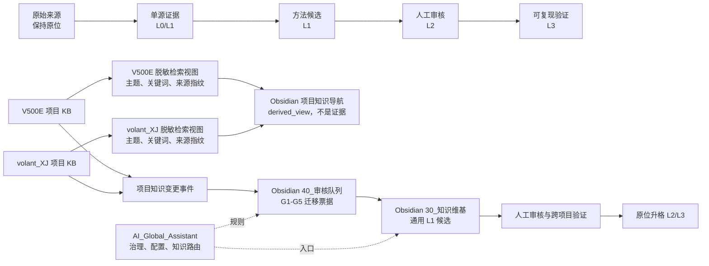

# 知识地图

## 项目知识导航

- [[../20_来源卡/V500E/V500E项目知识入口|V500E 入口]] → [[../20_来源卡/V500E/V500E项目知识目录|24 个对象的脱敏内容级检索视图]]
- [[../20_来源卡/volant_XJ/volant_XJ项目知识入口|volant_XJ 入口（待复核）]] → [[../20_来源卡/volant_XJ/volant_XJ项目知识目录|11 个对象的脱敏内容级检索视图]]

目录视图与迁移流程相互独立：目录中的页面关系只是导航关系，不表示事实因果、适用性继承或跨项目可迁移性，也不构成 G1–G5 批准。

## 知识所有权

| 知识类型 | canonical 位置 | 本 Vault 的角色 |
|---|---|---|
| Codex 全局治理与配置 | `AI_Global_Assistant` | 只读治理视图和入口卡 |
| 项目事实 | V500E 或 volant_XJ 项目 KB | 入口卡、路径指针、迁移票据 |
| 跨项目迁移过程 | 本 Vault 的 `40_审核队列/跨项目迁移` | G1–G5 审核记录 |
| 通用 L0–L3 知识正文 | 本 Vault 的 `30_知识维基` | 候选、有效知识与历史状态 |
| 倾转旋翼资料综合 | 本 Vault | 单源证据和知识候选 |
| 原始 PDF/资料 | 原资料目录 | 只引用，不复制 |

成熟度只描述证据和验证水平，不改变正文归属。项目方法若仍依赖项目参数或构型，继续留在项目 KB；只有抽象脱敏后的通用方法才进入本 Vault。

## 主题导航

- [[../30_知识维基/倾转过渡/全倾转飞行器综合过渡控制方法候选|倾转过渡]]
- [[../30_知识维基/配平线化与能力/配平点附近瞬时机动能力评估方法候选|配平、线化与能力]]
- [[../20_来源卡/倾转旋翼资料包/倾转旋翼文献地图#控制分配、可行域与故障|控制分配]]
- [[../30_知识维基/气动干扰/单向低阶旋翼滑流气动干扰建模方法候选|气动干扰]]
- [[../30_知识维基/气动数据与模型可信度/CFD气动数据源交付与验收规范方法候选|气动数据与模型可信度]]
